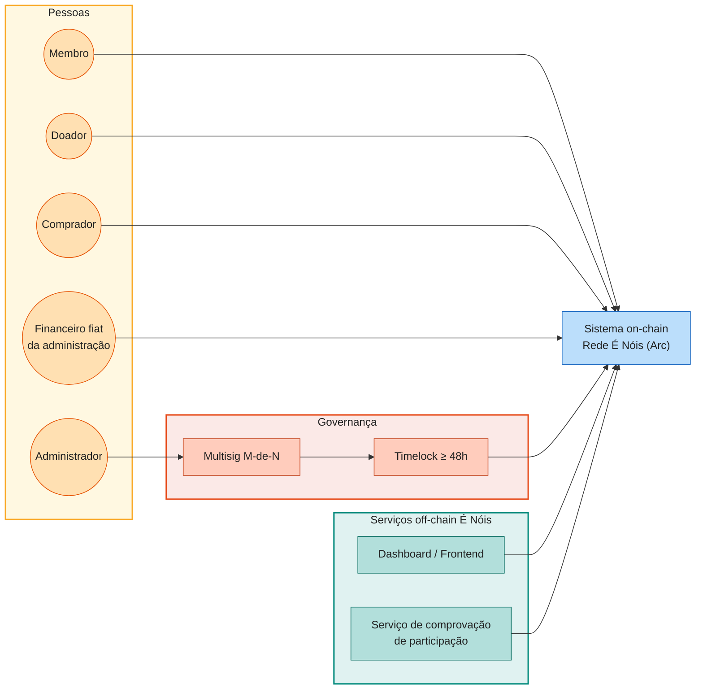
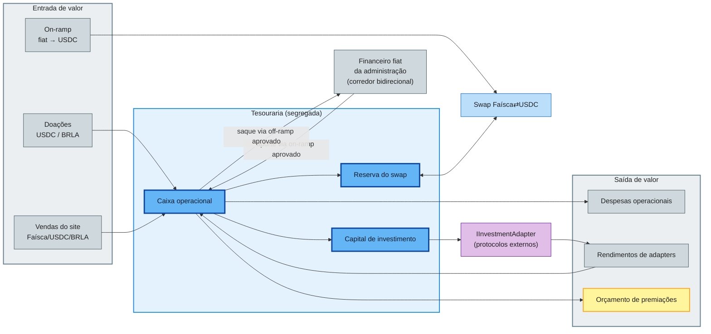
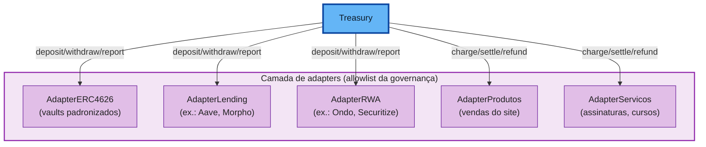

# 01 — Visão Geral do Sistema Econômico

**Participação que gera reconhecimento. Tecnologia a serviço da comunidade.**

Este documento apresenta a visão geral do sistema econômico da Rede É Nóis:
seu propósito, seus atores, seus componentes on-chain e off-chain, os fluxos
de valor e os princípios que orientam o desenvolvimento. É a porta de entrada
da análise — os detalhes normativos estão em
[Requisitos](03-requisitos.md) e as decisões estruturais em
[Arquitetura](04-arquitetura.md).

## 1. Propósito

A Rede É Nóis é uma comunidade que deseja **reconhecer e recompensar a
participação** de seus membros de forma transparente e auditável. O sistema
econômico cria três instrumentos complementares:

1. **Faísca** — token fungível de utilidade (ERC-20) que premia participação,
   gratifica doações e pode ser adquirido ou trocado por USDC.
2. **NFTs de reconhecimento e utilidade** — itens colecionáveis e
   conquistas (ERC-1155/ERC-721) que marcam papéis, metas e momentos da
   comunidade e podem, por política, gerar premiações em Faísca. O subsistema
   é **totalmente plugável**: novos domínios — como os jogos **GameFi** da
   plataforma — entram por registro, sem alterar os contratos existentes, e
   jogadores podem **alugar seus NFTs** sem perder a titularidade.
3. **Tesouraria** — o centro financeiro da rede, que recebe recursos,
   segrega finalidades e executa decisões de uma governança multisig,
   conectando-se a investimentos e vendas por **adapters** intercambiáveis
   e ao financeiro fiat da administração por um **corredor bidirecional**
   para capital próprio.

## 2. Ambiente de execução

- **Rede:** **Arc** — Layer-1 da Circle focada em finanças de stablecoins,
  compatível com EVM, com finalidade determinística e USDC como ativo
  nativo de taxas. A compatibilidade EVM preserva a portabilidade dos
  contratos para outras redes, se a governança assim decidir.
- **Moedas de liquidação:** **USDC** (referência em dólar) e **BRLA**
  (referência em real, ERC-20). USDC é o ativo de reserva do swap e o
  principal numerário da tesouraria; BRLA é o canal natural de entrada para
  o público brasileiro e unidade de preço de produtos/serviços em reais.
- **On-ramp:** fluxos do ecossistema Circle para aquisição de USDC e
  integrações equivalentes para BRLA, sujeitos a disponibilidade comercial,
  regional e requisitos de conformidade.
- **Carteiras:** cada membro recebe uma **Smart Account custodiada pela
  plataforma**, orientada ao modelo **EIP-7702** (EOA que delega a código de
  conta inteligente), com **chave privada exportável** para quem quiser
  assumir a autocustódia. Carteiras próprias (ex.: MetaMask) continuam
  suportadas e são a referência para exibição de NFTs.
- **Legado Web2:** a Faísca **já existe na Web 2 como moeda interna com
  economia própria** — ledger contábil com hash-chain, transferências P2P
  estilo Pix, marketplace e serviços com escrow, jogos com gasto e impulso,
  e premiações debitadas de uma tesouraria de supply fixo — e será migrada
  **1:1** para a criptomoeda (ver §5 e o levantamento completo em
  [08-levantamento-web2-faisca](08-levantamento-web2-faisca.md)).

## 3. Atores

| Ator | Papel no sistema econômico |
|---|---|
| **Membro** | Participa, recebe premiações em Faísca e NFTs, usa Faísca em funcionalidades e produtos. |
| **Doador** | Doa USDC/BRLA à tesouraria e pode receber gratificação em Faísca por campanha. |
| **Comprador** | Adquire USDC por on-ramp e troca por Faísca no swap; pode vender Faísca conforme liquidez. |
| **Administrador** | Configura políticas em telas do dashboard, dentro do que os contratos autorizam. |
| **Financeiro fiat** | Movimenta capital próprio da administração entre contas fiduciárias e a tesouraria (corredor fiat), para investimento em cripto e gestão financeira em fiat. |
| **Multisig** | Colégio de `N` signatários; decisões críticas exigem `M = teto(2N/3)` assinaturas. |
| **Timelock** | Impõe espera mínima on-chain (≥ 48h) entre aprovação e execução de mudanças sensíveis. |
| **Serviço de comprovação** | Valida participação/elegibilidade off-chain e autoriza premiações dentro de limites. |

## 4. Componentes

### 4.1 Mapa de componentes

```mermaid
flowchart TB
    subgraph OffChain["Off-chain"]
        FE["Dashboard / Frontend"]
        VAL["Serviço de comprovação<br/>de participação"]
        RAMP["On-ramp<br/>(Circle / provedor BRLA)"]
        SA["Smart Accounts<br/>custodiadas (EIP-7702)"]
    end

    subgraph Gov["Governança"]
        MS["Multisig M-de-N"]
        TL["Timelock"]
    end

    subgraph Core["Constelação de contratos (Arc)"]
        REG["ContractRegistry"]
        NREG["NFTRegistry<br/>(módulos de NFT)"]
        FAI["FaiscaToken<br/>ERC-20"]
        NFT["EnoisNFT<br/>ERC-1155 / ERC-721"]
        SWP["EnoisSwap<br/>AMM Faísca⇄USDC"]
        TRS["Treasury<br/>(Tesouraria)"]
        PRE["RewardsDistributor<br/>(premiações)"]
        RENT["NFTRental<br/>(aluguel de NFTs)"]
    end

    subgraph Ext["Adapters externos"]
        INV["IInvestmentAdapter<br/>→ vaults ERC-4626 e outros"]
        PRD["IProductAdapter<br/>→ produtos/serviços do site"]
        MOD["INFTModule<br/>→ jogos GameFi e coleções"]
    end

    LEG["Faísca Web2 (legado)"]

    RAMP --> FE
    FE --> SA
    FE --> FAI & NFT & SWP & RENT
    VAL --> PRE
    MS --> TL --> TRS
    TRS --> FAI
    TRS --> SWP
    TRS --> NFT
    TRS --> INV
    TRS --> PRD
    LEG -.->|migração 1:1| FAI
    REG -.-> FAI & NFT & SWP & TRS & NREG & RENT
    NREG -.-> NFT & MOD
    RENT -->|direito de uso temporário| MOD
    RENT -->|taxa da rede + splits| TRS

    classDef offchain fill:#B2DFDB,stroke:#00695C,stroke-width:1px,color:#212121;
    classDef gov fill:#FFCCBC,stroke:#BF360C,stroke-width:1px,color:#212121;
    classDef contract fill:#BBDEFB,stroke:#1565C0,stroke-width:1px,color:#212121;
    classDef treasury fill:#64B5F6,stroke:#0D47A1,stroke-width:3px,color:#0D1B2A;
    classDef token fill:#FFF59D,stroke:#F9A825,stroke-width:2px,color:#212121;
    classDef adapter fill:#E1BEE7,stroke:#6A1B9A,stroke-width:1px,color:#212121;
    classDef external fill:#CFD8DC,stroke:#455A64,stroke-width:1px,color:#212121;

    class FE,VAL,RAMP,SA offchain;
    class MS,TL gov;
    class REG,NREG,PRE,NFT,SWP,RENT contract;
    class TRS treasury;
    class FAI token;
    class INV,PRD,MOD adapter;
    class LEG external;

    style OffChain fill:#E0F2F1,stroke:#00897B,stroke-width:2px,color:#212121;
    style Gov fill:#FBE9E7,stroke:#E64A19,stroke-width:2px,color:#212121;
    style Core fill:#E3F2FD,stroke:#1E88E5,stroke-width:2px,color:#212121;
    style Ext fill:#F3E5F5,stroke:#8E24AA,stroke-width:2px,color:#212121;
```

### 4.2 Responsabilidades

| Componente | Responsabilidade |
|---|---|
| **ContractRegistry** | Ponto único de descoberta de endereços; backend e frontend nunca hardcodam contratos. |
| **FaiscaToken** | Token ERC-20 sem teto global; mint/burn apenas por papéis autorizados e políticas auditáveis. |
| **EnoisNFT** | Módulo nativo de conquistas, funções e colecionáveis; edições múltiplas (ERC-1155) e itens únicos (ERC-721); transferibilidade definida por coleção, imposta no contrato. |
| **NFTRegistry** | Allowlist de módulos de NFT (`INFTModule`): cada novo domínio — jogo, coleção parceira — entra por registro da governança, sem redeploy dos demais contratos. |
| **INFTModule** | Interface plugável dos domínios de NFT: emissão autorizada, metadados, políticas de coleção e *capabilities* declaradas (soulbound, alugável, royalties). |
| **NFTRental** | Mercado de aluguel de NFTs: concede direito de uso temporário (ERC-4907) sem transferir a titularidade; divide a receita on-chain entre locador, criador e rede. |
| **EnoisSwap** | AMM de produto constante `x·y = k` com reservas reais de Faísca e USDC; taxa `f` definida por governança; **não promete preço mínimo nem recompra**. |
| **Treasury** | Recebe recursos, segrega caixa operacional / liquidez do swap / capital de investimento, executa saques e alocações aprovados. |
| **RewardsDistributor** | Concede premiações e NFTs mediante comprovação, com anti-duplicidade, limites por período e trilha de auditoria. |
| **IInvestmentAdapter** | Interface plugável para estratégias externas (ERC-4626, Aave, Morpho, RWA); cada integração com seu adapter e seus limites. |
| **IProductAdapter** | Interface plugável para produtos e serviços vendidos no site: cobra em Faísca/USDC/BRLA e liquida para a tesouraria. |

## 5. Fluxos econômicos

### Migração 1:1 da Faísca Web2

A Faísca nasce com uma base pré-existente — e **não é só um saldo**: a moeda
interna da Web 2 já circula por transferências P2P, compras em marketplace e
serviços com escrow (split 90/10, reembolso 100%, janela de 7 dias), gastos
em jogos e impulso de criadores, loja de cosméticos e premiações debitadas
de uma tesouraria de supply fixo — mapeadas item a item em
[08-levantamento-web2-faisca](08-levantamento-web2-faisca.md). Estimativa de
trabalho: **média de ~250 Faíscas por membro**, com **valor de referência
interno sugerido de R$ 0,01 por Faísca** — na Web 2 essa cotação é
administrativa e **declaradamente não é câmbio**; no Web 3, a referência
segue como parâmetro de política e precificação, não paridade garantida (o
mercado se forma no swap).

A migração segue o trilho das premiações: comprovação do saldo Web2,
autorização assinada (EIP-712), claim 1:1 com anti-duplicidade por
identidade, janela definida por governança e emissão contabilizada no
orçamento de emissão. O destino típico do crédito é a **Smart Account
custodiada** do membro.

### Corredor fiat ⇄ tesouraria

Além das entradas de usuários (doações, vendas, on-ramp), a administração
movimenta **capital próprio** entre o financeiro fiat e a tesouraria nas
duas direções: aportes fiduciários são convertidos a cripto por canais
aprovados — por exemplo, compras executadas quando os preços estão
competitivos para investimento — e posições da tesouraria podem ser
realizadas a fiat para despesas e gestão financeira da administração.

Cada movimentação do corredor é operação de governança (multisig +
timelock), com canal de conversão aprovado, conta fiat de destino
registrada e evento auditável reconciliado com a contabilidade off-chain.
É um corredor de capital próprio: recursos de terceiros ficam fora dele e
a reserva do swap permanece intocável.

Três propriedades organizam esses fluxos:

- **Segregação patrimonial:** caixa operacional, reserva do swap e capital
  de investimento são contábeis e fisicamente separados. USDC da reserva do
  swap não é caixa livre nem colateral de estratégias.
- **Ausência de promessas:** a proposta não confere à Faísca paridade,
  direito automático à tesouraria nem a rendimentos. O swap não garante
  liquidez permanente. Essa intenção não encerra o enquadramento jurídico:
  campanhas, prêmios por posse, negociação e aluguel exigem avaliação da
  realidade econômica por operação e jurisdição, conforme
  [RF-REG](03-requisitos.md#17-conformidade-e-caracterização-regulatória-rf-reg)
  e a [defesa condicionada Brasil/EUA](09-teste-howey-valores-mobiliarios.md).
- **Transparência verificável:** toda mutação relevante emite eventos;
  endereços de contratos, multisig e timelock são públicos e verificáveis.

## 6. Premiações e NFTs

A participação gera dois tipos de reconhecimento, decididos por políticas da
administração e executados dentro de limites on-chain:

- **Faísca:** metas, ações e campanhas valem Faísca; doações podem gerar
  gratificação proporcional conforme regra pública de campanha.
- **NFTs:** edições como *Perfil Completo*, *Admin de Comunidade* e
  *Membro Mais Ativo do Período* são distribuídas como conquistas — muitas
  intransferíveis (soulbound por coleção), algumas colecionáveis ou
  compráveis. Políticas de coleção podem **gerar premiações em Faísca**
  para detentores elegíveis (por exemplo, recompensa periódica a quem
  mantém determinada conquista), sempre com snapshot elegível e claim
  auditável, nunca como promessa de rendimento financeiro.

### Módulos de NFT plugáveis e GameFi

O subsistema de NFTs é **plugável por desenho**: além das conquistas
comunitárias do `EnoisNFT`, novos domínios entram pelo `NFTRegistry`
implementando a interface `INFTModule` — cada módulo declara suas
*capabilities* (transferível, soulbound, alugável, royalties) e opera sob
sua própria política, pausável e removível individualmente.

O **GameFi** é o caso de uso que justifica essa abertura: a plataforma
hospeda diversos jogos cujos itens — personagens, equipamentos, passes,
terrenos — são NFTs da rede, seja em contrato dedicado do jogo, seja em
coleção compartilhada multi-jogo. O modelo monetiza os três lados da
economia:

- **a rede**, por taxa sobre vendas, aluguéis e movimentações liquidada à
  tesouraria;
- **os criadores**, por receita primária, comissão sobre aluguéis e
  royalties ERC-2981 no secundário;
- **os jogadores**, por premiações em Faísca por desempenho (trilho usual
  do `RewardsDistributor`) e por **renda de aluguel** dos próprios itens.

O aluguel usa direito de uso temporário (**ERC-4907** ou equivalente): o
locatário usa o item até a expiração on-chain, sem custódia nem garantia,
e o NFT nunca sai da carteira do locador. Todas as divisões de receita são
calculadas e executadas pelo contrato que liquida a operação — jamais por
repasse manual.

## 7. Tesouraria e adapters

A tesouraria é o centro, mas **não um contrato monolítico**: cada capacidade
externa entra por um adapter autorizado, com interface mínima, limite de
exposição e plano de saída.

- **Adapters de investimento** convertem a interface da tesouraria
  (`deposit`, `withdraw`, `positionValue`, `riskInfo`) para o protocolo
  específico; ERC-4626 é o caso padronizado, mas nenhuma integração presume
  garantias iguais entre protocolos.
- **Adapters de produtos** conectam o catálogo do site ao pagamento on-chain:
  recebem Faísca/USDC/BRLA do comprador, aplicam a política comercial
  (desconto em Faísca, split de receita) e liquidam à tesouraria.
- **Corredor fiat:** o financeiro fiat da administração aporta e recebe
  capital próprio da tesouraria por canais de on/off-ramp aprovados — trilho
  distinto dos fluxos de usuários, usado para investimento em cripto
  (inclusive compras em preços competitivos) e gestão financeira em fiat.

## 8. Governança e evolução

Decisões críticas — upgrades, saques administrativos, inclusão de adapters,
mudanças de política de emissão, taxas e liquidez — exigem **multisig
`M = teto(2N/3)` sobre o total de signatários** e **timelock on-chain de ao
menos 48 horas**. Uma pausa emergencial terá fluxo restrito próprio, sem
poder de saque ou upgrade. Posse de Faísca ou NFT **não** concede poder
administrativo.

## 9. Princípios de desenvolvimento

1. **Segurança antes de recursos:** testes unitários, integração, fuzzing e
   invariantes; auditoria independente antes de mainnet.
2. **Permissão mínima:** cada contrato e papel faz exatamente o necessário.
3. **Modularidade:** adapters e módulos trocáveis; decisão Diamond × UUPS
   após modelagem de ameaças (ver [Arquitetura](04-arquitetura.md)).
4. **Minimização de dados:** nenhum dado pessoal on-chain; comprovações por
   assinatura/prova, não por exposição.
5. **Evolução por etapas:** cada módulo vai a produção só depois de
   simulado, testado em testnet e aprovado pela governança.

## 10. Riscos macro

| Risco | Mitigação proposta |
|---|---|
| Pressão de venda de premiações | Orçamento de emissão por período, monitoramento, revisão transparente de incentivos. |
| Perda de liquidez do swap | Reservas segregadas, parâmetros de taxa e profundidade aprovados por governança. |
| Falha de protocolo externo | Allowlist de adapters, limite de exposição, plano de saída, monitoramento. |
| Módulo de NFT de terceiro (jogo) falho ou malicioso | Interface mínima `INFTModule`, allowlist de governança, pausa/remoção por módulo, isolamento de permissões. |
| Comprometimento de signatário | Quórum 2/3, timelock, rotação de chaves, pausa emergencial restrita. |
| Desvinculação de USDC/BRLA | Risco do emissor documentado; nenhuma cotação garantida ao usuário final. |

## Changelog

| Data | Versão | Descrição |
|---|---|---|
| 2026-10-24 | 0.6.0 | Ressalva de caracterização por operação/jurisdição e referências a RF-REG e à análise Howey/CVM. |
| 2026-10-23 | 0.1.0 | Versão inicial da visão geral. |
| 2026-10-23 | 0.2.0 | Migração Faísca Web2 1:1 e Smart Accounts custodiadas (EIP-7702); diagramas coloridos. |
| 2026-10-23 | 0.3.0 | Corredor fiat ⇄ tesouraria: movimentação bidirecional de capital próprio da administração (aportes para investimento em cripto e saques a fiat) via on/off-ramp aprovado. |
| 2026-10-23 | 0.4.0 | Subsistema de NFTs plugável (`NFTRegistry` + `INFTModule`), domínios GameFi e aluguel de NFTs (`NFTRental`/ERC-4907) com split on-chain jogador/criador/rede. |
| 2026-10-23 | 0.5.0 | Levantamento da Faísca Web 2 ([doc 08](08-levantamento-web2-faisca.md)): economia real do legado (P2P, escrow, jogos, premiações de tesouraria, cotação não-câmbio) refletida no contexto e na migração 1:1. |

