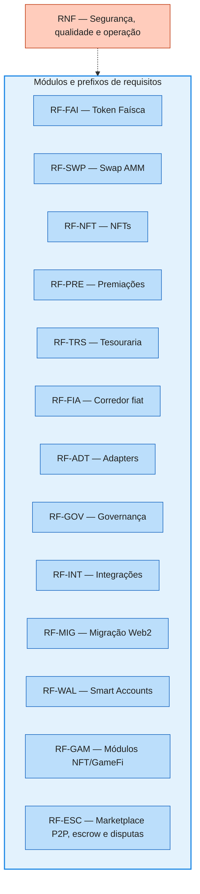

# 03 — Requisitos do Sistema Econômico

Requisitos funcionais (RF) e não funcionais (RNF) do ecossistema É Nóis,
organizados por módulo. Cada requisito tem identificador estável para
rastreabilidade em testes, auditorias e aprovações de governança. Prioridades
seguem MoSCoW: **M**ust (essencial ao lançamento), **S**hould (importante),
**C**ould (desejável), **W**on't (fora do escopo desta fase).

> Estado: proposta de análise. Nenhum requisito implica contrato já
> implantado; parâmetros dependem de simulação e aprovação.

## 1. Convenções

- `RF-<módulo>-<nn>` — requisito funcional testável.
- `RNF-<nn>` — requisito não funcional (segurança, qualidade, operação).
- "Governança" = multisig `M = teto(2N/3)` + timelock ≥ 48h, salvo quando o
  requisito definir fluxo próprio (ex.: pausa emergencial).
- Valores de exemplo (taxas, limites) são placeholders de política.

## 2. Token Faísca (RF-FAI)

| ID | Prioridade | Requisito |
|---|---|---|
| RF-FAI-01 | M | Implementar a Faísca como ERC-20 upgradeável, com símbolo e casas decimais definidos na especificação de deploy. |
| RF-FAI-02 | M | Não impor teto máximo global de suprimento (`totalSupply` ilimitado por política, não por ausência de controle). |
| RF-FAI-03 | M | Restringir `mint` a papéis autorizados (ex.: `MINTER_ROLE`) dentro de **orçamento de emissão por período** configurável por governança. |
| RF-FAI-04 | M | Permitir `burn` do próprio saldo e `burnFrom` por autorização explícita; queimas administrativas só por governança. |
| RF-FAI-05 | M | Emitir eventos de mint, burn e mudança de política de emissão, com emissor, quantidade e motivo/campanha. |
| RF-FAI-06 | S | Suportar `permit` (ERC-2612) para aprovações sem transação de `approve` separada. |
| RF-FAI-07 | S | Ser pausável por pausa emergencial de escopo definido (transferências congeladas; sem efeito retroativo). |
| RF-FAI-08 | M | Não codificar promessa de rendimento, recompra ou paridade em qualquer metadado, nome ou símbolo. |
| RF-FAI-09 | C | Expor `version()`/`DOMAIN_SEPARATOR` consistente para integrações EIP-712. |
| RF-FAI-10 | M | Manter a transferência livre (`transfer`/`transferFrom`) **irreversível por construção**: nenhum papel administrativo pode reverter ou descontar saldo de titular; contestações existem apenas em fluxos mediados por contrato (RF-ESC). |
| RF-FAI-11 | M | Delegar a resolução de destinatário por identidade da plataforma (username → endereço) ao backend off-chain; o contrato opera exclusivamente sobre endereços EVM. |

## 3. Swap Faísca⇄USDC (RF-SWP)

| ID | Prioridade | Requisito |
|---|---|---|
| RF-SWP-01 | M | Implementar AMM de produto constante `k = x·y` com reservas reais de Faísca (`x`) e USDC (`y`), fórmulas conforme README §3. |
| RF-SWP-02 | M | Exigir `minOut` e `deadline` em toda troca; reverter se a saída calculada for menor que `minOut` ou o prazo expirar. |
| RF-SWP-03 | M | Aplicar taxa `f` (`0 ≤ f < 1`) configurável por governança, retida no ativo de entrada dentro da reserva. |
| RF-SWP-04 | M | Manter a reserva do swap contábil e fisicamente segregada do caixa operacional e do capital de investimento. |
| RF-SWP-05 | M | Preservar a propriedade "saída < reserva" com arredondamento a favor do contrato e validações de reserva positiva. |
| RF-SWP-06 | M | Proteger trocas contra reentrância (`ReentrancyGuard` + checks-effects-interactions). |
| RF-SWP-07 | M | Expor função de cotação `quote` (view) informando saída estimada, taxa, impacto no preço — sem comprometer execução. |
| RF-SWP-08 | M | Restringir adição/retirada administrativa de liquidez à governança, com evento registrando motivo e impacto. |
| RF-SWP-09 | M | Impedir que USDC comprometido com o swap seja usado em investimentos ou contado como caixa livre. |
| RF-SWP-10 | S | Publicar eventos `Swap`, `LiquidityAdded`, `LiquidityRemoved`, `FeeUpdated` com parâmetros completos. |
| RF-SWP-11 | S | Proibir uso da cotação instantânea do próprio swap como oráculo em premiações, crédito ou valoração de posições. |
| RF-SWP-12 | C | Suportar limite de tamanho de ordem por transação e por janela de tempo (proteção de liquidez). |
| RF-SWP-13 | M | Consultar oráculo da DEX de referência — **Uniswap v4 nesta fase inicial** — para obter o preço de mercado da Faísca e ancorar o preço praticado pelo swap. |
| RF-SWP-14 | M | Acompanhar automaticamente o preço praticado na DEX de referência via oráculo, impedindo divergência que viabilize **arbitragem circular** swap⇄DEX (comprar no lado mais barato e revender no mais caro em ciclo), capaz de drenar as reservas de quem praticar o menor preço. |
| RF-SWP-15 | M | Usar preço resistente a manipulação do oráculo (TWAP ou mediana das observações da pool Uniswap v4), nunca o preço spot instantâneo; validar o frescor do dado e reverter ou pausar trocas quando o oráculo estiver expirado ou indisponível. |
| RF-SWP-16 | M | Definir banda de desvio máxima entre o preço efetivo do swap e o preço do oráculo, configurável por governança; fora da banda, a troca é reprecificada ao valor do oráculo ou revertida — jamais executada a preço que premie a arbitragem circular. |
| RF-SWP-17 | S | Manter allowlist de fontes de oráculo gerida por governança (pool Uniswap v4 nesta fase), com fallback documentado para indisponibilidade da fonte primária. |
| RF-SWP-18 | S | Emitir eventos com o preço do oráculo consultado, o desvio detectado e a decisão aplicada em cada troca, para auditoria e monitoramento. |
| RF-SWP-19 | M | Condicionar qualquer conversão fiat↔Faísca — compra direta de Faísca com moeda fiduciária ou saque de criador em fiduciário — a **parecer jurídico/regulatório formal** e aprovação de governança; na Web 2 a cotação publicada é referência administrativa e não câmbio (ver [08](08-levantamento-web2-faisca.md) §2.3). |

## 4. NFTs (RF-NFT)

O `EnoisNFT` é o **módulo nativo** de conquistas e coleções da rede. Domínios
adicionais — jogos GameFi, coleções parceiras — entram pela arquitetura
plugável definida em [RF-GAM](#13-gamefi-e-módulos-de-nft-plugáveis-rf-gam).

| ID | Prioridade | Requisito |
|---|---|---|
| RF-NFT-01 | M | Emitir edições de conquistas em **ERC-1155** (múltiplas unidades do mesmo token ID), incluindo *Perfil Completo*, *Admin de Comunidade* e *Membro Mais Ativo do Período*. |
| RF-NFT-02 | S | Suportar itens individualizados em **ERC-721** quando a coleção exigir unidade única. |
| RF-NFT-03 | M | Definir transferibilidade **por coleção** e impô-la no contrato (`soulbound` quando intransferível), nunca apenas na interface. |
| RF-NFT-04 | M | Compatibilizar metadados (`uri`, `name`, `image`, atributos) com exibição em MetaMask e no perfil É Nóis, com política de persistência (ex.: IPFS/Arweave) e sem dados pessoais. |
| RF-NFT-05 | M | Implementar resgate em evento: limite global `X` por edição, contagem **atômica** no contrato, autorização vinculada a carteira/campanha/rede com validade e nonce anti-reutilização. |
| RF-NFT-06 | M | Não publicar códigos secretos em texto aberto nas transações; usar assinatura EIP-712, prova de elegibilidade ou commit-reveal. |
| RF-NFT-07 | S | Suportar limite por carteira/participante elegível e mitigação de bots (sem presumir 1 carteira = 1 pessoa). |
| RF-NFT-08 | M | Definir critérios de revogação, expiração e atualização por coleção; funções administrativas não concedem permissão de contrato por simples posse. |
| RF-NFT-09 | S | Permitir políticas de coleção que gerem **premiações em Faísca** a detentores elegíveis, via snapshot e claim auditável — sem promessa de rendimento. |
| RF-NFT-10 | C | Suportar royalties ERC-2981 em coleções colecionáveis/compráveis, quando aplicável. |
| RF-NFT-11 | M | Emitir eventos de mint, resgate, revogação e mudança de política por coleção. |
| RF-NFT-12 | M | Registrar-se como módulo `INFTModule` no `NFTRegistry`, expondo as mesmas *capabilities* exigidas dos domínios externos (RF-GAM-02). |

## 5. Premiações (RF-PRE)

| ID | Prioridade | Requisito |
|---|---|---|
| RF-PRE-01 | M | Distribuir Faísca e NFTs somente mediante autorização assinada pelo **serviço de comprovação de participação** (EIP-712, nonce, deadline, chainId). |
| RF-PRE-02 | M | Impedir duplicidade: identificador de premiação único; rejeitar reaproveitamento de autorização. |
| RF-PRE-03 | M | Aplicar limites por período e por destinatário configuráveis por governança; registrar consumo de orçamento. |
| RF-PRE-04 | M | Rastrear origem: evento com tipo de premiação, campanha/regra e hash da comprovação — sem dados pessoais on-chain. |
| RF-PRE-05 | M | Gratificar doadores conforme regra pública de campanha, com parâmetros (proporção, teto, vigência) versionados. |
| RF-PRE-06 | S | Oferecer modo **claim** (destinatário reivindica) e modo push (distribuidor envia), ambos dentro das mesmas regras. |
| RF-PRE-07 | S | Ratear orçamento de emissão entre premiação, gratificação e liquidez conforme política aprovada. |
| RF-PRE-08 | C | Suportar premiação recorrente por holding de NFT (edições elegíveis) via snapshots periódicos. |
| RF-PRE-09 | M | Organizar as premiações em **programas nomeados** com orçamento próprio — airdrop de cadastro, presença diária (com bônus semanal), jogos diários, conclusão de microprojeto, prêmios de evento/comunidade — com consumo registrado por programa e auditável. |
| RF-PRE-10 | M | Aplicar limites por programa além do global (ex.: bônus de microprojeto limitado a 3×/mês por profissional, conforme prática Web 2), configuráveis por governança. |

## 6. Tesouraria (RF-TRS)

| ID | Prioridade | Requisito |
|---|---|---|
| RF-TRS-01 | M | Receber e custodiar USDC, BRLA, Faísca e demais ativos aprovados, com contabilidade por finalidade. |
| RF-TRS-02 | M | Segregar três finalidades: **caixa operacional**, **reserva do swap** e **capital de investimento** — sem promiscuidade entre elas. |
| RF-TRS-03 | M | Executar saques administrativos somente por operação aprovada e timelocada pela governança. |
| RF-TRS-04 | M | Coordenar políticas de mint/burn da Faísca dentro do orçamento delegado (não cria política, executa a aprovada). |
| RF-TRS-05 | M | Alimentar a reserva do swap por transferência explícita e registrada, nunca por uso indireto. |
| RF-TRS-06 | M | Alocar/desalocar capital de investimento apenas para adapters da allowlist e dentro do limite de exposição de cada um. |
| RF-TRS-07 | M | Registrar todas as movimentações em eventos com finalidade, ativo, valor, contraparte e autorização. |
| RF-TRS-08 | S | Expor relatórios view: saldos por finalidade, posições por adapter, histórico de políticas. |
| RF-TRS-09 | S | Suportar recebimentos identificados (doação com tag de campanha) preservando anonimato do doador on-chain. |
| RF-TRS-10 | C | Executar conversão BRLA⇄USDC por adapter/DEX aprovado quando a política exigir unificação de numerário. |

## 7. Corredor fiat ⇄ tesouraria (RF-FIA)

O financeiro fiat da administração da Rede É Nóis movimenta **capital
próprio** em ambas as direções com a `Treasury`: aportes fiduciários
convertidos a cripto — por exemplo, compras executadas quando os preços
estão competitivos para investimento — e saídas de cripto convertidas a fiat
para o financeiro da administração. É um corredor de tesouraria, não um
serviço a usuários: recursos de terceiros e a reserva do swap ficam fora
dele.

| ID | Prioridade | Requisito |
|---|---|---|
| RF-FIA-01 | M | Manter um corredor bidirecional entre o financeiro fiat da administração e a `Treasury`, restrito a capital próprio da administração — nunca a fundos de membros, doadores ou terceiros. |
| RF-FIA-02 | M | Exigir que toda movimentação do corredor, em qualquer direção, seja operação aprovada e timelocada pela governança, com direção, ativo, valor e finalidade registrados. |
| RF-FIA-03 | M | Converter aportes fiat→cripto somente por canais aprovados pela governança (on-ramp institucional, corretora ou OTC da allowlist) e registrar a chegada na `Treasury` como depósito identificado, com tag de finalidade (caixa operacional ou capital de investimento). |
| RF-FIA-04 | M | Executar saídas cripto→fiat somente por off-ramp aprovado, com destino restrito a contas fiat da administração previamente registradas (allowlist de contas/referências de destino). |
| RF-FIA-05 | M | Permitir **compras de cripto por oportunidade** (ex.: preços competitivos para investimento): a política de aproveitamento — ativos-alvo, critérios ou gatilhos de oportunidade, limites por operação e por período — é definida por governança e executada dentro desses parâmetros. |
| RF-FIA-06 | M | Emitir evento completo por movimentação do corredor: direção, ativo, valor, finalidade, referência da operação fiat (hash/identificador do on/off-ramp) e autorização de governança. |
| RF-FIA-07 | M | Reconciliar periodicamente o registro on-chain do corredor com a contabilidade fiat off-chain da administração; divergências são tratadas como incidente operacional. |
| RF-FIA-08 | M | Preservar a segregação patrimonial: o corredor movimenta caixa operacional e capital de investimento, jamais a reserva do swap. |
| RF-FIA-09 | S | Suportar limites do corredor por período e por operação, configuráveis por governança, com consumo registrado e auditável. |
| RF-FIA-10 | S | Restringir ativos adquiridos via corredor à allowlist de ativos da tesouraria, aplicando as mesmas regras de alocação e limite de exposição do capital de investimento. |
| RF-FIA-11 | C | Suportar execução programada dentro de política aprovada (ex.: compras recorrentes ou por gatilho de preço via keeper/executor autorizado), sempre dentro de orçamento e limites — nunca por chave isolada. |

## 8. Adapters (RF-ADT)

| ID | Prioridade | Requisito |
|---|---|---|
| RF-ADT-01 | M | Definir interface `IInvestmentAdapter`: `deposit`, `withdraw`, `positionValue`, `riskInfo`, `exitPlan` — mínima e estável. |
| RF-ADT-02 | M | Definir interface `IProductAdapter`: `charge`, `settle`, `refund`, `quote` — para produtos e serviços vendidos no site. |
| RF-ADT-03 | M | Manter allowlist de adapters gerida exclusivamente pela governança, com evento de inclusão/substituição/remoção. |
| RF-ADT-04 | M | Cada adapter declara: ativos aceitos, limite de exposição, disponibilidade de resgate, taxas e riscos — verificável on-chain. |
| RF-ADT-05 | M | Fornecer adapter de referência para **vaults ERC-4626**, com tratamento de inflação de shares e arredondamento seguro. |
| RF-ADT-06 | S | Adapters de protocolos específicos (Aave, Morpho, RWA) sob medida — nenhum protocolo tratado como ERC-4626 genérico. |
| RF-ADT-07 | S | `positionValue` deve retornar valoração conservadora; a tesouraria não presume que a cota do vault garante liquidez imediata. |
| RF-ADT-08 | S | Adapters de produto liquidam vendas à tesouraria com split e descontos de política; aceitar Faísca, USDC e BRLA conforme catálogo. |
| RF-ADT-09 | S | Suportar pausa individual de adapter sem travar os demais, e desligamento com plano de saída executável. |
| RF-ADT-10 | C | Reporte padronizado de rendimento/perda por período para o dashboard. |

## 9. Governança e upgrades (RF-GOV)

| ID | Prioridade | Requisito |
|---|---|---|
| RF-GOV-01 | M | Multisig `M-de-N` com `M = teto(2N/3)` calculado sobre o **total** de signatários autorizados; abstenção não reduz quórum. |
| RF-GOV-02 | M | Timelock on-chain ≥ 48h para: upgrades, saques administrativos, mudanças de adapters, políticas de emissão, taxas e liquidez. |
| RF-GOV-03 | M | Pausa emergencial com fluxo restrito próprio: suspende operações de risco; **sem** poder de saque, upgrade ou retomada unilateral. |
| RF-GOV-04 | M | Operações rotineiras (premiações dentro de política, trocas de usuários) não exigem votação individual, mas permanecem sob permissões e limites. |
| RF-GOV-05 | M | Upgrades exigem inicialização protegida, compatibilidade de storage e testes de preservação de estado. |
| RF-GOV-06 | S | Mudança na composição do multisig segue o próprio quórum + timelock. |
| RF-GOV-07 | S | Propostas e execuções geram eventos completos: proponente, hash da operação, eta, executor. |
| RF-GOV-08 | C | Fila de operações com cancelamento por quórum antes do `eta` (defesa contra proposta comprometida). |

## 10. Integrações (RF-INT)

| ID | Prioridade | Requisito |
|---|---|---|
| RF-INT-01 | M | Implantar inicialmente na **Arc**; contratos portáveis para qualquer EVM sem alteração de lógica. |
| RF-INT-02 | M | Aceitar **USDC** como ativo de reserva do swap e principal numerário; aceitar **BRLA** em doações e vendas. |
| RF-INT-03 | S | Integrar fluxo de on-ramp (Circle / provedor BRLA) no frontend — o contrato não depende do provedor. |
| RF-INT-04 | M | `ContractRegistry` como única fonte de endereços para backend/frontend; registro pós-deploy obrigatório. |
| RF-INT-05 | M | Serviço de comprovação assina autorizações EIP-712; chave do assinante rotacionável e revogável. |
| RF-INT-06 | S | Dashboard consome eventos e views dos contratos; nenhuma leitura exige chamada privilegiada. |
| RF-INT-07 | C | Suportar `watchAsset` do MetaMask para facilitar exibição de Faísca e NFTs ao usuário. |

## 11. Migração da Faísca Web2 (RF-MIG)

| ID | Prioridade | Requisito |
|---|---|---|
| RF-MIG-01 | M | Registrar a base de saldos elegíveis da Faísca Web2 de forma verificável (snapshot com identificação por membro, sem dados pessoais on-chain). |
| RF-MIG-02 | M | Converter cada saldo elegível em Faísca on-chain na razão **1:1**, mediante autorização assinada pelo serviço de comprovação (EIP-712, nonce, deadline). |
| RF-MIG-03 | M | Garantir **uma única migração por identidade elegível**: identificador de migração registrado como consumido; reaproveitamento reverte. |
| RF-MIG-04 | M | Definir janela de migração com abertura e encerramento por governança; após o encerramento, claims são rejeitados. |
| RF-MIG-05 | M | Contabilizar a emissão de migração no orçamento de emissão por período, com evento `Migrated(identidade-hash, carteira, quantidade)`. |
| RF-MIG-06 | M | Suportar o cenário de escala: média esperada de **~250 Faíscas por membro**, podendo variar por membro conforme o saldo Web2 registrado. |
| RF-MIG-07 | S | Documentar a **referência interna sugerida de R$ 0,01 por Faísca** como parâmetro de política (premiações, precificação), declaradamente não-vinculante ao preço de mercado do swap. |
| RF-MIG-08 | S | Destinar o crédito migrado preferencialmente à Smart Account custodiada do membro, com opção de claim para carteira própria. |
| RF-MIG-09 | C | Publicar relatório de migração: elegíveis, migrados, pendentes e encerramento, sem expor dados pessoais. |
| RF-MIG-10 | M | Fixar o snapshot de saldos elegíveis por **versão/commit identificado** da base Web 2, com política explícita para contas banidas, excluídas ou com disputa aberta (excluir ou reter até decisão); o total migrável deve reconciliar com `Σ coin_accounts` elegível. |
| RF-MIG-11 | S | Registrar o estado da conta Web 2 no snapshot (saldo, situação, disputas pendentes) de forma verificável, mantendo dados pessoais fora da cadeia. |

## 12. Smart Accounts custodiadas (RF-WAL)

| ID | Prioridade | Requisito |
|---|---|---|
| RF-WAL-01 | M | Prover a cada membro uma **Smart Account custodiada na plataforma**, criada junto ao perfil Web 2, capaz de receber Faísca, NFTs e executar operações do ecossistema. |
| RF-WAL-02 | M | Permitir ao membro **exportar a chave privada** da sua Smart Account mediante autenticação forte, assumindo a autocustódia sem perda de saldos ou histórico. |
| RF-WAL-03 | M | Alinhar o modelo de conta à **EIP-7702** (EOA com delegação a código de smart account, tx tipo 0x04), avaliando suporte da rede Arc e de carteiras compatíveis; fallback documentado se indisponível. |
| RF-WAL-04 | M | Exportação de chave como evento auditado e autenticado; chaves jamais em logs, telas administrativas ou repositório. |
| RF-WAL-05 | S | Suportar **gas patrocinado** pela plataforma para operações de membros sem USDC para taxas (paymaster/relayer), dentro de limites antifraude. |
| RF-WAL-06 | S | Manter compatibilidade total com carteiras próprias (MetaMask e outras EVM): Smart Account custodiada é opção de entrada, não requisito. |
| RF-WAL-07 | S | A migração da Faísca Web2 deve poder creditar diretamente a Smart Account do membro (RF-MIG-08). |

## 13. GameFi e módulos de NFT plugáveis (RF-GAM)

A plataforma hospedará diversos jogos e coleções de terceiros cujos itens são
NFTs da rede. O subsistema deve ser **totalmente plugável**: adicionar um novo
domínio — um jogo, uma coleção parceira — é um ato de **registro** na
allowlist da governança, nunca de alteração ou republicação dos contratos já
implantados. O GameFi é o primeiro grande caso: os jogos movimentam a rede,
monetizam a plataforma e os criadores (studios), e geram renda aos jogadores
— inclusive pelo **aluguel dos próprios NFTs**.

| ID | Prioridade | Requisito |
|---|---|---|
| RF-GAM-01 | M | Subsistema de NFTs totalmente plugável: novos domínios (jogos GameFi, coleções parceiras) entram por registro em allowlist de governança, sem alterar nem republicar contratos existentes. |
| RF-GAM-02 | M | Definir a interface `INFTModule`, mínima e estável — emissão autorizada, metadados, políticas de coleção e *capabilities* declaradas (transferível, soulbound, alugável, royalties) — obrigatória a todo módulo registrado. |
| RF-GAM-03 | M | Manter o `NFTRegistry` como fonte única de descoberta dos módulos de NFT: registro, substituição, pausa e remoção somente por governança, com eventos completos. |
| RF-GAM-04 | M | Registrar o `EnoisNFT` como primeiro módulo nativo, provando que o modelo plugável atende tanto conquistas comunitárias quanto domínios de terceiros. |
| RF-GAM-05 | M | Suportar os dois modelos de coleção de jogo: contrato compartilhado multi-jogo (ERC-1155 com namespaces por jogo) e contrato dedicado do próprio jogo (ERC-721/1155), ambos atrás de `INFTModule`. |
| RF-GAM-06 | M | Implementar o `NFTRental`: aluguel por direito de uso temporário (ERC-4907 ou mecanismo equivalente), sem transferência de titularidade nem depósito de garantia, com expiração automática on-chain. |
| RF-GAM-07 | M | Calcular e executar os splits de receita on-chain na liquidação de vendas e aluguéis — locador, criador e taxa da rede à tesouraria — por política pública do domínio, nunca por repasse manual. |
| RF-GAM-08 | M | Restringir o aluguel a módulos que declarem a *capability* alugável; conquistas soulbound e coleções não alugáveis permanecem fora do mercado por construção. |
| RF-GAM-09 | M | Premiações de jogo (play-to-earn) somente pelo `RewardsDistributor` com autorização do serviço de comprovação (EIP-712), dentro do orçamento e limites de RF-PRE; módulos nunca recebem `MINTER_ROLE` da Faísca. |
| RF-GAM-10 | M | Garantir isolamento entre módulos: pausa ou remoção de um domínio não afeta os demais nem o núcleo; posse de NFT de jogo não confere papel administrativo. |
| RF-GAM-11 | S | Operar listagens de aluguel por assinatura EIP-712 do locador (preço, ativo de cobrança, duração máxima, nonce, deadline), canceláveis antes do uso e protegidas contra replay. |
| RF-GAM-12 | S | Monetização do criador por domínio: preço de venda primária, comissão sobre aluguéis e royalties ERC-2981 declarados no registro e auditáveis. |
| RF-GAM-13 | S | Permitir venda primária de itens de jogo via `IProductAdapter`, com desconto em Faísca e demais políticas comerciais conforme catálogo do domínio. |
| RF-GAM-14 | C | Marketplace agregador que descobre os módulos ativos pelo `NFTRegistry`, sem lista fixa de jogos codificada no frontend. |
| RF-GAM-15 | M | Executar gasto em jogo (`spend(gameId, amount, refId)`) **somente com autorização do titular** — assinatura EIP-712 confirmada pelo jogador ou allowance limitado por módulo — com dedup por `refId` único; o servidor do jogo nunca pode debitar por iniciativa própria (modelo da Web 2, ver [08](08-levantamento-web2-faisca.md) §3). |
| RF-GAM-16 | M | Suportar impulso de jogo (`boost`) com dedup por semana/jogo e preço de política configurável, débito direcionado à tesouraria ou a split de domínio. |
| RF-GAM-17 | S | Direcionar o produto do gasto em jogo à tesouraria ou a split configurável por domínio (criador do jogo × tesouraria), por política pública do módulo — jamais mint ao jogo (mantém RF-GAM-09). |

## 14. Marketplace P2P, escrow e disputas (RF-ESC)

A Web 2 já opera **dois consumidores da mesma semântica de escrow** — o
marketplace de itens (temas, banners, templates, conteúdos) e o mercado de
serviços freelance (ofertas e pedidos com propostas): compra retém o valor em
garantia, aceite liquida **90% ao vendedor + 10% à tesouraria** e recusa ou
expiração devolve **100% ao comprador**, dentro de janela de decisão de 7 dias
(ver [08](08-levantamento-web2-faisca.md) §3). On-chain esse comportamento vira
um **contrato de escrow genérico** com custódia real, consumido por módulos —
não um flag contábil no token.

| ID | Prioridade | Requisito |
|---|---|---|
| RF-ESC-01 | M | Implementar `FaiscaEscrow` genérico com custódia real de Faísca e máquina de estados `HOLD → RELEASED \| REFUNDED \| DISPUTED`; consumido por marketplace e serviços via interface estável (`IEscrowConsumer`). |
| RF-ESC-02 | M | Liquidar o release em split configurável por governança — referência Web 2: **90% vendedor / 10% tesouraria** — atômico na mesma transação. |
| RF-ESC-03 | M | Devolver **100% ao comprador** em recusa do vendedor ou expiração da janela de decisão (referência: 7 dias, parametrizável). |
| RF-ESC-04 | M | Permitir contestação por qualquer das partes dentro da janela; a decisão é de um **árbitro multisig** (`DISPUTE_ADMIN_ROLE` delegado pela governança, sujeito a timelock de RF-GOV) e resulta somente em release ou refund — **proibido clawback de terceiros ou de transferências livres**. |
| RF-ESC-05 | M | Dedup/idempotência por `refId` único por operação (análogo à `idempotency_key` por conta da Web 2); preço mínimo de listagem configurável (referência: 50 Faíscas). |
| RF-ESC-06 | M | Garantir a invariante de conservação `hold = release_vendedor + fee_tesouraria + refund` em todos os estados terminais; emitir eventos completos por transição de estado. |
| RF-ESC-07 | S | Exigir entrega declarada pelo vendedor como pré-condição do release pelo comprador (exceto decisão arbitral); a entrega em si permanece off-chain. |
| RF-ESC-08 | S | Suportar os dois fluxos de contratação de serviço da Web 2: compra direta de oferta (modelo Fiverr) e escolha de proposta dentro de faixa de orçamento de um pedido. |

## 15. Requisitos não funcionais (RNF)

| ID | Prioridade | Requisito |
|---|---|---|
| RNF-01 | M | Solidity `^0.8.24`; licença `GPL-3.0-only`; convenções de código das regras do projeto (custom errors, eventos, `uint256`, `__gap` em upgradeáveis). |
| RNF-02 | M | Controle de acesso por papéis (AccessControl); privilégio mínimo; nenhuma carteira única com poder irrestrito. |
| RNF-03 | M | Proteção contra reentrância, replay (nonce/deadline/domínio), front-running em resgates e inflação de shares em vaults. |
| RNF-04 | M | Contratos upgradeáveis: padrão decidido (Diamond × UUPS) após modelagem de ameaças; inicializadores protegidos; storage compatível. |
| RNF-05 | M | Cobertura de testes: unitário, integração, fuzzing e invariantes das regras financeiras (obrigatório para swap e tesouraria). |
| RNF-06 | M | Auditoria independente dos contratos centrais antes de mainnet, com revalidação das correções. |
| RNF-07 | M | Limite de 24KB por contrato (EIP-170); otimização de gas (calldata, cache de storage, `unchecked` quando seguro). |
| RNF-08 | M | Nenhum dado pessoal on-chain; segredos fora do repositório; logs estruturados e sanitizados. |
| RNF-09 | S | Monitoramento: emissões, reservas, posições, saques e mudanças administrativas com alertas. |
| RNF-10 | S | Plano de resposta a incidentes e runbook de pausa/retomada com escopo definido. |
| RNF-11 | S | Código-fonte verificável; endereços de contratos, multisig e timelock publicados. |
| RNF-12 | C | Simulações econômicas versionadas (emissão, liquidez, pressão de venda) anexas às decisões de parâmetros. |

## 16. Fora de escopo desta fase

- Reversão administrativa de transferências livres (clawback de saldo de titular fora de escrow — vedada por RF-FAI-10).
- Venda direta fiat→Faísca ou saque de criador em fiduciário — fase posterior, condicionada a parecer jurídico (RF-SWP-19, decisão D-13).
- Off-ramp garantido pelo projeto (conversão em fiduciário é serviço externo; o corredor fiat ⇄ tesouraria depende de provedores aprovados pela governança).
- Rendimento automático a detentores de Faísca.
- Garantia de liquidez permanente ou preço mínimo no swap.
- DAO com votação ponderada por token (governança atual é multisig; DAO futura é decisão separada).
- Custódia permanente de chaves pela plataforma (a custódia é transitória; a chave da Smart Account é sempre exportável).

## 17. Conformidade e caracterização regulatória (RF-REG)

A designação utilitária é uma finalidade proposta, não conclusão jurídica.
Aplicam-se avaliações separadas para Brasil e EUA conforme o
[doc 09 — Howey e valores mobiliários](09-teste-howey-valores-mobiliarios.md).
Estes requisitos são condições de aprovação ainda a implementar, não controles
já disponíveis. Nenhum resultado jurídico é inferido apenas de um padrão ERC,
multisig, ausência de garantia financeira ou uso de blockchain.

| ID | Prioridade | Requisito |
|---|---|---|
| RF-REG-01 | M | Manter avaliação versionada por ativo, campanha, operação e jurisdição/público-alvo: no Brasil, categorias do art. 2º da Lei 6.385/1976 e seis elementos do CIC do Parecer CVM 40; nos EUA, categorias de security e Howey, distinguindo caracterização de registro/isenção e alcance territorial. Examinar oferta primária e negociação secundária sem presumir identidade entre elas. |
| RF-REG-02 | M | Documentar contraprestação, origem, titularidade e destinação dos recursos, direitos dos participantes, fonte de benefícios e esforços de cada parte. Separar consumo, serviço, participação comprovada, gratificação, benefício por posse e investimento; segregação contábil não prova, sozinha, capital próprio nem ausência de direito econômico. |
| RF-REG-03 | M | Revisar termos, metadados, campanhas e comunicações atribuíveis ao ofertante antes de divulgação, preservando versões e evidências. Proibir promessas enganosas de retorno, liquidez, recompra ou paridade; declarar riscos e verificar expectativas econômicas efetivamente criadas, sem tratar disclaimers como dispensa regulatória. |
| RF-REG-04 | M | Submeter expressamente à avaliação de RF-REG-01/02/03: compra/venda em USDC e gestão de liquidez (RF-SWP), gratificações proporcionais a doações (RF-PRE-05), prêmios por posse de NFT (RF-NFT-09, RF-PRE-08), venda/aluguel e premiações GameFi (RF-GAM-06/07/09/12/13), migração (RF-MIG), escrow (RF-ESC) e tesouraria/adapters (RF-TRS/RF-FIA/RF-ADT). A ausência de promessa de rendimento em RF-FAI-08 e RF-NFT-09 não substitui essa avaliação. |
| RF-REG-05 | M | Condicionar divulgação de ofertas e ativação de fluxos econômicos reais à revisão jurídica profissional aplicável e decisão de governança, identificando versão, público, condições e pendências. Ausência de avaliação ou pendência impeditiva mantém o fluxo não aprovado. Se houver enquadramento, exigir caminho regulatório aplicável antes da oferta; a aprovação interna não substitui registro, isenção ou autorização exigível. Este gate complementa RF-SWP-19 e não altera sua restrição fiat↔Faísca. |
| RF-REG-06 | M | Reavaliar antes de ativar mudanças materiais em direitos, recompensas, splits, emissão, liquidez, upgrades, coleções/módulos, publicidade, públicos ou jurisdições, e diante de mudança normativa relevante. Preservar avaliações anteriores, sem reclassificação retroativa automática de transações. |
| RF-REG-07 | M | Manter dossiê rastreável com requisitos, termos, matrizes Brasil/EUA, evidências, responsável jurídico, conclusão e decisão de governança. Publicar somente resumo apropriado: parecer sujeito a sigilo profissional, dados pessoais e segredos permanecem restritos. |
| RF-REG-08 | M | Validar os casos de aceitação do doc 09 §6.1 por revisão documental registrada; quando houver implementação, adicionar testes positivos/negativos dos gates técnicos e controles afetados, ligados aos IDs. Não apresentar revisão documental como teste de contrato nem teste técnico como decisão jurídica automatizada. |

**Aceitação:** cada fluxo terá fatos, argumentos favoráveis, contrapontos,
lacunas, conclusão por jurisdição e estado de aprovação explícitos. Os casos
adversos incluem NFT pago com prêmio passivo, doação como aquisição econômica,
marketing de valorização, atuação meramente acessória do jogador e upgrade
que mude incentivos. Funcionalidades continuam propostas: este módulo não as
remove nem declara sua legalidade antecipadamente.

## Changelog

| Data | Versão | Descrição |
|---|---|---|
| 2026-10-24 | 0.7.0 | RF-REG-01 a 08: caracterização Brasil/EUA, revisão de ofertas e incentivos, gate jurídico e critérios documentais vinculados ao doc 09. |
| 2026-10-23 | 0.1.0 | Versão inicial dos requisitos. |
| 2026-10-23 | 0.2.0 | Novos módulos RF-MIG (migração Faísca Web2 1:1) e RF-WAL (Smart Accounts custodiadas/EIP-7702); diagrama colorido. |
| 2026-10-23 | 0.3.0 | RF-SWP-13 a 18: swap ancorado a oráculo de DEX (Uniswap v4 nesta fase) para acompanhar o preço de mercado e impedir arbitragem circular/drenagem de reservas. |
| 2026-10-23 | 0.4.0 | Novo módulo RF-FIA: corredor fiat ⇄ tesouraria para capital próprio da administração — aportes para compra de cripto (ex.: preços competitivos) e repasses cripto→fiat, sob governança e reconciliação contábil. |
| 2026-10-23 | 0.5.0 | Novo módulo RF-GAM: subsistema de NFTs totalmente plugável (`NFTRegistry` + `INFTModule`) para GameFi e coleções de terceiros, com aluguel via `NFTRental` (ERC-4907) e splits on-chain jogador/criador/rede; RF-NFT-12 (EnoisNFT como módulo registrado). |
| 2026-10-23 | 0.6.0 | Levantamento Faísca Web 2 ([doc 08](08-levantamento-web2-faisca.md)): novo módulo RF-ESC (escrow P2P com disputa arbitral); RF-FAI-10/11 (transferência irreversível, resolução username off-chain); RF-PRE-09/10 (programas nomeados e limites); RF-MIG-10/11 (snapshot pinado, contas em disputa); RF-GAM-15..17 (gasto em jogo autorizado, boost, split); RF-SWP-19 (gating jurídico fiat↔Faísca). |

