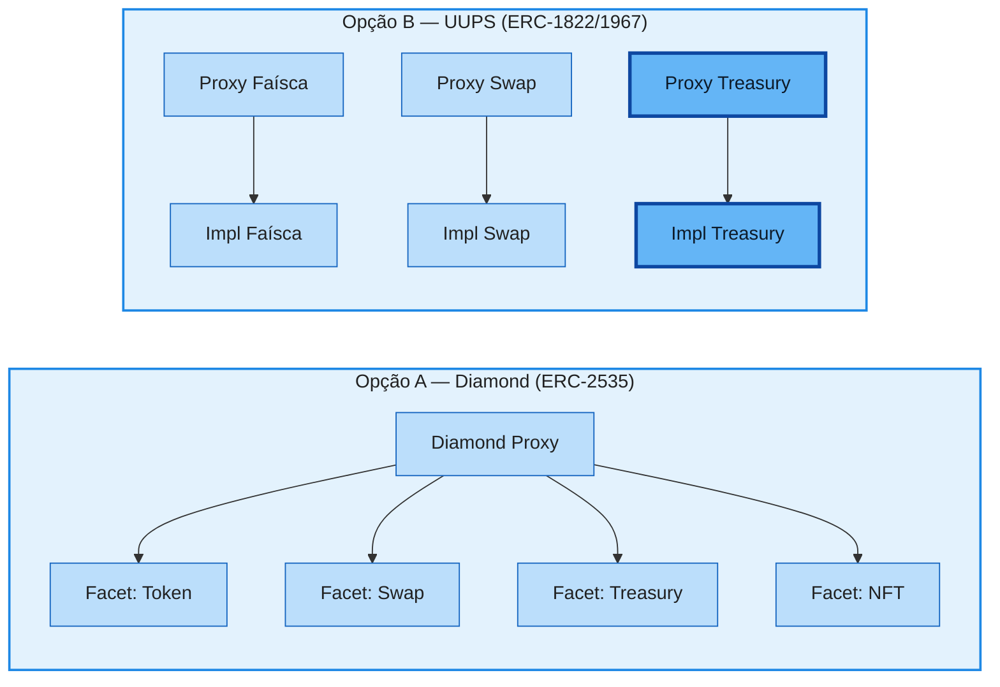
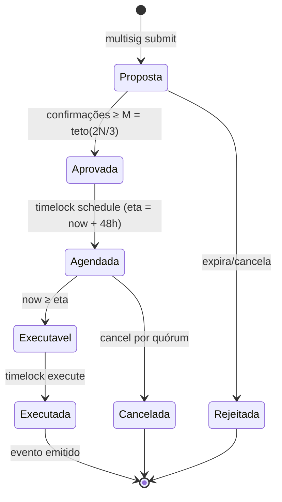
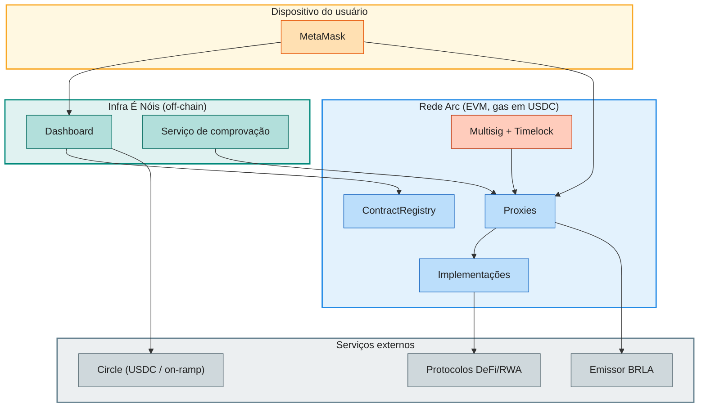

[](../../LICENSE)


[](https://github.com/Rede-ENois/smartcontracts/issues)

# 04 — Arquitetura da Constelação de Contratos

Modelo estrutural proposto para o ecossistema on-chain da Rede É Nóis na rede
Arc. Apresenta a constelação de contratos, suas relações, papéis de acesso,
estratégia de upgradeabilidade e o desenho de implantação. Nomes de contratos
são propostas de trabalho — a nomenclatura final acompanha a implementação.

## 1. Princípios arquiteturais

- **Tesouraria como centro de coordenação, não monólito:** cada capacidade
  (token, NFT, swap, premiações, adapters) é um contrato com permissão mínima.
- **Descoberta por Registry:** `ContractRegistry` é a única fonte de
  endereços; nada é hardcoded fora da cadeia.
- **Composição por interfaces:** adapters implementam contratos estáveis
  (`IInvestmentAdapter`, `IProductAdapter`) e entram por allowlist.
- **Extensibilidade por registro:** novos domínios de NFT — jogos GameFi,
  coleções parceiras — entram via `NFTRegistry` implementando `INFTModule`,
  sem alterar nem republicar o núcleo.
- **Upgradeabilidade sob governança:** todo upgrade passa por multisig +
  timelock, com storage compatível e testes de preservação de estado.
- **Segregação por construção:** a separação caixa/reserva/capital é
  estrutural (saldos e permissões), não apenas contábil.

## 2. Diagrama de classes UML

```mermaid
classDiagram
    direction TB

    class ContractRegistry {
        +register(key: bytes32, addr: address)
        +get(key: bytes32) address
        +rotate(key: bytes32, addr: address)
    }

    class FaiscaToken {
        +name() string
        +symbol() string
        +mint(to: address, amount: uint256)
        +burn(amount: uint256)
        +burnFrom(from: address, amount: uint256)
        +setEmissionBudget(period: uint256, cap: uint256)
        +pause() unpause()
    }

    class EnoisNFT {
        +createCollection(cfg: CollectionCfg) uint256
        +mintAchievement(to: address, tokenId: uint256)
        +redeem(auth: bytes, signature: bytes)
        +revoke(holder: address, tokenId: uint256)
        +setTransferable(tokenId: uint256, allowed: bool)
        +uri(tokenId: uint256) string
    }

    class INFTModule {
        <<interface>>
        +mint(to: address, itemId: uint256, amount: uint256)
        +capabilities() bytes32
        +collectionInfo() CollectionInfo
        +policyInfo() PolicyInfo
    }

    class NFTRegistry {
        +register(module: address, cfg: ModuleCfg)
        +pause(module: address) unpause(module: address)
        +remove(module: address)
        +isActive(module: address) bool
        +modules() address[]
    }

    class EnoisGameAssets {
        +registerGame(gameId: bytes32, policy: GamePolicy)
        +mintItem(to: address, gameId: bytes32, itemId: uint256)
        +setUser(tokenId: uint256, user: address, expires: uint64)
        +capabilities() bytes32
    }

    class NFTRental {
        +list(order: RentalOrder, signature: bytes)
        +cancel(listingId: bytes32)
        +rent(listingId: bytes32, duration: uint64)
        +userOf(module: address, tokenId: uint256) address
        +setSplitPolicy(domain: bytes32, splits: Splits)
    }

    class EnoisSwap {
        +swapUSDCForFaisca(u: uint256, minOut: uint256, deadline: uint256)
        +swapFaiscaForUSDC(q: uint256, minOut: uint256, deadline: uint256)
        +quote(input: address, amount: uint256) Quote
        +addLiquidity(x: uint256, y: uint256)
        +removeLiquidity(x: uint256, y: uint256)
        +setFee(f: uint256)
        -x: uint256
        -y: uint256
    }

    class Treasury {
        +deposit(asset: address, amount: uint256, tag: bytes32)
        +withdraw(op: WithdrawOp)
        +allocateToSwap(x: uint256, y: uint256)
        +allocate(adapter: address, amount: uint256)
        +deallocate(adapter: address, amount: uint256)
        +balanceOf(purpose: Purpose, asset: address) uint256
    }

    class RewardsDistributor {
        +claim(auth: RewardAuth, signature: bytes)
        +pushBatch(auths: RewardAuth[])
        +registerClaim(id: bytes32)
        +setBudget(period: uint256, cap: uint256)
    }

    class FaiscaMigration {
        +claim(auth: MigrationAuth, signature: bytes)
        +closeWindow()
        +remainingWindow() uint256
        -migrated: mapping(bytes32=>bool)
    }

    class FaiscaEscrow {
        +list(itemId: bytes32, price: uint256, refId: bytes32)
        +buy(listingId: bytes32, refId: bytes32)
        +confirm(purchaseId: bytes32)
        +refund(purchaseId: bytes32)
        +dispute(purchaseId: bytes32)
        +resolve(purchaseId: bytes32, outcome: Outcome)
        +setSplitPolicy(feeBps: uint256, window: uint64)
        -holds: mapping(bytes32=>Hold)
    }

    class IEscrowConsumer {
        <<interface>>
        +onHold(purchaseId: bytes32)
        +onReleased(purchaseId: bytes32)
        +onRefunded(purchaseId: bytes32)
    }

    class MarketplaceModule {
        +publishListing(item: ItemRef, price: uint256)
        +deliverable(purchaseId: bytes32) bytes32
    }

    class ServiceModule {
        +publishOffer(offer: Offer, price: uint256, deliveryDays: uint16)
        +chooseProposal(requestId: bytes32, proposalId: bytes32)
        +declareDelivery(contractId: bytes32)
    }

    class GameSpendModule {
        +spend(gameId: bytes32, amount: uint256, refId: bytes32, auth: bytes)
        +boost(gameId: bytes32)
        +setSpendSplitPolicy(domain: bytes32, splits: Splits)
        -usedRefs: mapping(bytes32=>bool)
    }

    class IInvestmentAdapter {
        <<interface>>
        +deposit(amount: uint256) uint256
        +withdraw(amount: uint256) uint256
        +positionValue() uint256
        +riskInfo() RiskInfo
        +exitPlan() bytes
    }

    class IProductAdapter {
        <<interface>>
        +charge(buyer: address, asset: address, amount: uint256)
        +settle() uint256
        +refund(orderId: bytes32)
        +quote(productId: bytes32, asset: address) uint256
    }

    class AdapterERC4626 {
        +vault() IERC4626
        +deposit(amount: uint256) uint256
        +withdraw(amount: uint256) uint256
        +positionValue() uint256
    }

    class AdapterProdutosSite {
        +charge(buyer: address, asset: address, amount: uint256)
        +settle() uint256
    }

    class Multisig {
        +submit(op: Operation) bytes32
        +confirm(opId: bytes32)
        +execute(opId: bytes32)
        +quorum() uint256
    }

    class Timelock {
        +schedule(op: Operation) bytes32
        +execute(opId: bytes32)
        +cancel(opId: bytes32)
        +MIN_DELAY: uint48
    }

    FaiscaToken --|> Initializable
    FaiscaToken --|> AccessControlUpgradeable
    EnoisNFT --|> AccessControlUpgradeable
    EnoisSwap --|> ReentrancyGuardUpgradeable
    Treasury --|> AccessControlUpgradeable
    RewardsDistributor --|> AccessControlUpgradeable
    AdapterERC4626 ..|> IInvestmentAdapter
    AdapterProdutosSite ..|> IProductAdapter
    EnoisNFT ..|> INFTModule
    EnoisGameAssets ..|> INFTModule
    Treasury --> IInvestmentAdapter : allowlist
    Treasury --> IProductAdapter : allowlist
    Treasury --> EnoisSwap : fund reserve
    Treasury --> FaiscaToken : mint/burn policy
    FaiscaEscrow --> FaiscaToken : custódia de HOLDs
    FaiscaEscrow --> Treasury : taxa de marketplace/serviços
    FaiscaEscrow --> IEscrowConsumer : notifica consumidores
    MarketplaceModule ..|> IEscrowConsumer
    ServiceModule ..|> IEscrowConsumer
    GameSpendModule --> FaiscaToken : débito autorizado (EIP-712/allowance)
    GameSpendModule --> Treasury : produto de gasto e boost
    Timelock --> FaiscaEscrow : arbitragem (DISPUTE_ADMIN)
    NFTRegistry --> INFTModule : allowlist de módulos
    RewardsDistributor --> FaiscaToken : authorized minter
    RewardsDistributor --> INFTModule : mint por módulo registrado
    NFTRental --> NFTRegistry : só módulos alugáveis
    NFTRental --> INFTModule : direito de uso temporário
    NFTRental --> Treasury : split da receita
    FaiscaMigration --> FaiscaToken : mint 1-para-1 (saldo Web2)
    Multisig --> Timelock : schedule
    Timelock --> Treasury : execute
    ContractRegistry ..> FaiscaToken
    ContractRegistry ..> EnoisNFT
    ContractRegistry ..> EnoisSwap
    ContractRegistry ..> Treasury
    ContractRegistry ..> NFTRegistry
    ContractRegistry ..> NFTRental
    ContractRegistry ..> FaiscaEscrow
    ContractRegistry ..> GameSpendModule

    classDef contract fill:#BBDEFB,stroke:#1565C0,stroke-width:1px,color:#212121;
    classDef gov fill:#FFCCBC,stroke:#BF360C,stroke-width:1px,color:#212121;
    classDef treasury fill:#64B5F6,stroke:#0D47A1,stroke-width:3px,color:#0D1B2A;
    classDef token fill:#FFF59D,stroke:#F9A825,stroke-width:2px,color:#212121;
    classDef adapter fill:#E1BEE7,stroke:#6A1B9A,stroke-width:1px,color:#212121;

    class ContractRegistry contract
    class NFTRegistry contract
    class EnoisNFT contract
    class EnoisSwap contract
    class RewardsDistributor contract
    class NFTRental contract
    class FaiscaMigration contract
    class Multisig gov
    class Timelock gov
    class Treasury treasury
    class FaiscaToken token
    class IInvestmentAdapter adapter
    class IProductAdapter adapter
    class INFTModule adapter
    class AdapterERC4626 adapter
    class AdapterProdutosSite adapter
    class EnoisGameAssets adapter
    class FaiscaEscrow contract
    class GameSpendModule contract
    class MarketplaceModule adapter
    class ServiceModule adapter
    class IEscrowConsumer adapter
```



## 3. Componentes e colaborações

```mermaid
flowchart TB
    subgraph Edge["Borda do sistema"]
        FE["Dashboard / Frontend"]
        VAL["Serviço de comprovação<br/>(assinante EIP-712)"]
        RAMP["On-ramp Circle / BRLA"]
        SA["Smart Accounts<br/>custodiadas (EIP-7702)"]
        FIN["Financeiro fiat<br/>da administração"]
    end

    subgraph Gov["Camada de governança"]
        MS["Multisig M-de-N"]
        TL["Timelock ≥ 48h"]
        PAUSE["Pausa emergencial<br/>(escopo restrito)"]
    end

    subgraph Core["Núcleo on-chain (Arc)"]
        REG["ContractRegistry"]
        NREG["NFTRegistry"]
        FAI["FaiscaToken (ERC-20)"]
        NFTC["EnoisNFT (ERC-1155/721)"]
        SWP["EnoisSwap (AMM)"]
        TRS["Treasury"]
        PRE["RewardsDistributor"]
        RENT["NFTRental (aluguel)"]
        ESC["FaiscaEscrow<br/>(marketplace + serviços)"]
        GSP["GameSpendModule<br/>(gasto em jogo + boost)"]
        MIG["FaiscaMigration<br/>claim 1:1 do legado Web2"]
    end

    subgraph Adapters["Camada de adapters"]
        A4626["AdapterERC4626"]
        AEXT["AdapterLending/RWA"]
        AP["AdapterProdutos/Serviços"]
    end

    subgraph Mods["Módulos plugáveis de NFT (INFTModule)"]
        GAM["Jogos GameFi<br/>itens, personagens, passes"]
    end

    EXT["Protocolos externos<br/>(vaults, lending, RWA)"]
    LEG["Faísca Web2 (legado)"]

    FE --> FAI & NFTC & SWP & PRE & ESC & GSP
    FE --> SA
    VAL -->|assinatura EIP-712| PRE
    VAL -->|assinatura EIP-712| MIG
    VAL -->|assinatura EIP-712| GSP
    RAMP --> FE
    FIN -->|aporte via on-ramp aprovado| TRS
    TRS -->|saque via off-ramp aprovado| FIN
    MS --> TL
    TL --> TRS & FAI & SWP & NFTC & NREG & ESC
    PAUSE -.-> FAI & SWP & NFTC & PRE & RENT & ESC & GSP
    ESC -->|taxa + disputas| TRS
    GSP -->|gasto e boost| TRS
    TRS --> A4626 & AEXT & AP
    A4626 & AEXT --> EXT
    LEG -.->|saldo elegível| MIG
    MIG -->|mint 1:1| FAI
    NREG -.-> NFTC & GAM
    PRE -.->|premiações de jogo| GAM
    RENT -->|direito de uso| GAM
    RENT -->|split da receita| TRS
    AP -.->|venda primária de itens| GAM
    REG -. registra .-> FAI & NFTC & SWP & TRS & PRE & NREG & RENT

    classDef offchain fill:#B2DFDB,stroke:#00695C,stroke-width:1px,color:#212121;
    classDef gov fill:#FFCCBC,stroke:#BF360C,stroke-width:1px,color:#212121;
    classDef contract fill:#BBDEFB,stroke:#1565C0,stroke-width:1px,color:#212121;
    classDef treasury fill:#64B5F6,stroke:#0D47A1,stroke-width:3px,color:#0D1B2A;
    classDef token fill:#FFF59D,stroke:#F9A825,stroke-width:2px,color:#212121;
    classDef adapter fill:#E1BEE7,stroke:#6A1B9A,stroke-width:1px,color:#212121;
    classDef external fill:#CFD8DC,stroke:#455A64,stroke-width:1px,color:#212121;

    class FE,VAL,RAMP,SA,FIN offchain;
    class MS,TL,PAUSE gov;
    class REG,NREG,NFTC,SWP,PRE,RENT,MIG,ESC,GSP contract;
    class TRS treasury;
    class FAI token;
    class A4626,AEXT,AP,GAM adapter;
    class EXT,LEG external;

    style Edge fill:#E0F2F1,stroke:#00897B,stroke-width:2px,color:#212121;
    style Gov fill:#FBE9E7,stroke:#E64A19,stroke-width:2px,color:#212121;
    style Core fill:#E3F2FD,stroke:#1E88E5,stroke-width:2px,color:#212121;
    style Adapters fill:#F3E5F5,stroke:#8E24AA,stroke-width:2px,color:#212121;
    style Mods fill:#F3E5F5,stroke:#8E24AA,stroke-width:2px,color:#212121;
```



## 4. Papéis e permissões

| Papel | Titular típico | Permissões | Limites |
|---|---|---|---|
| `DEFAULT_ADMIN_ROLE` | Timelock | Conceder/revogar papéis | Toda ação via multisig + timelock |
| `MINTER_ROLE` (Faísca) | RewardsDistributor, Treasury | `mint` | Orçamento por período |
| `BURNER_ROLE` | Treasury | `burnFrom` autorizado | Apenas saldos do próprio sistema |
| `MINTER_ROLE` (NFT) | RewardsDistributor | `mintAchievement`, `redeem` | Políticas por coleção |
| `NFT_MODULE_ADMIN` | Timelock | `register`, `pause`, `remove` no `NFTRegistry` | Somente via governança; não concede poder sobre o módulo |
| `RENTAL_ADMIN` | Timelock | políticas de split e taxas do `NFTRental` | Percentuais dentro de faixas aprovadas |
| `DISPUTE_ADMIN_ROLE` | Árbitro multisig (delegado pelo Timelock) | `resolve(purchaseId, outcome)` no `FaiscaEscrow` — apenas release ou refund | Só opera sobre fundos em `DISPUTED`; vedado clawback fora de escrow |
| `GAME_SPEND_ADMIN` | Timelock | políticas de split e preço de boost do `GameSpendModule` | Dentro das faixas aprovadas pela governança |
| `SWAP_ADMIN_ROLE` | Timelock | `setFee`, `add/removeLiquidity` | Só pela governança |
| `TREASURY_OPERATOR` | Timelock | `withdraw`, `allocate` | Apenas operações aprovadas |
| `ADAPTER_ADMIN` | Timelock | allowlist de adapters | Dentro dos limites de exposição |
| `PAUSER_ROLE` | Conselho de emergência | `pause` seletivo | Sem saque/upgrade; retomada por governança |
| `SIGNER_ROLE` (off-chain) | Serviço de comprovação | Assinar autorizações EIP-712 (premiações, migração 1:1, resgates) | Chave rotacionável e revogável |

> Posse de Faísca ou NFT **não** atribui nenhum papel.

## 5. Upgradeabilidade: decisão pendente



| Critério | Diamond | UUPS por contrato |
|---|---|---|
| Granularidade de upgrade | Por facet/função | Por contrato inteiro |
| Complexidade de storage | Compartilhado (risco de colisão) | Isolado por proxy (mais simples) |
| Tamanho de módulo | Contorna EIP-170 via facets | Cada impl ≤ 24KB |
| Auditoria | Exige revisão especializada | Padrão mais difundido (OpenZeppelin) |
| Acoplamento | Facets compartilham estado | Contratos independentes |

A decisão depende de modelagem de ameaças, custos e auditoria. Uma
composição híbrida só entra com justificativa explícita. Em qualquer caso:
inicializadores protegidos, `__gap` em bases herdadas, testes de preservação
de estado e upgrade apenas via timelock.

## 6. Ciclo de vida de uma operação administrativa



## 7. Diagrama de implantação (Arc)



## 8. Estrutura de diretórios prevista

```text
smartcontracts/
├── contracts/
│   ├── core/          # Treasury, ContractRegistry, FaiscaToken, EnoisSwap
│   ├── nft/           # INFTModule, NFTRegistry, EnoisNFT, NFTRental,
│   │                  #   EnoisGameAssets e políticas de coleção/domínio
│   ├── rewards/       # RewardsDistributor, FaiscaMigration, verificação EIP-712
│   ├── escrow/        # FaiscaEscrow, IEscrowConsumer, MarketplaceModule,
│   │                  #   ServiceModule, GameSpendModule
│   ├── adapters/      # IInvestmentAdapter, IProductAdapter, AdapterERC4626...
│   ├── governance/    # Multisig (se próprio), Timelock, pausa emergencial
│   ├── interfaces/    # I*.sol
│   └── libs/          # Lib*.sol (ex.: math do AMM, validações)
├── test/              # espelha contracts/ + test/integration/
└── docs/analise/      # esta análise
```

## 9. Decisões abertas

| # | Decisão | Alternativas | Pré-requisito |
|---|---|---|---|
| D-01 | Padrão de proxy | Diamond × UUPS × híbrido | Modelagem de ameaças + cotação de auditoria |
| D-02 | Multisig | Safe{Wallet} na Arc × contrato próprio | Disponibilidade do Safe na rede |
| D-03 | Numerário do swap | USDC (padrão) × par BRLA/Faísca futuro | Profundidade e demanda de BRLA |
| D-04 | On-ramp | Circle × provedores regionais | Elegibilidade comercial |
| D-05 | NFTs compráveis | Venda primária no site × marketplace | Política comercial da administração |
| D-06 | Modelo de Smart Account | EIP-7702 (EOA delegada) × ERC-4337 × híbrido | Suporte da Arc a tx tipo 0x04 e carteiras compatíveis |
| D-07 | Âncora de preço do swap ao oráculo Uniswap v4 (RF-SWP-13/16) | Reprecificação direta pela cotação do oráculo × banda de desvio sobre o AMM `k=x·y` × curva PMM ancorada | Disponibilidade de pool/observações TWAP da Uniswap v4 na Arc e simulação de arbitragem |
| D-08 | Trilhos do corredor fiat ⇄ tesouraria (RF-FIA) | On-ramp institucional (ex.: Circle Mint) × corretora/CEX regulada × OTC; custódia de cripto não-stable adquirido via corredor | Elegibilidade institucional/KYC, allowlist de contas fiat de destino e avaliação jurídica/contábil |
| D-09 | Modelo de coleção de jogo (RF-GAM-05) | Contrato compartilhado multi-jogo (ERC-1155 com namespaces) × contrato dedicado por jogo × híbrido | Custo de deploy, isolamento de falhas, autonomia dos criadores e padrão de metadados |
| D-10 | Mecanismo de aluguel de NFTs (RF-GAM-06) | Direito de uso on-chain (ERC-4907) × empréstimo com custódia no `NFTRental` × adapter por jogo | Suporte dos módulos/jogos, garantias exigidas pelos criadores e UX de expiração |
| D-11 | Disputa arbitral do escrow (RF-ESC-04) | Árbitro multisig próprio × arbitragem delegada a serviço especializado × janela + timelock com decisão automática ao expirar | Desenho do processo off-chain de evidências, jurisdição e custo operacional da arbitragem |
| D-12 | Destino do gasto em jogo (RF-GAM-17) | Tudo à tesouraria (modelo Web 2) × split ao criador do jogo × híbrido por domínio | Política econômica de monetização de criadores e simulação de incentivos |
| D-13 | Trilho fiat↔Faísca e saque de criador (RF-SWP-19) | Venda direta de Faísca × off-ramp de receita de criador × manter apenas swap USDC | Parecer jurídico/regulatório (a Web 2 declara explicitamente "não é câmbio") e disponibilidade de provedores |

## Changelog

| Data | Versão | Descrição |
|---|---|---|
| 2026-10-23 | 0.1.0 | Versão inicial da arquitetura. |
| 2026-10-23 | 0.2.0 | FaiscaMigration (1:1 Web2), Smart Accounts EIP-7702, decisão D-06, diagramas coloridos. |
| 2026-10-23 | 0.3.0 | Decisão aberta D-07: mecanismo de âncora do preço do swap ao oráculo da Uniswap v4 (anti-arbitragem circular). |
| 2026-10-23 | 0.4.0 | Corredor fiat ⇄ tesouraria no diagrama de componentes (aporte via on-ramp, saque via off-ramp); decisão aberta D-08 sobre os trilhos do corredor. |
| 2026-10-23 | 0.5.0 | Arquitetura plugável de NFTs: `INFTModule`, `NFTRegistry`, `EnoisGameAssets` e `NFTRental` nos diagramas; papéis `NFT_MODULE_ADMIN`/`RENTAL_ADMIN`; decisões D-09 (coleção compartilhada × dedicada) e D-10 (mecanismo de aluguel). |
| 2026-10-23 | 0.6.0 | Levantamento Faísca Web 2: `FaiscaEscrow` + `IEscrowConsumer` (marketplace/serviços) e `GameSpendModule` (gasto em jogo + boost) nos diagramas; papéis `DISPUTE_ADMIN_ROLE`/`GAME_SPEND_ADMIN`; decisões D-11 (arbitragem), D-12 (split do gasto em jogo) e D-13 (trilho fiat↔Faísca). |


