[](../../LICENSE)


[](https://github.com/Rede-ENois/smartcontracts/issues)

# 05 — Casos de Uso

Cada caso de uso é um capítulo com seu diagrama e uma descrição de
funcionamento. Como o Mermaid não possui notação nativa de diagrama de
casos de uso UML, adota-se a convenção: **atores são círculos `((Ator))`**,
**casos de uso são estádios `([Caso])`** e a fronteira do sistema é um
`subgraph`. Relações de inclusão aparecem como setas pontilhadas `include`.

## Atores do sistema

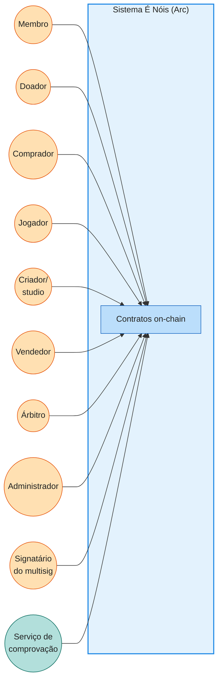

| Ator | Interesse principal |
|---|---|
| Membro | Participar, acumular Faísca e NFTs, usufruir benefícios. |
| Doador | Financiar a rede e receber gratificação de campanha. |
| Comprador | Converter USDC em Faísca (e vice-versa) pelo swap. |
| Administrador | Operar políticas dentro dos limites dos contratos. |
| Jogador | Jogar, colecionar itens e monetizar seus NFTs (venda, aluguel). |
| Criador (studio) | Publicar jogos/coleções como módulos de NFT e monetizar. |
| Vendedor | Ofertar itens e serviços no marketplace P2P e receber a liquidação do escrow. |
| Árbitro | Decidir disputas de operações mediadas por escrow, dentro da janela de contestação. |
| Signatário | Aprovar operações críticas no multisig. |
| Serviço de comprovação | Assinar autorizações de premiação (EIP-712). |

---

## UC-01 — Conectar carteira e obter USDC

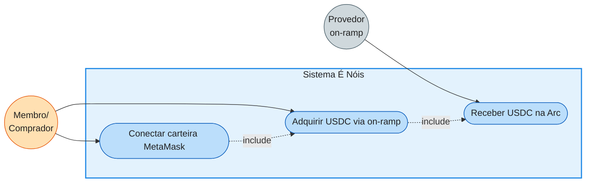

O membro conecta sua MetaMask à plataforma É Nóis já apontada para a rede Arc
— o frontend usa o `ContractRegistry` para descobrir os contratos e orienta a
troca de rede quando necessário. Para se capitalizar, ele segue o fluxo de
on-ramp integrado (ecossistema Circle ou provedor regional), informa o valor
em moeda fiduciária e conclui a compra sujeita a identificação do provedor.

O USDC é creditado diretamente na carteira do usuário na Arc, também servindo
para pagar taxas de rede (gas em USDC). O contrato É Nóis não custodia esse
USDC nem depende do provedor: a integração termina quando o saldo chega à
carteira, ponto a partir do qual os casos de uso de swap e compra se tornam
disponíveis. O equivalente em BRLA segue o mesmo desenho para o público
brasileiro.

---

## UC-02 — Comprar Faísca com USDC no swap

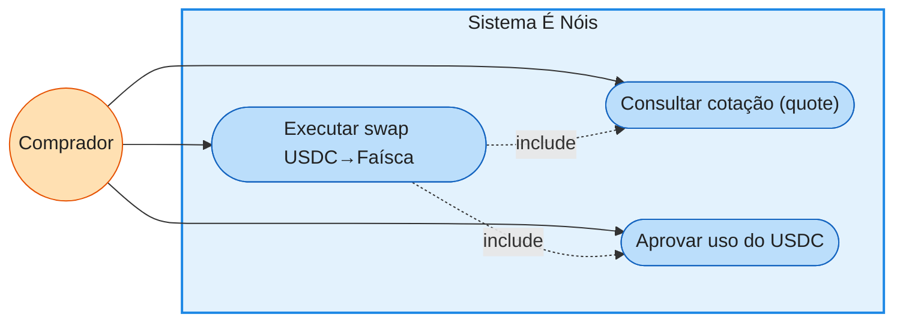

O comprador consulta a função `quote` do `EnoisSwap`, que devolve a saída
estimada em Faísca, a taxa `f` aplicada e o impacto no preço da sua ordem —
a cotação é indicativa e nunca garante execução. Informados `minOut` e
`deadline`, ele aprova o gasto do USDC (por `permit` ERC-2612 ou `approve`)
e submete a troca.

O contrato calcula `Faísca_recebida = x·u_efetivo/(y+u_efetivo)` sobre a
reserva real, retém a taxa no ativo de entrada e transfere a Faísca à
carteira — revertendo integralmente se a saída ficar abaixo de `minOut` ou o
prazo expirar. A reserva de USDC cresce e a de Faísca diminui, elevando o
preço marginal; nenhum valor sai da reserva além do calculado pela fórmula.

---

## UC-03 — Vender Faísca por USDC no swap

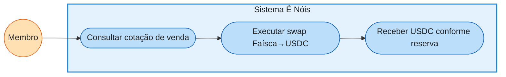

O detentor de Faísca consulta a cotação inversa, que informa quanto USDC sua
quantidade `q` renderá dado `USDC_recebido = y·q_efetivo/(x+q_efetivo)`, já
com taxa e impacto descontados. Ele confirma a operação com `minOut` e
`deadline` e recebe o USDC na carteira.

A venda **só é honrada conforme a liquidez existente**: se a reserva de USDC
for insuficiente para o preço esperado, o impacto cresce e a saída diminui —
o AMM nunca promete recompra nem cria obrigação para a rede. Grandes vendas
repetidas drenam a reserva e deprimem o preço, sinal econômico que a
governança monitora para revisar orçamentos de emissão.

---

## UC-04 — Receber premiação em Faísca por participação

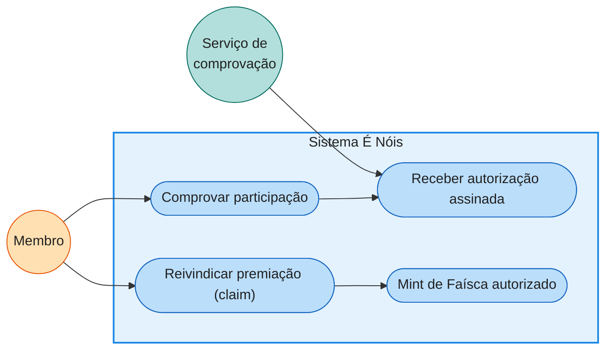

O membro realiza a ação premiável (meta, contribuição, presença) e o serviço
de comprovação valida a elegibilidade off-chain, emitindo uma autorização
EIP-712 vinculada à carteira, ao tipo de premiação, à campanha, a um nonce e
a um prazo — sem expor dados pessoais on-chain. O membro então executa o
`claim` apresentando a assinatura.

O `RewardsDistributor` verifica a assinatura, o domínio (chainId/contrato), o
nonce não utilizado e os limites do período; só então aciona o `MINTER_ROLE`
da Faísca dentro do orçamento. Cada identificador de premiação é registrado
como consumido, tornando impossível reivindicar duas vezes ou reaproveitar
assinatura alheia. Em modo push, o distribuidor executa o mesmo fluxo em lote.

---

## UC-05 — Doar e receber gratificação em Faísca

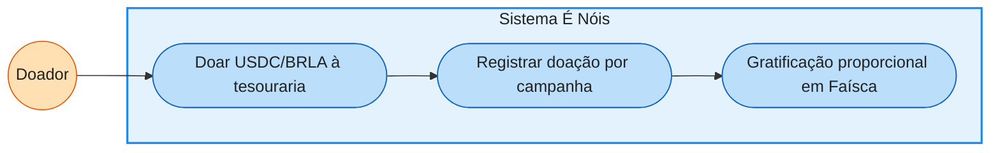

O doador transfere USDC ou BRLA à `Treasury` por uma função de depósito que
aceita uma `tag` de campanha, permitindo à governança atribuir gratificações
conforme a regra pública vigente — proporção, teto e vigência publicados
antes da campanha. O recurso entra no caixa operacional, segregado do swap e
do capital de investimento.

A gratificação em Faísca segue o mesmo trilho das premiações: autorização
assinada, limites de período e registro auditável com hash da doação como
comprovação. A doação em si nunca é condicionada à Faísca — quem doa fora de
campanha, ou acima do teto, contribui normalmente sem receber tokens além do
previsto na regra.

---

## UC-06 — Receber NFT de conquista

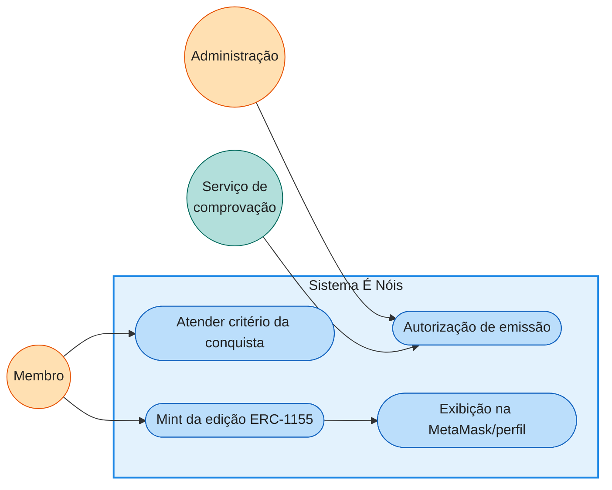

Quando o membro atende o critério de uma conquista — perfil completo, função
de admin de comunidade, membro mais ativo do período — a administração (via
serviço de comprovação) autoriza a emissão de uma unidade da edição
correspondente no `EnoisNFT`. Conquistas de reconhecimento são tipicamente
ERC-1155 (várias unidades do mesmo token ID) e, por política, podem ser
intransferíveis, bloqueio aplicado no contrato.

O NFT passa a constar na carteira do membro, visível na MetaMask e no perfil
É Nóis, com metadados persistentes e sem dados pessoais. A posse é
honorífica: não concede permissão de contrato nem poder administrativo — os
direitos da função (ex.: moderar) são verificados pela combinação de
coleção, validade e política, com revogação prevista quando aplicável.

---

## UC-07 — Resgatar NFT em evento (edição limitada)

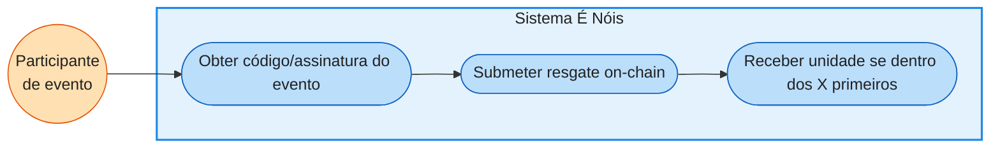

Em campanhas e eventos, a organização distribui autorizações de resgate
(assinaturas EIP-712 vinculadas a carteira, campanha e rede, ou esquema
commit-reveal) válidas por prazo definido. O participante submete o resgate
ao contrato, que verifica autenticidade, validade e não-reutilização da
autorização.

O contrato mantém contagem atômica da edição: os primeiros `X` resgates
válidos — ordenados pela execução na blockchain, não pelo clique na interface
— recebem a unidade; além do limite, a transação reverte sem custo de NFT.
Códigos secretos nunca trafegam em texto aberto, e limites por carteira
dificultam varredura por bots.

---

## UC-08 — Receber premiação em Faísca por coleção de NFT

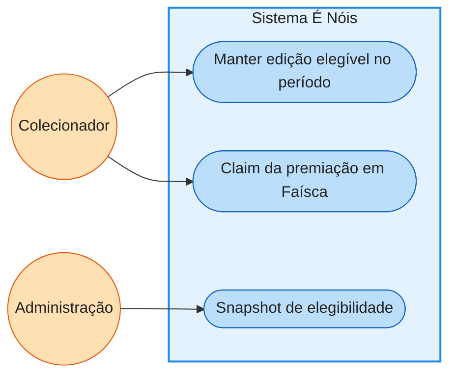

Políticas de coleção podem premiar em Faísca quem detém determinadas edições
— por exemplo, um reconhecimento periódico a quem mantém a conquista "Admin
de Comunidade" ativa. A administração define edições elegíveis, valor e
periodicidade; um snapshot registra os detentores na altura apurada, sem
transferir nem bloquear os NFTs.

O detentor elegível executa o `claim` dentro da janela, e o
`RewardsDistributor` aplica as mesmas proteções das demais premiações:
identificador único por período/carteira/edição, orçamento de emissão e
evento auditável. A mecânica é de reconhecimento, não de rendimento — a
política pode ser revista ou encerrada por governança.

---

## UC-09 — Comprar produto ou serviço no site com crypto

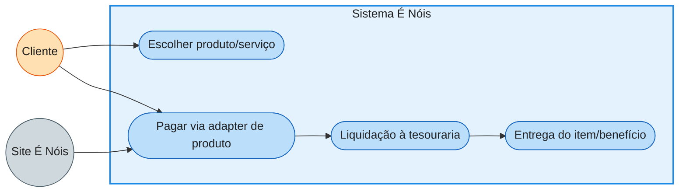

O cliente escolhe um produto ou serviço do catálogo do site — assinatura,
item colecionável, NFT comprável, itens de jogos, experiência — cotado pelo
`IProductAdapter` correspondente em Faísca, USDC ou BRLA. A cobrança ocorre
on-chain: o adapter recebe o ativo, aplica a política comercial (desconto em
Faísca, split de receita) e emite o comprovante da ordem.

A liquidação transfere o valor à tesouraria como caixa operacional, e a
entrega — item digital, NFT ou benefício off-chain — é acionada pelo evento
de pagamento confirmado. Reembolsos seguem `refund(orderId)` restrito a
condições da política; novos produtos entram por novos adapters ou
configuração dos existentes, sempre via allowlist da governança.

---

## UC-10 — Executar operação administrativa (saque)

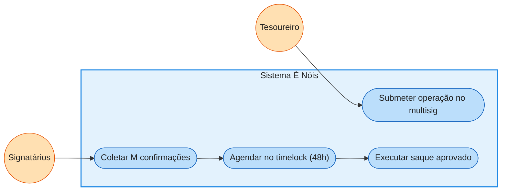

Um saque administrativo nasce como `Operation` no multisig: destino, ativo,
valor e justificativa. Signatários confirmam até atingir `M = teto(2N/3)`
sobre o total de autorizados — comparecimento parcial não reduz o quórum e
abstenção equivale a não-aprovação.

Aprovada, a operação é agendada no timelock com `eta ≥ now+48h`, tornando-se
pública e cancelável por quórum se identificada como indevida. Decorrido o
prazo, qualquer executor a dispara e a `Treasury` transfere do caixa
operacional — jamais da reserva do swap ou do capital de investimento —
registrando evento completo para o dashboard e para auditoria.

---

## UC-11 — Alocar capital em adapter de investimento

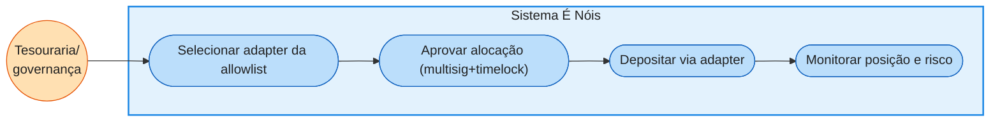

A governança decide aplicar parte do capital autorizado — previamente
segregado do caixa e do swap — em um adapter da allowlist, por exemplo um
`AdapterERC4626` sobre um vault auditado ou um adapter específico de lending.
A operação `allocate(adapter, amount)` passa pelo mesmo fluxo
multisig+timelock das demais decisões críticas.

O adapter executa o depósito no protocolo externo e passa a reportar
`positionValue()` e `riskInfo()` de forma conservadora — a tesouraria trata a
cota do vault como estimativa, não como liquidez garantida. Limites de
exposição por protocolo/ativo/estratégia são verificados no contrato antes de
cada alocação, e o plano de saída de cada adapter é requisito de cadastro.

---

## UC-12 — Desinvestir e recolher rendimento

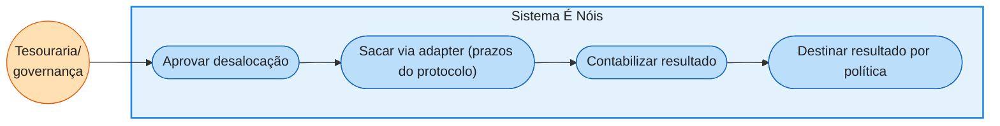

Quando a política manda realizar, reduzir exposição ou responder a incidente
externo, a governança aprova `deallocate(adapter, amount)`. O adapter executa
o resgate respeitando a realidade do protocolo — filas, prazos, taxas e
possíveis perdas — sem promessa de imediatismo ao usuário final.

O principal retorna ao capital de investimento ou ao caixa, conforme a
decisão, e o resultado (rendimento ou perda) é contabilizado em evento e no
relatório por período. O destino do rendimento — recomposição de caixa,
orçamento de premiações, reserva — é definido por governança; possuir Faísca
não dá direito automático a ele.

---

## UC-13 — Gerir liquidez do swap

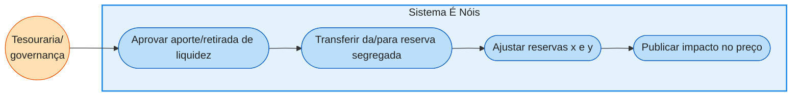

A liquidez inicial e seus reforços são financiados pela tesouraria mediante
aporte conjunto de Faísca e USDC na reserva segregada — aprovado por
governança, nunca por operador isolado. Aportar ambos os ativos na proporção
corrente amplia a profundidade sem mover o preço marginal; aportar só um lado
desloca a cotação.

Retiradas administrativas seguem o mesmo cuidado: preservam compromissos de
usuários em aberto, são timelocadas e publicam o impacto resultante. A
reserva do swap permanece intocável para despesas operacionais ou
investimentos — essa é a propriedade que transforma o AMM em promessa
limitada e verificável, e não em obrigação aberta da rede.

---

## UC-14 — Pausa emergencial

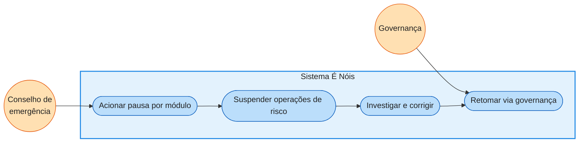

Diante de exploit, falha de integração ou comportamento anômalo, o conselho
de emergência aciona a pausa seletiva: pode suspender swaps, mints, claims ou
o adapter afetado — sem poder sacar fundos, fazer upgrade ou retomar
unilateralmente. O escopo da pausa é definido por módulo para minimizar dano
colateral.

A investigação e a correção seguem o fluxo normal de governança, e a retomada
exige multisig + timelock como qualquer mudança sensível. O evento de pausa é
público e monitorado; o runbook de incidentes define quem aciona, em que
condições e como a comunidade é informada.

---

## UC-15 — Upgrade de contrato

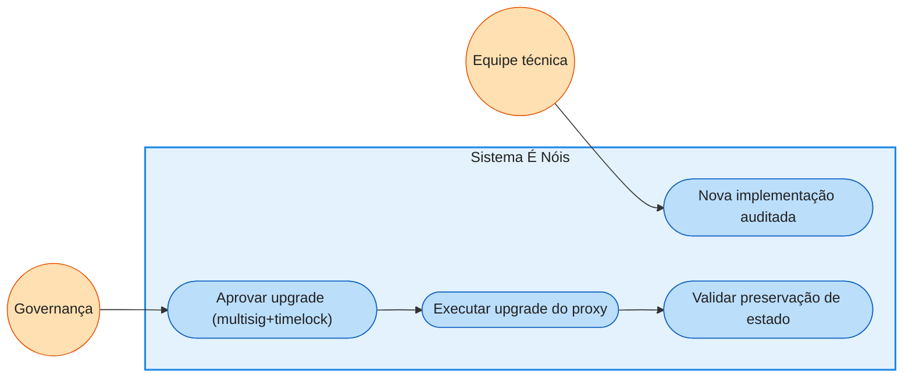

Uma evolução de contrato começa com a nova implementação testada, auditada e
com análise de compatibilidade de storage documentada. A governança aprova o
upgrade — facet no modelo Diamond ou implementação no modelo UUPS — pelo
fluxo completo de multisig e timelock, com o bytecode do alvo publicado
durante a espera.

Executado o upgrade, testes de preservação de estado e verificação funcional
confirmam que saldos, reservas, permissões e histórico permanecem íntegros.
Qualquer divergência aciona o plano de rollback/contingência previsto antes
da execução — upgrade nunca é operação de rotina nem decisão de uma chave só.

---

## UC-16 — Migrar saldo de Faísca Web2 para on-chain (1:1)

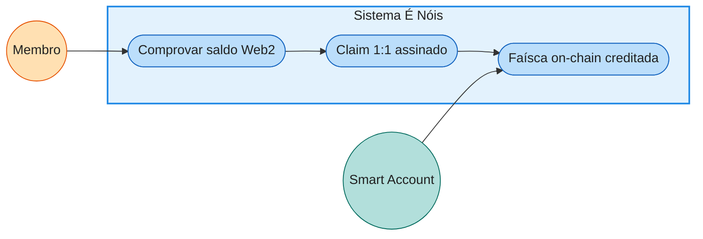

O membro já possui saldo na Faísca simbólica da plataforma Web 2 — média
esperada de ~250 Faíscas por membro, com referência interna sugerida de
R$ 0,01 por Faísca. O serviço de comprovação confere o saldo elegível no
registro Web2 e emite uma autorização EIP-712 vinculada à identidade do
membro e à carteira/Smart Account de destino.

O membro executa o `claim` no `FaiscaMigration`, que verifica a assinatura,
a janela de migração e a unicidade por identidade — um saldo migra uma única
vez — antes de emitir exatamente a mesma quantidade de Faísca on-chain
(razão 1:1). O evento `Migrated` registra o hash da identidade, a carteira e
o valor; a referência de R$ 0,01 orienta políticas internas e não promete
preço de mercado.

---

## UC-17 — Gerenciar Smart Account custodiada

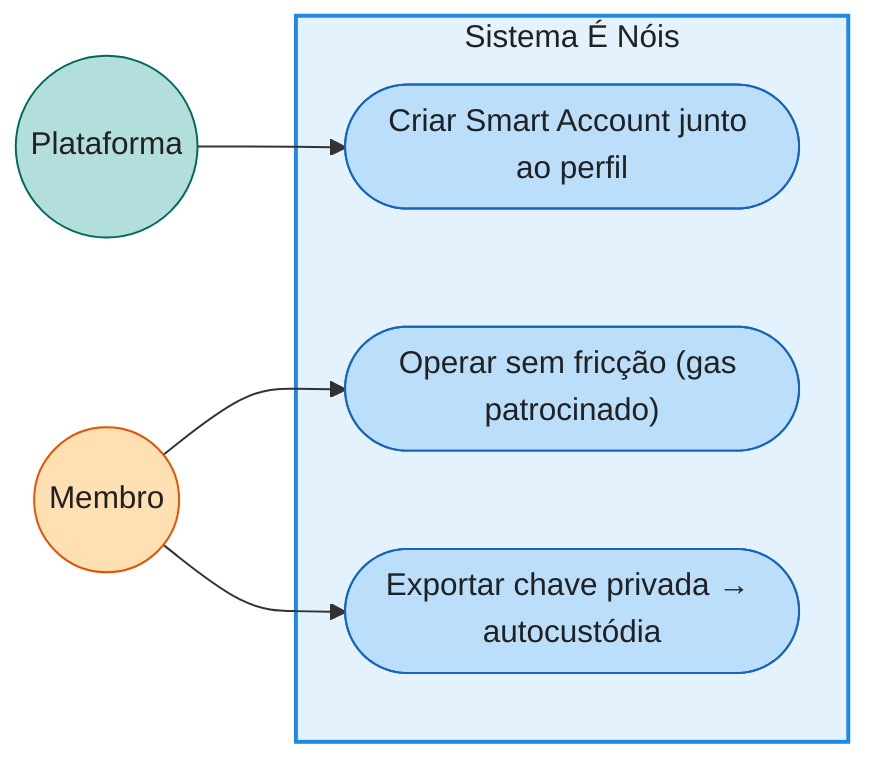

Ao criar o perfil na plataforma, o membro recebe automaticamente uma Smart
Account custodiada, alinhada ao modelo **EIP-7702**: uma EOA que delega a
execução a código de conta inteligente, permitindo operações em lote, gas
patrocinado e regras de sessão — UX de Web 2 com propriedades de Web 3.

A custódia é transitória por desenho: mediante autenticação forte, o membro
**exporta a chave privada** e passa a operar a mesma conta por MetaMask ou
outra carteira EVM, sem perder saldos, NFTs ou histórico. A exportação é
evento auditado; a chave nunca aparece em logs ou telas administrativas;
carteiras próprias seguem suportadas como caminho alternativo desde o
primeiro dia.

---

## UC-18 — Movimentar capital entre tesouraria e financeiro fiat

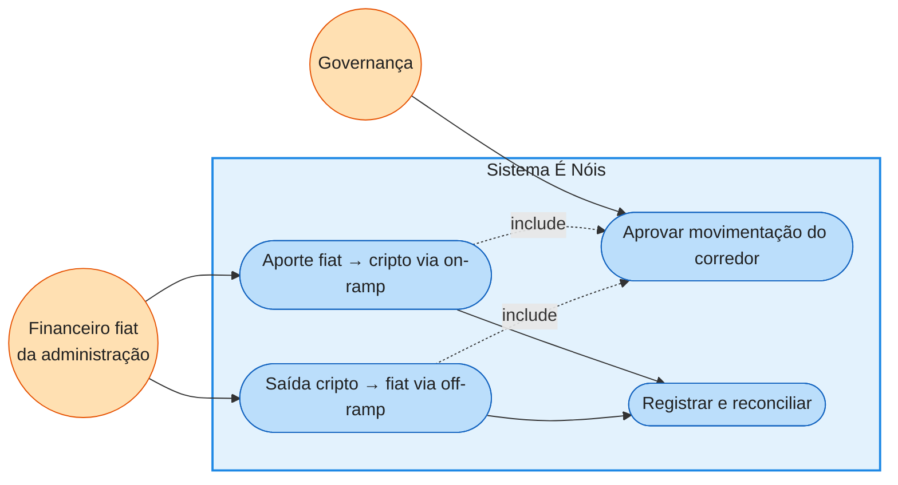

A administração mantém um **corredor bidirecional** entre o financeiro fiat e
a `Treasury` para capital próprio da rede. Na direção **fiat → cripto**, a
governança aprova o aporte — por exemplo, uma compra de cripto aproveitando
preços competitivos para investimento — e a conversão acontece por canal
aprovado (on-ramp institucional, corretora ou OTC da allowlist); o ativo
entra na tesouraria como depósito identificado, indo ao caixa operacional
ou ao capital de investimento conforme a finalidade registrada.

Na direção **cripto → fiat**, a tesouraria envia o ativo aprovado a um
off-ramp autorizado e o resultado fiduciário só pode chegar a contas da
administração previamente registradas. Ambas as pernas passam por multisig +
timelock, emitem eventos com a referência da operação e são reconciliadas
com a contabilidade fiat. O corredor nunca toca a reserva do swap nem
fundos de terceiros — é trilho de capital próprio, não serviço a usuários.

---

## UC-19 — Publicar novo módulo de NFT (jogo GameFi)

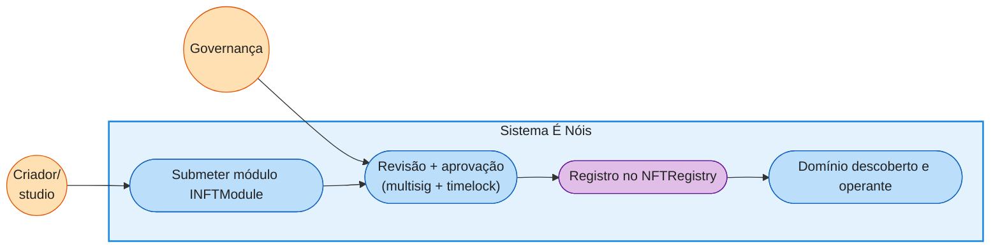

Um criador quer publicar seu jogo na rede: implanta um contrato próprio
implementando `INFTModule` (ERC-721/1155 dedicado) **ou** solicita um
namespace no contrato compartilhado `EnoisGameAssets` — a escolha é a decisão
D-09, transparente para o resto do sistema. Junto ao módulo, declara as
*capabilities* (transferível, alugável, royalties) e a política comercial do
domínio (preço primário, comissão de aluguel, splits e beneficiário do
criador).

A entrada passa por revisão de segurança e aprovação completa da governança:
registro no `NFTRegistry` via multisig + timelock, com a política gravada e
eventos públicos. A partir daí o domínio é descoberto por frontend,
marketplace e `RewardsDistributor`; seus itens podem ser vendidos via adapter
de produto, premiados pelo trilho usual e — se o módulo declarar a
*capability* alugável — oferecidos no `NFTRental`. Nenhum contrato existente
é alterado: a extensão é só registro. Se o módulo se comportar mal, pode ser
pausado ou removido isoladamente, sem afetar os demais domínios.

---

## UC-20 — Alugar NFT de jogo (renda ao jogador)

```mermaid
flowchart LR
    J1(("Jogador<br/>locador"))
    J2(("Jogador<br/>locatário"))

    subgraph SIS["Sistema É Nóis"]
        UC1(["Listar item p/ aluguel<br/>(ordem assinada)"])
        UC2(["Pagar aluguel"])
        UC3(["Receber direito de uso<br/>até a expiração"])
        UC4(["Split locador/criador/rede"])
        UC5(["Expiração automática<br/>do uso"])
    end

    J1 --> UC1
    J2 --> UC2 --> UC3
    UC2 -.->|include| UC4
    UC3 --> UC5

    classDef actor fill:#FFE0B2,stroke:#E65100,stroke-width:1px,color:#212121;
    classDef contract fill:#BBDEFB,stroke:#1565C0,stroke-width:1px,color:#212121;

    class J1,J2 actor;
    class UC1,UC2,UC3,UC4,UC5 contract;

    style SIS fill:#E3F2FD,stroke:#1E88E5,stroke-width:2px,color:#212121;
```

O locador assina uma ordem EIP-712 no `NFTRental`: item, módulo, preço e
ativo de cobrança (Faísca/USDC/BRLA), duração máxima, nonce e prazo da
oferta. O NFT **não sai da carteira** — não há custódia nem depósito de
garantia. O locatário escolhe a listagem, paga o aluguel e recebe o **direito
de uso** do item (ERC-4907 ou mecanismo equivalente) até a expiração
contratada.

Na liquidação, o contrato divide a receita on-chain conforme a política do
domínio: o **locador** recebe sua parte, o **criador** do jogo recebe a
comissão e a **taxa da rede** é liquidada à tesouraria. Findo o prazo, o
direito de uso expira sozinho — o item segue com o dono, que pode alugá-lo
de novo. Somente módulos que declararam a *capability* alugável participam:
conquistas soulbound e coleções não alugáveis simplesmente não aparecem no
mercado.

---

## UC-21 — Transferir Faísca P2P (estilo Pix)

```mermaid
flowchart LR
    REM(("Remetente"))
    DEST(("Destinatário"))

    subgraph SIS["Sistema É Nóis"]
        UC1(["Resolver username<br/>→ endereço (off-chain)"])
        UC2(["Confirmar transferência"])
        UC3(["Transfer on-chain<br/>irreversível"])
    end

    REM --> UC1 --> UC2 --> UC3 --> DEST

    classDef actor fill:#FFE0B2,stroke:#E65100,stroke-width:1px,color:#212121;
    classDef offchain fill:#B2DFDB,stroke:#00695C,stroke-width:1px,color:#212121;
    classDef contract fill:#BBDEFB,stroke:#1565C0,stroke-width:1px,color:#212121;

    class REM,DEST actor;
    class UC1 offchain;
    class UC2,UC3 contract;

    style SIS fill:#E3F2FD,stroke:#1E88E5,stroke-width:2px,color:#212121;
```

O membro inicia uma transferência indicando o destinatário pela identidade da
plataforma — o username, como no Pix-style da Web 2. O backend resolve o
username para o endereço EVM registrado (Smart Account custodiada ou carteira
própria) e a UI apresenta a confirmação com valor e destinatário resolvido.

A `transfer` executa on-chain e é **irreversível por construção**: nenhum papel
administrativo reverte ou desconta saldo de um titular (RF-FAI-10). A
experiência de "contestação" da Web 2 não se aplica ao envio livre — só
operações mediadas por escrow (UC-22, UC-23) admitem disputa (UC-25). Mensagens
de lançamento permanecem off-chain e cifradas, como hoje.

---

## UC-22 — Comprar item no marketplace P2P com escrow

```mermaid
flowchart LR
    CMP(("Comprador"))
    VEN(("Vendedor"))

    subgraph SIS["Sistema É Nóis"]
        UC1(["Listar item (min. 50 Faíscas)"])
        UC2(["Comprar → hold no escrow"])
        UC3(["Confirmar → split 90/10"])
        UC4(["Reembolso → 100% comprador"])
        UC5(["Contestar → disputa (UC-25)"])
    end

    VEN --> UC1
    CMP --> UC2
    UC2 --> UC3
    UC2 --> UC4
    UC2 -.->|dentro da janela| UC5

    classDef actor fill:#FFE0B2,stroke:#E65100,stroke-width:1px,color:#212121;
    classDef contract fill:#BBDEFB,stroke:#1565C0,stroke-width:1px,color:#212121;

    class CMP,VEN actor;
    class UC1,UC2,UC3,UC4,UC5 contract;

    style SIS fill:#E3F2FD,stroke:#1E88E5,stroke-width:2px,color:#212121;
```

O vendedor lista um item do marketplace — tema, banner, template, página,
conteúdo — com preço em Faísca acima do mínimo configurável (referência Web 2:
50 Faíscas). O comprador paga e o valor fica **custodiado no `FaiscaEscrow`**
(estado `HOLD`), não mais como flag contábil no saldo.

Na janela de decisão (referência: 7 dias), o comprador **confirma**: o escrow
liquida atômico 90% ao vendedor e 10% à tesouraria como taxa. Ou o comprador
**recusa/expira**: 100% retorna ao comprador. Qualquer parte pode contestar na
janela e a decisão passa à arbitragem (UC-25). Todo o fluxo é idempotente por
`refId` — requisição repetida nunca cobra duas vezes.

---

## UC-23 — Contratar serviço freelance com escrow

```mermaid
flowchart LR
    CLI(("Cliente"))
    PRE(("Prestador"))

    subgraph SIS["Sistema É Nóis"]
        UC1(["Oferta (Fiverr) ou<br/>pedido + proposta"])
        UC2(["Contratar → hold no escrow"])
        UC3(["Entregar (declaração)"])
        UC4(["Aceitar → 90% prestador"])
        UC5(["Reembolso → 100% cliente"])
    end

    PRE --> UC1
    CLI --> UC2
    PRE --> UC3
    UC2 --> UC4
    UC2 --> UC5
    UC3 -.->|pré-condição| UC4

    classDef actor fill:#FFE0B2,stroke:#E65100,stroke-width:1px,color:#212121;
    classDef contract fill:#BBDEFB,stroke:#1565C0,stroke-width:1px,color:#212121;

    class CLI,PRE actor;
    class UC1,UC2,UC3,UC4,UC5 contract;

    style SIS fill:#E3F2FD,stroke:#1E88E5,stroke-width:2px,color:#212121;
```

Espelha o mercado de serviços da Web 2, que opera dois fluxos sobre o mesmo
escrow: **compra direta de oferta** (o prestador publica um serviço com preço,
deliverables e prazo) e **pedido com propostas** (o cliente abre demanda com
orçamento em faixa e escolhe uma proposta). A contratação trava o valor em
`HOLD` no `FaiscaEscrow`.

O prestador declara a **entrega** (evento off-chain registrado) — pré-condição
para o cliente aceitar e liberar o split 90/10. Recusa do cliente ou expiração
devolve 100%. Desacordo sobre a entrega vai à disputa arbitral (UC-25), que só
pode liberar ou reembolsar — nunca descontar de outra conta. O pagamento em si
é sempre em Faísca on-chain; "pago fora da plataforma" dos microprojetos Web 2
vira o bônus de RF-PRE-09, não o contrato.

---

## UC-24 — Gastar Faísca em jogo e impulsionar jogo

```mermaid
flowchart LR
    JOG(("Jogador"))
    JG(("Jogo (iframe externo)"))
    CRI(("Criador"))

    subgraph SIS["Sistema É Nóis"]
        UC1(["Jogo pede gasto<br/>(postMessage)"])
        UC2(["Jogador confirma<br/>(autorização EIP-712)"])
        UC3(["spend(gameId, refId)<br/>→ tesouraria/split"])
        UC4(["boost(gameId)<br/>5 Faíscas / 7 dias"])
    end

    JG -.->|pede| UC1
    JOG --> UC2 --> UC3
    CRI --> UC4

    classDef actor fill:#FFE0B2,stroke:#E65100,stroke-width:1px,color:#212121;
    classDef contract fill:#BBDEFB,stroke:#1565C0,stroke-width:1px,color:#212121;
    classDef external fill:#CFD8DC,stroke:#455A64,stroke-width:1px,color:#212121;

    class JOG,CRI actor;
    class JG external;
    class UC1,UC2,UC3,UC4 contract;

    style SIS fill:#E3F2FD,stroke:#1E88E5,stroke-width:2px,color:#212121;
```

O jogo — aplicação externa em iframe, sem acesso à sessão — **pede** um gasto
via `postMessage`; quem confirma é o jogador na plataforma, com autorização
assinada (EIP-712) ou allowance limitado por módulo. O `spend` debita com
dedup por `refId` (`game:{id}:{requestId}` da Web 2) — pedido repetido não
cobra duas vezes. O valor vai à **tesouraria** hoje; uma política de domínio
pode direcionar split ao criador (RF-GAM-17, decisão D-12).

O **boost** é o destaque pago do criador: 5 Faíscas (referência) por 7 dias no
topo do catálogo, dedup de um impulso por semana por jogo. Ambos os fluxos são
idempotentes, auditáveis por evento e nunca dão ao jogo poder de mint — a
identidade pseudônima (`playerRef`) separa quem joga de quem assina.

---

## UC-25 — Contestar operação mediada (disputa arbitral)

```mermaid
flowchart LR
    PT1(("Parte reclamante"))
    ARB(("Árbitro"))

    subgraph SIS["Sistema É Nóis"]
        UC1(["Abrir disputa<br/>dentro da janela"])
        UC2(["Estado DISPUTED<br/>(fundos congelados)"])
        UC3(["Decisão: release ou refund"])
        UC4(["Registro do desfecho"])
    end

    PT1 --> UC1 --> UC2
    ARB --> UC3 --> UC4

    classDef actor fill:#FFE0B2,stroke:#E65100,stroke-width:1px,color:#212121;
    classDef gov fill:#FFCCBC,stroke:#BF360C,stroke-width:1px,color:#212121;
    classDef contract fill:#BBDEFB,stroke:#1565C0,stroke-width:1px,color:#212121;

    class PT1 actor;
    class ARB gov;
    class UC1,UC2,UC3,UC4 contract;

    style SIS fill:#E3F2FD,stroke:#1E88E5,stroke-width:2px,color:#212121;
```

Qualquer parte de um `HOLD` abre disputa dentro da janela de contestação — na
Web 2, 7 dias. O escrow muda para `DISPUTED` e os fundos ficam congelados até
decisão: a reclamação, as evidências e a mediação acontecem **off-chain** (sem
dados pessoais nem conteúdo sensível na cadeia).

O árbitro (`DISPUTE_ADMIN_ROLE`, sempre delegação de governança e sujeito a
timelock) resolve por **release** (split ao vendedor) ou **refund** (100% ao
comprador) — o desfecho vira evento auditável. Diferente da Web 2, onde o admin
reverte qualquer transferência, on-chain a disputa só alcança o que está em
custódia do escrow: transferências livres já liquidadas são finais
(RF-FAI-10). Abuso recorrente de disputa pode ser tratado por penalidade
reputacional off-chain, nunca por confiscação de saldo.

---

## Matriz de rastreabilidade

| Caso de uso | Requisitos atendidos |
|---|---|
| UC-01 | RF-INT-01, RF-INT-03, RF-INT-04 |
| UC-02 | RF-SWP-01, RF-SWP-02, RF-SWP-03, RF-SWP-05, RF-SWP-06, RF-SWP-07, RF-FAI-06 |
| UC-03 | RF-SWP-01, RF-SWP-02, RF-SWP-05, RF-SWP-11 |
| UC-04 | RF-PRE-01, RF-PRE-02, RF-PRE-03, RF-PRE-04, RF-PRE-06, RF-FAI-03 |
| UC-05 | RF-TRS-01, RF-TRS-02, RF-TRS-09, RF-PRE-05 |
| UC-06 | RF-NFT-01, RF-NFT-03, RF-NFT-04, RF-NFT-08, RF-PRE-01 |
| UC-07 | RF-NFT-05, RF-NFT-06, RF-NFT-07, RNF-03 |
| UC-08 | RF-NFT-09, RF-PRE-03, RF-PRE-08 |
| UC-09 | RF-ADT-02, RF-ADT-08, RF-TRS-02, RF-INT-02 |
| UC-10 | RF-TRS-03, RF-GOV-01, RF-GOV-02, RF-GOV-07 |
| UC-11 | RF-ADT-01, RF-ADT-03, RF-ADT-04, RF-ADT-05, RF-TRS-06, RF-GOV-02 |
| UC-12 | RF-ADT-07, RF-ADT-10, RF-TRS-06, RF-TRS-07 |
| UC-13 | RF-SWP-04, RF-SWP-08, RF-SWP-09, RF-TRS-05 |
| UC-14 | RF-GOV-03, RF-FAI-07, RNF-10 |
| UC-15 | RF-GOV-02, RF-GOV-05, RNF-04, RNF-06 |
| UC-16 | RF-MIG-01..09, RF-PRE-01/02, RF-FAI-03 |
| UC-17 | RF-WAL-01..07, RF-MIG-08, RNF-08 |
| UC-18 | RF-FIA-01..08, RF-TRS-03/06/07, RF-GOV-02 |
| UC-19 | RF-GAM-01..05, RF-GAM-10, RF-GAM-12, RF-NFT-12, RF-GOV-02 |
| UC-20 | RF-GAM-06, RF-GAM-07, RF-GAM-08, RF-GAM-11, RF-TRS-02/07, RNF-03 |
| UC-21 | RF-FAI-10, RF-FAI-11, RF-INT-04 |
| UC-22 | RF-ESC-01..06, RF-TRS-02, RNF-03 |
| UC-23 | RF-ESC-01..08, RF-PRE-09, RNF-03 |
| UC-24 | RF-GAM-15, RF-GAM-16, RF-GAM-17, RF-GAM-09, RNF-03 |
| UC-25 | RF-ESC-04, RF-ESC-06, RF-FAI-10, RF-GOV-01/02, RNF-08 |

## Changelog

| Data | Versão | Descrição |
|---|---|---|
| 2026-10-23 | 0.1.0 | Versão inicial dos casos de uso. |
| 2026-10-23 | 0.2.0 | UC-16 (migração Faísca Web2 1:1) e UC-17 (Smart Account custodiada/EIP-7702); diagramas coloridos. |
| 2026-10-23 | 0.3.0 | UC-18: corredor fiat ⇄ tesouraria para capital próprio da administração (aportes para investimento em cripto e saques a fiat via off-ramp). |
| 2026-10-23 | 0.4.0 | UC-19 (publicar módulo de NFT/jogo via NFTRegistry + INFTModule) e UC-20 (alugar NFT de jogo com split on-chain); novos atores Jogador e Criador. |
| 2026-10-23 | 0.5.0 | Levantamento Faísca Web 2: UC-21 (transferência P2P estilo Pix), UC-22 (marketplace com escrow), UC-23 (serviço freelance com escrow), UC-24 (gasto/boost em jogo), UC-25 (disputa arbitral); novos atores Vendedor e Árbitro. |


