

# 06 — Diagramas de Sequência

Fluxos temporais dos principais processos do ecossistema, no nível de
interação entre usuário, frontend, serviços off-chain e contratos na rede
Arc. Cada capítulo traz um diagrama `sequenceDiagram` e a descrição do
comportamento esperado. Os diagramas correspondem aos casos de uso de
[05 — Casos de Uso](05-casos-de-uso.md).

---

## SD-01 — On-ramp de USDC e conexão da carteira

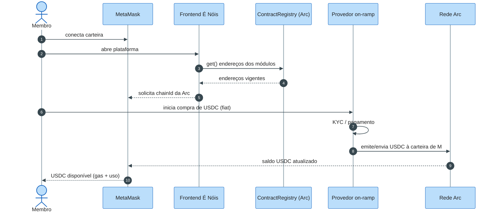

A jornada começa fora dos contratos É Nóis: o frontend descobre os endereços
vigentes pelo `ContractRegistry` — nunca por configuração local — e orienta a
MetaMask a operar na Arc. A compra de USDC acontece integralmente no provedor
de on-ramp, que resolve identificação, pagamento fiduciário e emissão.

O sistema É Nóis só percebe o resultado: saldo de USDC na carteira do membro,
pronto para pagar gas (nativo em USDC) e para os fluxos de swap, doação e
compra. Essa independência é proposital: trocar de provedor de on-ramp não
exige mudança em nenhum contrato.

---

## SD-02 — Compra de Faísca no swap (USDC→Faísca)

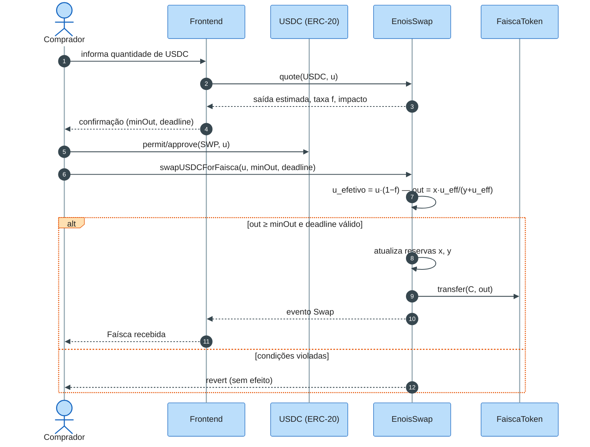

A cotação é puramente informativa: `quote` devolve estimativa, taxa e impacto
sem comprometer resultado. A autorização do USDC pode usar `permit`
(ERC-2612) poupando uma transação; a troca em si exige `minOut` e `deadline`
como proteção do usuário contra deslize e MEV.

No contrato, a fórmula de produto constante calcula a saída sobre as reservas
reais `x` e `y`, com a taxa retida no ativo de entrada — o que amplia `k` a
cada operação. Qualquer violação reverte a transação inteira; nunca há
saída parcial nem toque no caixa da tesouraria.

---

## SD-03 — Distribuição de premiação em Faísca

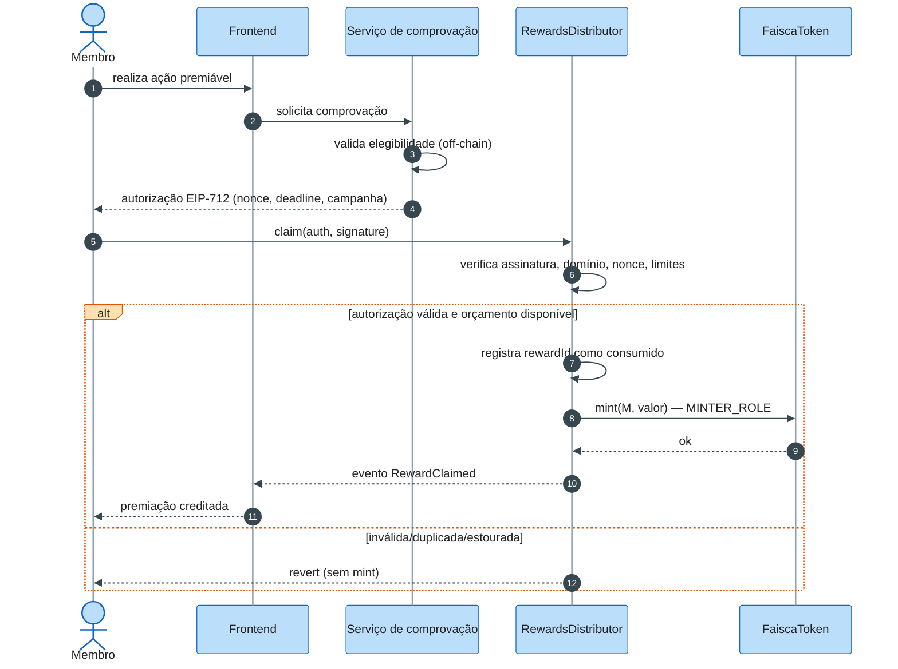

A autorização EIP-712 carrega carteira, tipo de premiação, campanha, valor,
nonce e prazo — assinada pela chave do serviço de comprovação, que é
rotacionável e revogável. Nenhum dado pessoal trafega on-chain; o que se
publica é o hash da comprovação.

O contrato é a segunda linha de defesa: valida domínio, assinatura, unicidade
do `rewardId` e o orçamento do período antes de acionar o `MINTER_ROLE` da
Faísca. Uma assinatura legítima reutilizada, ou uma premiação além do
orçamento, simplesmente reverte — o controle está no contrato, não na
confiança no backend.

---

## SD-04 — Emissão de NFT de conquista

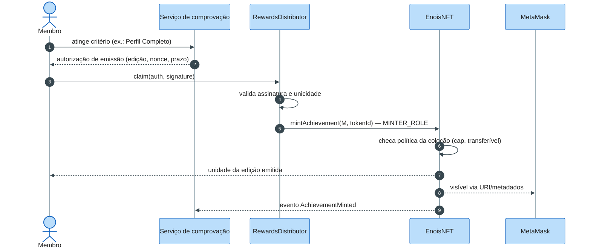

O fluxo espelha a premiação em Faísca, mas o ativo emitido é uma unidade da
edição configurada — com política de coleção aplicada no contrato:
transferibilidade, limite de unidades e validade. A autorização impede que
qualquer carteira minte a edição fora do critério reconhecido.

Após o mint, o NFT aparece na MetaMask e no perfil É Nóis conforme os
metadados persistentes da coleção. A posse é reconhecimento: ela não abre
permissões de contrato — o que habilita funções administrativas é a
combinação de papel + política, jamais o token sozinho.

---

## SD-05 — Resgate de NFT em evento

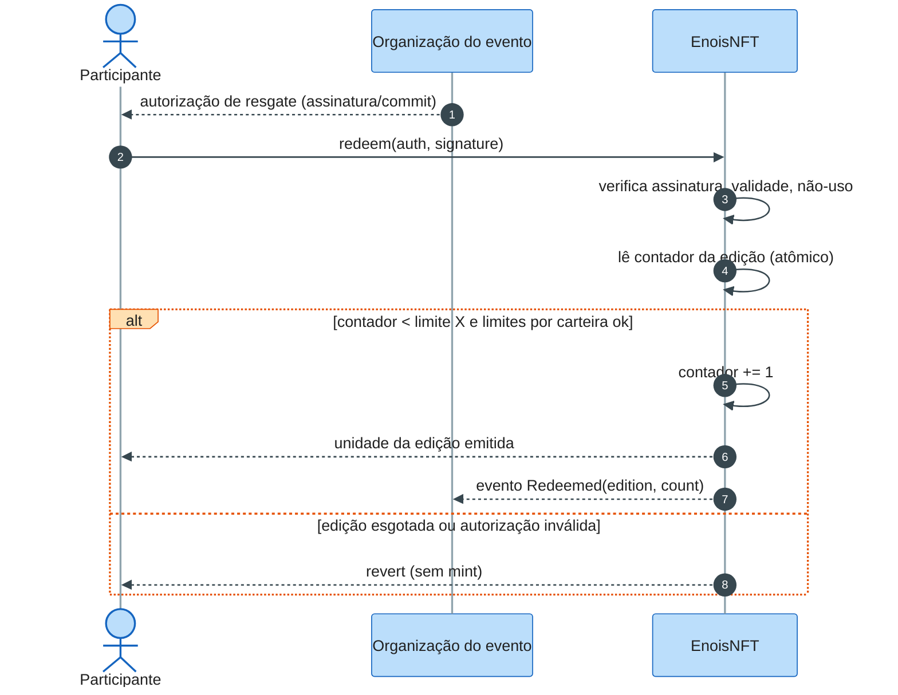

A autorização de resgate é vinculada a carteira, campanha e rede, com prazo e
nonce — nunca um código em texto aberto copiável do mempool. O contrato
incrementa o contador da edição **na mesma transação** em que minta: não
existe janela em que dois resgates concorrentes ultrapassem o limite `X`.

"Primeiros X" é definido estritamente pela ordem de execução on-chain —
front-running de clique não existe; o que existe é disputa de inclusão no
bloco, mitigada pelo vínculo da autorização à carteira específica e por
limites por endereço.

---

## SD-06 — Saque administrativo (multisig + timelock)

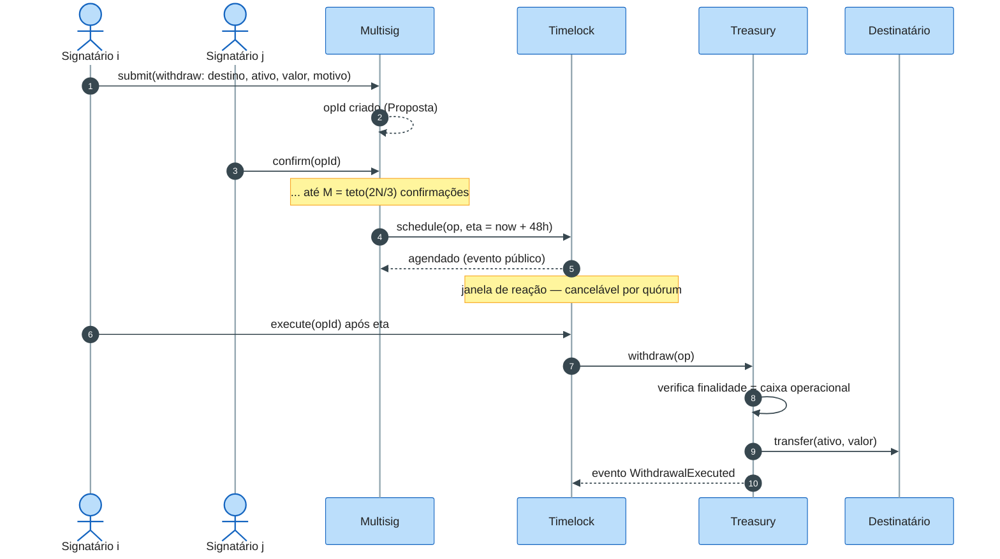

Nenhuma chave move recursos sozinha: a operação só agenda depois de atingir
`M = teto(2N/3)` confirmações sobre o **total** de signatários. O timelock
transforma a aprovação em fato público com 48h de antecedência — janela em
que a própria governança pode cancelar uma proposta comprometida.

Na execução, a `Treasury` ainda verifica a finalidade: saques
administrativos saem do caixa operacional, nunca da reserva do swap nem do
capital de investimento. Todo o trajeto — proposta, confirmações, agenda,
execução — é trilha de eventos auditável pelo dashboard.

---

## SD-07 — Alocação em adapter de investimento

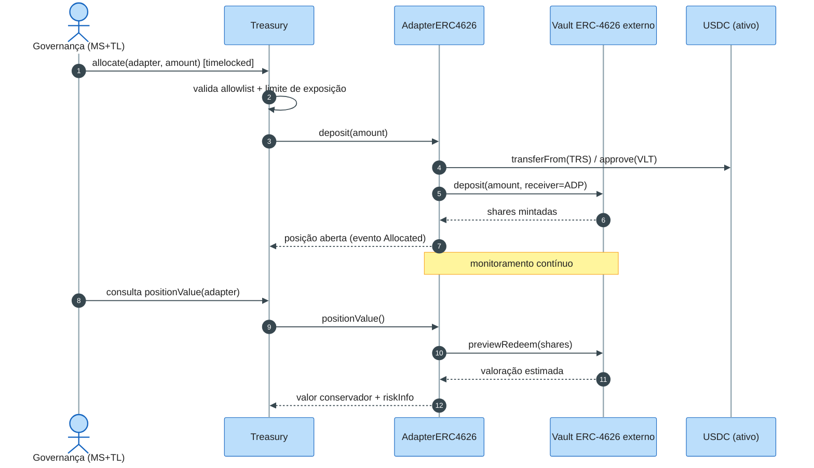

A alocação verifica no contrato duas condições antes de mover capital: o
adapter consta na allowlist e o valor respeita o limite de exposição
configurado. O adapter converte a chamada padronizada `deposit` no protocolo
específico — aqui, um vault ERC-4626 que devolve shares.

A valoração é conservadora: `positionValue` consulta o resgate estimado do
vault e o reporta junto a `riskInfo`, sem que a tesouraria trate a cota como
liquidez garantida. Rendimentos e perdas são reportados por período; o
destino de resultados é decisão de governança, não do adapter.

---

## SD-08 — Compra de produto no site com Faísca/USDC/BRLA

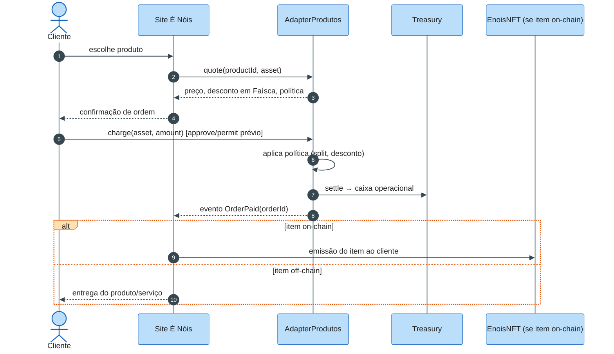

O adapter de produto é a ponte entre catálogo e liquidação: `quote` informa
preço e política (inclusive desconto para pagamento em Faísca), `charge`
cobra no ativo escolhido e `settle` encaminha à tesouraria como caixa
operacional — segregado, contabilizado, auditável.

A entrega desacopla do pagamento: itens on-chain (NFT comprável, edição
especial) são emitidos a partir do evento `OrderPaid`; itens off-chain seguem
o fulfillment do site. `refund(orderId)` cobre a política de reembolso —
restrito a condições configuradas e a operadores autorizados.

---

## SD-09 — Premiação recorrente por holding de NFT

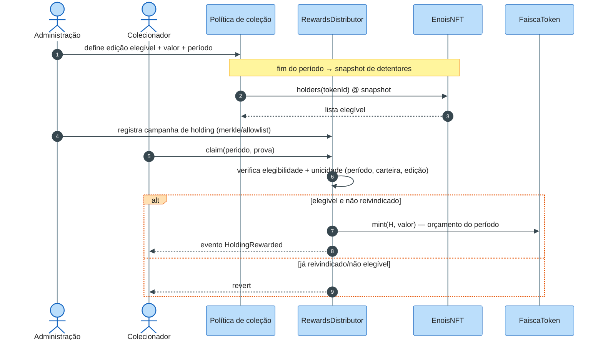

A premiação por holding começa com a política: quais edições geram Faísca,
quanto e com que periodicidade. O snapshot apura os detentores elegíveis na
altura definida — posse verificada on-chain, sem depender de lista externa
editável.

A distribuição usa o mesmo `RewardsDistributor` das demais premiações, com
identificador composto por período + carteira + edição para impedir claims
duplos entre períodos. O orçamento de emissão do período cobre essas
premiações junto às demais, mantendo o controle inflacionário unificado.

---

## SD-10 — Pausa emergencial e retomada

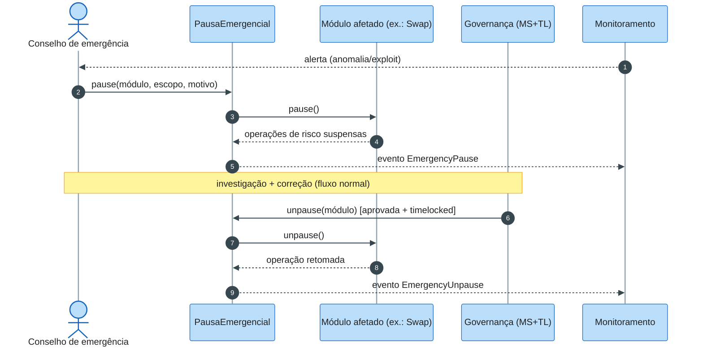

A pausa é deliberadamente **assimétrica**: acionar é rápido e restrito ao
conselho de emergência; retomar exige o fluxo completo de governança. O
conselho pode suspender swaps, mints, claims ou um adapter — e nada mais:
saque, upgrade e alteração de papéis seguem fora de seu alcance.

O evento público dispara o runbook de incidente: causa-raiz, correção
(eventualmente via upgrade timelocked) e comunicação à comunidade. A retomada
timelocada dá à rede tempo de verificar que a correção é legítima — a
estrutura pressupõe que o conselho pode ser ágil para conter, mas nunca para
concluir sozinho.

---

## SD-11 — Migração 1:1 da Faísca Web2

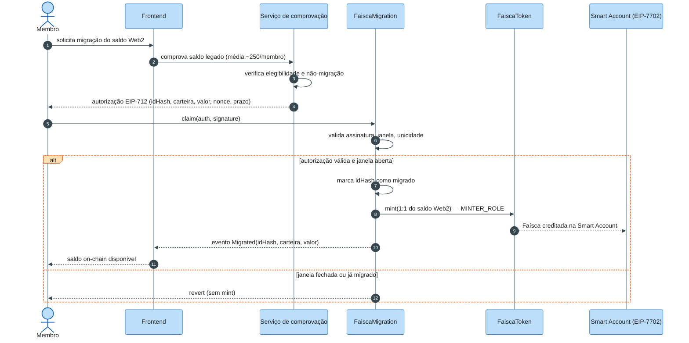

A migração replica o trilho de premiações: o saldo simbólico da Web 2 é
comprovado off-chain e autorizado por assinatura EIP-712 que vincula
identidade (hash), carteira de destino e valor exato — sempre na razão 1:1.
O identificador de migração é único por identidade: saldo migrado não migra
de novo, e a janela é controlada pela governança.

O destino preferencial é a Smart Account custodiada do membro — sem exigir
que ele já conheça carteiras. A emissão entra no orçamento do período; a
referência interna de R$ 0,01 por Faísca orienta a política, mas o preço de
mercado continuará sendo formado no swap.

---

## SD-12 — Exportação de chave da Smart Account

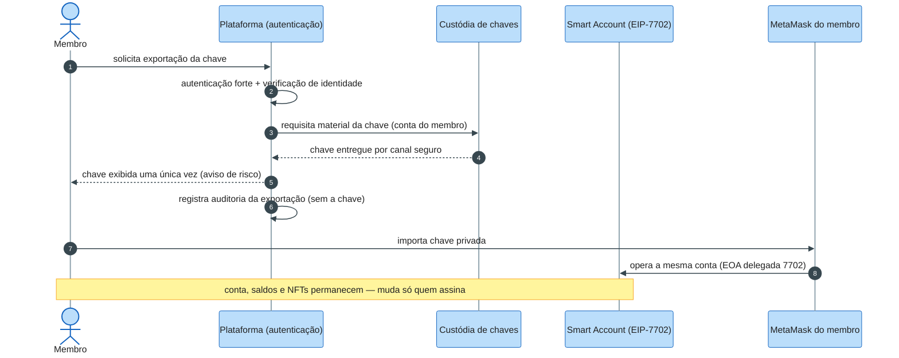

A custódia é desenhada como fase de entrada, não como aprisionamento: o
membro autenticado pode exportar a chave privada da sua Smart Account e
assumir a autocustódia. Como a conta segue o modelo EIP-7702 (EOA com
delegação), a mesma chave continua controlando a mesma conta — saldos,
NFTs e autorizações on-chain não se perdem na transição.

O evento de exportação é auditado sem expor a chave (nem em logs, nem em
telas administrativas). Após a exportação, a responsabilidade pela chave é
integralmente do membro: a plataforma deixa de poder agir em seu nome —
princípio "a chave é sua" respeitado por construção, não por promessa.

---

## SD-13 — Corredor fiat ⇄ tesouraria

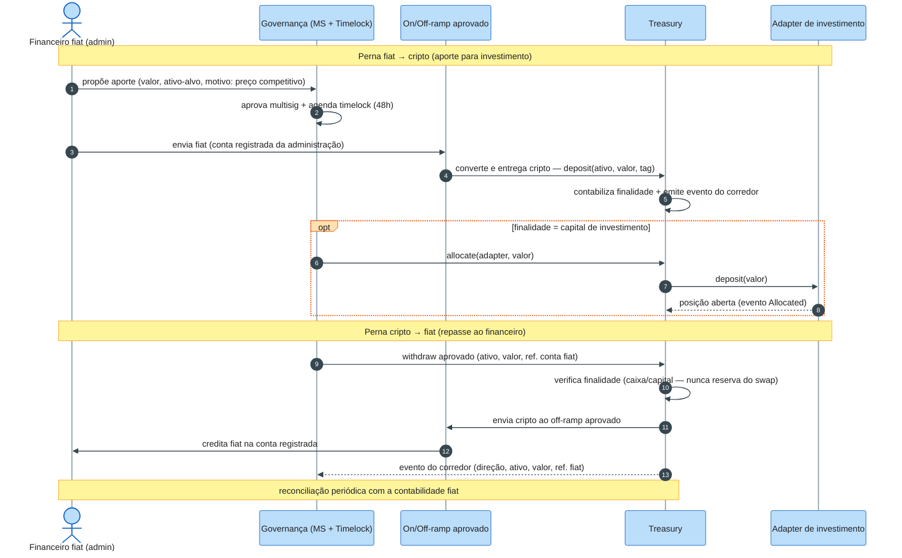

O corredor move **capital próprio da administração** nas duas direções, e
cada perna é uma operação de governança completa — proposta, quórum
`M = teto(2N/3)` e timelock. No aporte fiat→cripto, a conversão passa por
canal aprovado e o ativo entra na `Treasury` como depósito identificado por
tag de finalidade; quando a finalidade é investimento, a alocação a um
adapter da allowlist segue o mesmo fluxo do SD-07.

Na perna de saída, o `withdraw` referencia a conta fiat registrada que
receberá o valor convertido — o off-ramp é provedor externo aprovado, não
componente do contrato. O evento do corredor carrega direção, ativo, valor
e referência da operação fiat, permitindo a reconciliação periódica com a
contabilidade off-chain; divergências entram no runbook de incidentes.

---

## SD-14 — Registro de módulo de NFT (jogo GameFi)

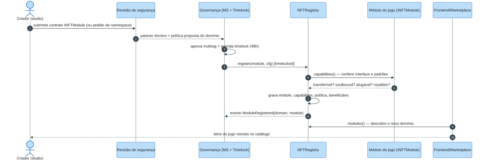

O onboarding de um jogo começa off-chain: o criador apresenta o contrato do
módulo — dedicado ao jogo ou namespace no `EnoisGameAssets` — e a política
comercial pretendida. A revisão de segurança (auditoria quando exigida) gera
o parecer que embasa a decisão de governança; como toda mudança sensível, o
registro passa por multisig e timelock.

Na execução, o `NFTRegistry` confere que o módulo responde a `INFTModule`,
grava as *capabilities* declaradas (que definem se seus itens podem ser
transferidos, alugados, gerar royalties) e o beneficiário do criador que
receberá os splits. O evento público permite que frontend e marketplace
descubram o domínio sem qualquer configuração manual — e, se necessário,
pausá-lo ou removê-lo isoladamente.

---

## SD-15 — Aluguel de NFT de jogo

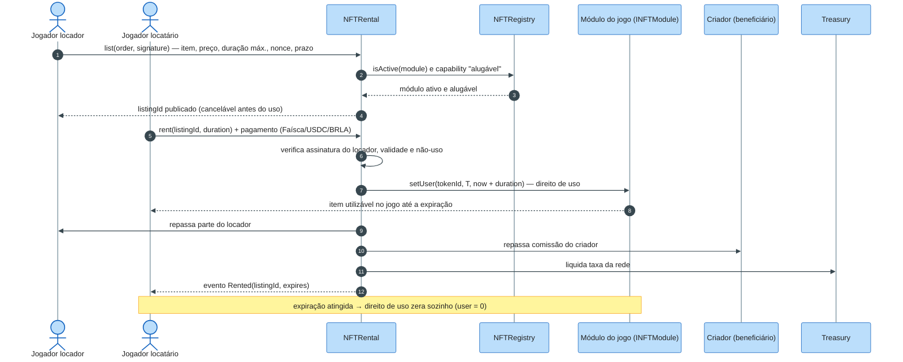

A listagem é uma ordem assinada pelo locador — EIP-712 com item, preço,
duração máxima e validade — cancelável a qualquer momento antes do primeiro
uso. O `NFTRental` só prossegue se o módulo estiver ativo no `NFTRegistry`
**e** tiver declarado a *capability* de aluguel: coleções soulbound jamais
entram no mercado.

No `rent`, o contrato verifica a assinatura, concede o direito de uso no
módulo do jogo (`user` com expiração, modelo ERC-4907) e liquida o pagamento
em splits atômicos: parte do locador, comissão do criador e taxa da rede à
tesouraria — tudo na mesma transação, sem repasses posteriores. Quando o
prazo termina, o direito de uso expira por si só: o NFT nunca saiu da
carteira do dono, que pode listá-lo novamente.

---

## SD-16 — Transferência P2P de Faísca (estilo Pix)

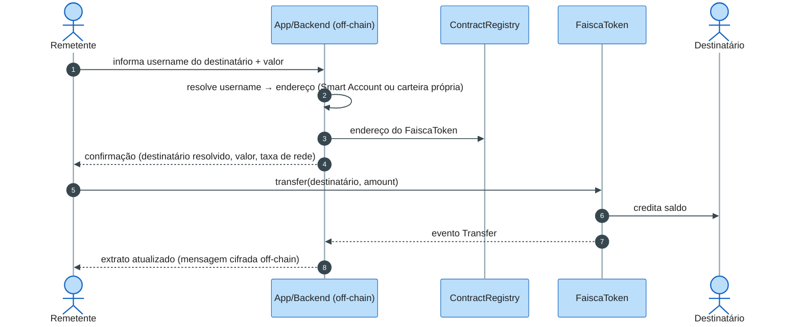

A resolução de identidade **permanece off-chain**: o contrato só conhece
endereços (RF-FAI-11), e o backend é quem traduz username → endereço —
cobrindo Smart Account custodiada e carteiras próprias indistintamente.

A `transfer` é uma operação ERC-20 pura: **final e irreversível** (RF-FAI-10).
Na Web 2 a transferência era contestável por 7 dias; on-chain, essa proteção
só existe onde há custódia intermediária — o escrow do SD-17 — e não no envio
livre. A mensagem do lançamento segue cifrada fora da cadeia, como hoje.

---

## SD-17 — Compra com escrow (marketplace e serviços)

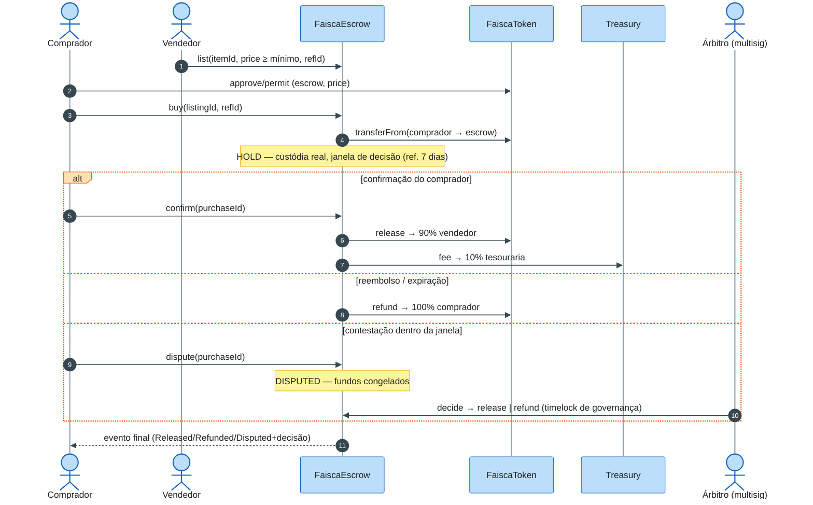

O `FaiscaEscrow` materializa on-chain o que a Web 2 fazia como lançamentos
contábeis (`ESCROW_HOLD/OUT/RELEASE/IN`, `FEE_IN`): a Faísca sai de fato do
saldo do comprador e fica custodiada pelo contrato até o desfecho — com a
mesma semântica 90/10 + reembolso 100% e janela de 7 dias usada por
marketplace e serviços freelance.

A disputa transforma o `HOLD` em `DISPUTED` e transfere o desfecho ao árbitro
multisig — a versão Web 3 da contestação administrativa da Web 2, limitada ao
que está em custódia. `refId` único garante idempotência; entrega de serviço
é declarada off-chain e é pré-condição para release pelo comprador
(RF-ESC-07), nunca condição que o contrato verifica sozinho.

---

## SD-18 — Gasto em jogo e impulso (boost)

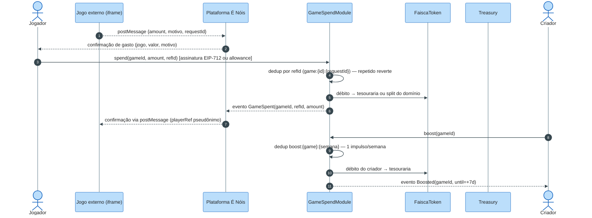

O modelo da Web 2 — *o jogo pede, o jogador confirma na plataforma* — vira
garantia criptográfica: o servidor do jogo nunca debita por conta própria
(RF-GAM-15). A confirmação do jogador materializa-se como assinatura EIP-712
(ou allowance limitado por módulo), e o `refId` do jogo dá a mesma
idempotência que a `idempotency_key` da Web 2 — pedido repetido não cobra de
novo.

O impulso usa a própria semântica Web 2 (dedup `boost:{game}:{semana}`, 5
Faíscas por 7 dias como referência de política) e também é débito do criador
para a tesouraria. O destino do gasto em jogo — tesouraria × split ao criador
— é política do domínio (RF-GAM-17, decisão D-12); o `playerRef` segue
pseudônimo, sem dados pessoais on-chain.

---

## Matriz de rastreabilidade

| Sequência | Caso de uso | Requisitos-chave |
|---|---|---|
| SD-01 | UC-01 | RF-INT-01..04 |
| SD-02 | UC-02 | RF-SWP-01..07, RF-FAI-06 |
| SD-03 | UC-04 | RF-PRE-01..04, RF-FAI-03 |
| SD-04 | UC-06 | RF-NFT-01/03/04/08, RF-PRE-01 |
| SD-05 | UC-07 | RF-NFT-05..07, RNF-03 |
| SD-06 | UC-10 | RF-TRS-02/03, RF-GOV-01/02/07 |
| SD-07 | UC-11 | RF-ADT-01..05/07, RF-TRS-06 |
| SD-08 | UC-09 | RF-ADT-02/08, RF-TRS-02, RF-INT-02 |
| SD-09 | UC-08 | RF-NFT-09, RF-PRE-03/08 |
| SD-10 | UC-14 | RF-GOV-03, RF-FAI-07, RNF-10 |
| SD-11 | UC-16 | RF-MIG-01..09, RF-WAL-07 |
| SD-12 | UC-17 | RF-WAL-02/03/04/06, RNF-08 |
| SD-13 | UC-18 | RF-FIA-01..08, RF-TRS-02/03, RF-GOV-02 |
| SD-14 | UC-19 | RF-GAM-01..05, RF-GAM-10/12, RF-NFT-12 |
| SD-15 | UC-20 | RF-GAM-06..08, RF-GAM-11, RF-TRS-02/07 |
| SD-16 | UC-21 | RF-FAI-10/11, RF-INT-04 |
| SD-17 | UC-22, UC-23, UC-25 | RF-ESC-01..08, RF-TRS-02 |
| SD-18 | UC-24 | RF-GAM-15..17, RF-GAM-09 |

## Changelog

| Data | Versão | Descrição |
|---|---|---|
| 2026-10-23 | 0.1.0 | Versão inicial dos diagramas de sequência. |
| 2026-10-23 | 0.2.0 | SD-11 (migração Faísca Web2 1:1) e SD-12 (exportação de chave da Smart Account); tema de cores aplicado. |
| 2026-10-23 | 0.3.0 | SD-13: corredor fiat ⇄ tesouraria — pernas fiat→cripto (aporte para investimento) e cripto→fiat (repasse a contas registradas) sob governança e reconciliação. |
| 2026-10-23 | 0.4.0 | SD-14 (registro de módulo de NFT/jogo no NFTRegistry) e SD-15 (aluguel de NFT de jogo com direito de uso ERC-4907 e splits atômicos). |
| 2026-10-23 | 0.5.0 | Levantamento Faísca Web 2: SD-16 (transferência P2P estilo Pix irreversível), SD-17 (compra com escrow — marketplace e serviços, 90/10, disputa arbitral), SD-18 (gasto em jogo autorizado + boost semanal). |

