# 07 — Normas ERC Utilizadas pelo Sistema

Catálogo dos padrões Ethereum Request for Comments (ERC/EIP) adotados ou
candidatos no ecossistema É Nóis, com o papel de cada um, os contratos que os
implementam e os cuidados de implementação. A compatibilidade EVM da rede Arc
permite adotar os padrões sem modificação.

## Mapa geral

```mermaid
flowchart TB
    subgraph Tokens["Padrões de token"]
        E20["ERC-20<br/>Faísca · USDC · BRLA"]
        E721["ERC-721<br/>NFTs únicos"]
        E1155["ERC-1155<br/>Edições de NFTs"]
        E4626["ERC-4626<br/>Vaults de investimento"]
    end

    subgraph Suporte["Introspecção e metadados"]
        E165["ERC-165<br/>supportsInterface"]
        E2981["ERC-2981<br/>Royalties"]
        E5192["ERC-5192<br/>Soulbound"]
        E4907["ERC-4907<br/>NFT alugável (user)"]
    end

    subgraph Assinaturas["Assinaturas e autorizações"]
        E712["EIP-712<br/>Dados tipados"]
        E2612["ERC-2612<br/>permit()"]
        E1271["ERC-1271<br/>Assinatura de contrato"]
    end

    subgraph Contas["Contas e carteiras"]
        E7702["EIP-7702<br/>Delegação de EOA"]
    end

    subgraph Upgrades["Upgradeabilidade"]
        E1967["ERC-1967<br/>Slots de proxy"]
        E1822["ERC-1822<br/>UUPS"]
        E2535["ERC-2535<br/>Diamond"]
        E170["EIP-170<br/>Limite 24KB"]
    end

    FAI["FaiscaToken"] --> E20 & E2612
    NFT["EnoisNFT"] --> E1155 & E721 & E165 & E2981 & E5192
    MOD["Módulos de jogo<br/>(INFTModule)"] --> E1155 & E721 & E165 & E2981 & E4907
    RENT["NFTRental"] --> E4907 & E712 & E2612
    NREG["NFTRegistry"] --> E165
    ADP["Adapters de investimento"] --> E4626
    PRE["RewardsDistributor"] --> E712 & E1271
    MIG["FaiscaMigration"] --> E712
    ESC["FaiscaEscrow"] --> E20 & E712
    GSP["GameSpendModule"] --> E712
    SA["Smart Accounts<br/>custodiadas"] --> E7702
    ALL["Contratos upgradeáveis"] --> E1967 & E1822 & E2535 & E170

    classDef token fill:#FFF59D,stroke:#F9A825,stroke-width:2px,color:#212121;
    classDef contract fill:#BBDEFB,stroke:#1565C0,stroke-width:1px,color:#212121;
    classDef adapter fill:#E1BEE7,stroke:#6A1B9A,stroke-width:1px,color:#212121;
    classDef external fill:#CFD8DC,stroke:#455A64,stroke-width:1px,color:#212121;
    classDef offchain fill:#B2DFDB,stroke:#00695C,stroke-width:1px,color:#212121;

    class E20 token;
    class E721,E1155,E4626 contract;
    class E165,E2981,E5192,E4907 external;
    class E712,E2612,E1271,E7702 offchain;
    class E1967,E1822,E2535,E170 external;
    class FAI token;
    class NFT,MIG,ALL,NREG,RENT,ESC,GSP contract;
    class ADP,MOD adapter;
    class PRE contract;
    class SA offchain;

    style Tokens fill:#E3F2FD,stroke:#1E88E5,stroke-width:2px,color:#212121;
    style Suporte fill:#ECEFF1,stroke:#607D8B,stroke-width:2px,color:#212121;
    style Assinaturas fill:#E0F2F1,stroke:#00897B,stroke-width:2px,color:#212121;
    style Contas fill:#E0F2F1,stroke:#00897B,stroke-width:2px,color:#212121;
    style Upgrades fill:#ECEFF1,stroke:#607D8B,stroke-width:2px,color:#212121;
```

---

## ERC-20 — Token fungível

**O que é.** O padrão fundamental de tokens fungíveis: `transfer`,
`approve`/`transferFrom`, `balanceOf`, `totalSupply`, eventos
`Transfer`/`Approval`.

**Uso no sistema.** É a base de três ativos:

- **Faísca** — implementação própria upgradeável com mint/burn por papel,
  orçamento de emissão, pausa seletiva e `permit`.
- **USDC** — ativo externo de reserva do swap e numerário da tesouraria; na
  Arc, também gas nativo.
- **BRLA** — ativo externo para doações e vendas em reais.

**Cuidados.** Integrações devem tolerar tokens não-padrão (`transfer` sem
retorno booleano — usar `SafeERC20`), fee-on-transfer e comportamento de
rebasing. USDC e BRLA são tratados como **não confiáveis por padrão**:
saldos medidos antes/depois, nunca presumidos. A ausência de teto da Faísca
exige que o controle inflacionário viva na política de emissão, não no tipo
do token.

**Contratos:** `FaiscaToken`, `EnoisSwap`, `Treasury`, adapters.

---

## ERC-165 — Introspecção de interfaces

**O que é.** `supportsInterface(bytes4)` — permite a qualquer chamador
descobrir quais interfaces um contrato implementa.

**Uso no sistema.** Obrigatório para que carteiras (MetaMask), marketplaces
e a própria tesouraria reconheçam `EnoisNFT` como ERC-1155/721/2981 e os
adapters como `IInvestmentAdapter`/`IProductAdapter`. A allowlist de adapters
pode validar `supportsInterface` no registro como checagem de sanidade.

**Cuidados.** `supportsInterface` prova declaração, não comportamento — um
adapter malicioso pode anunciar a interface e desviar fundos. A checagem é
complementar à revisão de código e à allowlist, nunca substituta.

**Contratos:** todos os tokens, NFTs e adapters.

---

## ERC-721 — NFT de unidade única

**O que é.** Cada `tokenId` é único e indivisível, com `ownerOf`, `tokenURI`
e transferências seguras (`safeTransferFrom` + `onERC721Received`).

**Uso no sistema.** Reservado a itens **individualizados**: peças únicas de
coleções especiais, honrarias numeradas, itens compráveis exclusivos. A
maioria das conquistas usa ERC-1155 (edições); ERC-721 entra quando a
unicidade é o valor.

**Cuidados.** Receptores contrato devem implementar o receiver; metadados
precisam de política de persistência (IPFS/Arweave + fallback). Sem dados
pessoais no `tokenURI`.

**Contratos:** `EnoisNFT` (coleções ERC-721), adapters de produto que vendem
itens únicos.

---

## ERC-1155 — Multi-token (edições)

**O que é.** Um contrato gerencia múltiplos `tokenId` fungíveis ou não
fungíveis em lote: `balanceOf(owner, id)`, `safeBatchTransferFrom`, `uri(id)`.

**Uso no sistema.** **Padrão principal dos NFTs É Nóis.** Uma conquista como
"Perfil Completo" é um `tokenId`; cada membro premiado recebe uma unidade —
edições ilimitadas ou capadas por coleção, num único contrato gas-eficiente.

**Cuidados.** Transferibilidade por coleção exige interceptar
`_beforeTokenTransfer`/`safeTransferFrom` — a política soulbound vive no
hook, não na interface. `uri(id)` deve suportar metadados por edição com
template de ID. Receptores contrato precisam implementar
`onERC1155Received`/`onERC1155BatchReceived`.

**Contratos:** `EnoisNFT` (núcleo), `RewardsDistributor` (mint autorizado),
adapters de produto.

---

## ERC-2981 — Royalties de NFT

**O que é.** `royaltyInfo(tokenId, salePrice)` — informa a quem e quanto
pagar de royalty numa venda secundária.

**Uso no sistema.** Candidato para coleções **colecionáveis e compráveis**:
vendas secundárias podem direcionar royalty à tesouraria, formando receita
recorrente alinhada à comunidade. Conquistas intransferíveis não têm
mercado secundário, logo não usam o padrão.

**Cuidados.** O padrão é **informativo** — marketplaces podem ignorá-lo.
Royalty não deve ser projetado como receita garantida; políticas comerciais
não podem depender dele para fechar caixa.

**Contratos:** `EnoisNFT` (coleções com royalty), adapters de produto.

---

## ERC-5192 — Soulbound (NFT intransferível)

**O que é.** Extensão mínima para NFTs "vinculados à alma": `locked(tokenId)`
e eventos `Locked`/`Unlocked`, sinalizando a carteiras e indexadores que o
token não se transfere.

**Uso no sistema.** Conquistas de reconhecimento — *Perfil Completo*, *Admin
de Comunidade*, *Membro Mais Ativo do Período* — são soulbound por política
de coleção: representam a pessoa/participação, não um ativo negociável.

**Cuidados.** O bloqueio de transferência precisa existir no hook de
transferência; ERC-5192 apenas **sinaliza**. Revogação (admin de comunidade
que deixa a função) deve ser prevista por `burn` administrativo, com critério
público por coleção.

**Contratos:** `EnoisNFT` (coleções soulbound).

---

## ERC-4907 — NFT alugável (direito de uso temporário)

**O que é.** Extensão dos padrões de NFT que separa **titularidade**
(`ownerOf`) de **uso** (`userOf`): `setUser(tokenId, user, expires)`,
`userOf(tokenId)` e o evento `UpdateUser`. O "usuário" detém o direito de
uso até a expiração gravada on-chain — vencido o prazo, `userOf` retorna
zero, sem transação de devolução.

**Uso no sistema.** Base do aluguel de itens de jogo no `NFTRental`: o
locador **mantém a titularidade** — o NFT não sai da carteira, sem custódia
nem depósito de garantia — e o locatário recebe o direito de uso que os
jogos respeitam durante o período contratado. Somente módulos `INFTModule`
que declararem a *capability* alugável no `NFTRegistry` participam do
mercado; conquistas soulbound ficam fora por construção.

**Cuidados.** O padrão grava a expiração, mas **quem a honra é o consumidor**:
jogos e serviços devem consultar `userOf`/`expires` — e não apenas `ownerOf`
— para habilitar funcionalidades do item; uma expiração ignorada quebra o
modelo. Direito de uso não é transferência: a venda do NFT durante o aluguel
deve limpar ou preservar o `user` conforme política documentada do módulo.
`expires` é `uint64` em segundos Unix; as listagens do `NFTRental` são
ordens assinadas (EIP-712) com nonce e prazo, canceláveis antes do uso.

**Contratos:** `NFTRental`, `EnoisGameAssets` e demais módulos de jogo com a
capability alugável; `EnoisNFT` se alguma coleção comunitária optar por ser
alugável.

---

## ERC-4626 — Vaults tokenizados

**O que é.** Padrão de cofres: deposita-se um `asset`, recebe-se `shares`;
`deposit`, `mint`, `withdraw`, `redeem`, `convertToAssets`, `preview*`.

**Uso no sistema.** Interface-alvo do `AdapterERC4626`: qualquer vault
compatível (yield, lending, RWA tokenizado) pode receber capital de
investimento da tesouraria **mediante adapter na allowlist**, com limite de
exposição.

**Cuidados.** O padrão uniformiza a API, **não os riscos** — protocolo,
emissor, custódia e liquidez diferem por vault. Cuidados obrigatórios:
ataque de inflação de shares (primeiro depositante), arredondamento de
`convertTo*`, `preview*` vs. execução real, filas de resgate e pausas
externas. `positionValue` deve ser conservador.

**Contratos:** `AdapterERC4626`, demais adapters de investimento, `Treasury`
(consumidora de `positionValue`).

---

## EIP-712 — Assinatura de dados tipados

**O que é.** Padrão para assinar dados estruturados com domínio separador
(nome, versão, chainId, contrato verificador), eliminando replay entre redes
e contratos.

**Uso no sistema.** Base de **todas as autorizações off-chain**: o serviço
de comprovação assina `RewardAuth` (premiações), `MintAuth` (NFTs) e
`RedeemAuth` (resgates de evento) com nonce, deadline e identificador de
campanha. Na economia do legado Web 2 ([doc 08](08-levantamento-web2-faisca.md)),
o EIP-712 também carrega a **confirmação do titular no gasto em jogo**
(`GameSpendModule.spend`) — o jogo externo só pede; quem autoriza é o jogador
— e autorizações de listagem/aceite do `FaiscaEscrow` quando a operação
chega por canal assinado em vez de transação direta.

**Cuidados.** `DOMAIN_SEPARATOR` deve incluir chainId — autorização da
testnet não vale na mainnet. Nonces são por autorização, não sequenciais
globais, para permitir emissão paralela. Deadline curto reduz janela de
abuso; `chainId` errado ou upgrade de domínio invalida assinaturas pendentes
— comportamento desejado. O `refId` do gasto em jogo é parte do payload
assinado: reutilizá-lo em outro jogo ou repeti-lo é rejeitado por dedup
(RF-GAM-15).

**Contratos:** `RewardsDistributor`, `EnoisNFT` (resgates), `GameSpendModule`
(gasto autorizado pelo titular), `FaiscaEscrow` (autorizações assinadas),
adapters de produto que aceitam autorizações.

---

## ERC-2612 — Permit (approve por assinatura)

**O que é.** Extensão ERC-20: `permit(owner, spender, value, deadline, v, r, s)`
autoriza gasto via assinatura EIP-712, sem transação de `approve` separada.

**Uso no sistema.** Melhora a UX do swap e dos checkouts: o usuário assina a
aprovação e submete uma única transação. A Faísca implementa `permit`; USDC
e BRLA já o suportam nativamente (FiatToken V2+), permitindo fluxo de uma
transação só também no pagamento.

**Cuidados.** Nem todo ERC-20 implementa `permit` — o frontend deve detectar
e cair para `approve` tradicional. `permit` consome nonce por assinatura;
frontera de expiração (`deadline`) evita autorização pendente indefinida.

**Contratos:** `FaiscaToken` (implementa), `EnoisSwap` e adapters de produto
(consumidores).

---

## ERC-1271 — Validação de assinatura por contrato

**O que é.** `isValidSignature(hash, signature)` — permite que **contratos**
(multisig, treasury, smart wallets) "assinem" autorizações verificáveis.

**Uso no sistema.** Duas direções: (1) autorizações emitidas **para**
contratos — um membro com smart wallet resgata NFT igual a qualquer EOA;
(2) quando a tesouraria ou o multisig precisar assinar algo em nome do
sistema (ex.: registro em serviço externo), ERC-1271 é o mecanismo.

**Cuidados.** Verificar assinatura de contrato custa mais gas e pode falhar
em carteiras antigas — os fluxos de claim/redeem devem tratar ERC-1271 como
caminho secundário ao ECDSA de EOA, nunca obrigatório.

**Contratos:** `Multisig`, `Treasury` (emissores), `RewardsDistributor`,
`EnoisNFT` (verificadores).

---

## EIP-7702 — Delegação de EOA (set code)

**O que é.** Tipo de transação `0x04` em que uma **EOA assina uma
autorização delegando sua execução a código de um contrato** — a conta
permanece EOA (mesma chave, mesmo endereço) mas passa a operar como smart
account: batch de chamadas, gas patrocinado, regras de sessão, recovery.

**Uso no sistema.** Modelo de referência das **Smart Accounts custodiadas**:
cada membro recebe uma conta criada com o perfil Web 2, que a plataforma
custodia para eliminar fricção de entrada. A chave privada é **exportável**
— e, por ser uma EOA no modelo 7702, o membro que exporta a chave assume a
mesma conta on-chain em qualquer carteira compatível, sem migração de
saldos.

**Relação com ERC-4337.** O ERC-4337 implementa abstração de conta via
mempool alternativa e contratos dedicados; o EIP-7702 delega a EOA em si.
Nosso desenho prefere 7702 pela portabilidade da chave; fallback para
modelo custodial clássico ou 4337 é a decisão aberta D-06, dependente do
suporte da rede Arc a transações tipo 0x04.

**Cuidados.** Autorizações 7702 são alvo de phishing — a plataforma não deve
solicitar assinatura de delegação além do contrato de conta previsto.
Delegação pode ser substituída por nova autorização: o design de sessões e
patrocínio precisa revalidar a implementação vigente. Suporte da Arc e das
carteiras (incluindo MetaMask) a 0x04 deve ser confirmado antes do
lançamento; a exportação de chave não depende dele.

**Contratos:** infraestrutura de Smart Accounts (off-chain + delegação);
consumido por `RewardsDistributor`, `FaiscaMigration` e demais fluxos que
operam contas de membros.

---

## ERC-1967 — Slots de armazenamento de proxy

**O que é.** Define os slots padrão onde proxies guardam `implementation`,
`admin` e `beacon` — permitindo que exploradores e ferramentas reconheçam e
leiam proxies.

**Uso no sistema.** Toda a constelação upgradeável armazena seus ponteiros
nos slots ERC-1967, tornando verificável on-chain qual implementação atende
cada proxy — transparência essencial durante o timelock de upgrade.

**Cuidados.** Implementações jamais devem escrever nos slots reservados;
colisões de slot são bug fatal. Ferramentas (OpenZeppelin upgrades) validam
automaticamente — usar sempre, nunca manipular slots manualmente.

**Contratos:** todos os proxies UUPS e/ou o Diamond.

---

## ERC-1822 — UUPS (Universal Upgradeable Proxy Standard)

**O que é.** Padrão de proxy em que a **lógica de upgrade vive na
implementação** (`proxiableUUID`), não no proxy — mais enxuto que proxies
administrados.

**Uso no sistema.** **Opção B** da decisão de upgradeabilidade: cada
contrato core atrás de seu proxy UUPS, com `_authorizeUpgrade` restrito ao
timelock — a autorização de upgrade vive no código, mas só a governança a
alcança.

**Cuidados.** Uma implementação que esquece de implementar/preservar o
mecanismo de upgrade **congela** o proxy permanentemente. Inicializadores
precisam de `_disableInitializers` no construtor da implementação; testes de
preservação de storage são obrigatórios a cada versão.

**Contratos:** todos os módulos upgradeáveis (se UUPS for a decisão D-01).

---

## ERC-2535 — Diamond (multi-facet proxy)

**O que é.** Proxy modular: um endereço delega a múltiplas **facets** conforme
o seletor de função; `diamondCut` adiciona/substitui/remove facets;
`diamondLoupe` lista o que está exposto.

**Uso no sistema.** **Opção A** da decisão de upgradeabilidade: um núcleo
Diamond cujos facets cobrem token, swap, tesouraria e NFTs — upgrades
granulares por facet e contorno natural do limite de 24KB.

**Cuidados.** Storage compartilhado entre facets exige disciplina
(AppStorage/Diamond Storage) — colisão entre facets é o modo clássico de
falha. `diamondCut` irrestrito é root total: só timelock. Auditoria de
Diamond é mais especializada e cara; a decisão deve pesar isso contra a
simplicidade de UUPS isolado. **"Diamond Proxy UUPS" não é padrão** — a
combinação só entra com justificativa explícita.

**Contratos:** `Diamond`, facets por domínio (se Diamond for a decisão D-01).

---

## EIP-170 — Limite de tamanho de contrato (24KB)

**O que é.** Restrição de protocolo: bytecode implantado ≤ 24.576 bytes.

**Uso no sistema.** Restrição de design: módulos grandes (EnoisNFT com
políticas, Treasury com relatórios) devem ser decompostos em bibliotecas,
contratos satélite ou facets — e o build deve falhar em CI se o limite for
atingido.

**Cuidados.** Herança profunda infla o bytecode silenciosamente; medir o
tamanho por contrato a cada compilação (`hardhat-contract-sizer` ou
equivalente) e reportar no pipeline.

**Contratos:** todos.

---

## Conformidade por contrato

| Contrato | Padrões implementados | Padrões consumidos |
|---|---|---|
| FaiscaToken | ERC-20, ERC-2612, ERC-165 | — |
| EnoisNFT | ERC-1155, ERC-721, ERC-165, ERC-2981, ERC-5192 | EIP-712, ERC-1271 (verificação) |
| NFTRegistry | — | ERC-165 (conferência de módulos) |
| Módulos de jogo (`INFTModule`) | ERC-1155 e/ou ERC-721, ERC-165, ERC-4907 (se alugável), ERC-2981 | EIP-712 |
| NFTRental | — | ERC-4907, EIP-712, ERC-20/ERC-2612 (cobrança) |
| EnoisSwap | — | ERC-20 (USDC/Faísca), ERC-2612 |
| Treasury | ERC-1271 (emissor) | ERC-20, ERC-4626 (via adapters) |
| RewardsDistributor | — | EIP-712, ERC-1271 |
| AdapterERC4626 | IInvestmentAdapter | ERC-4626, ERC-20 |
| AdapterProdutos | IProductAdapter | ERC-20, ERC-2612, EIP-712 |
| Proxies | ERC-1967 + ERC-1822 **ou** ERC-2535 | — |
| Smart Accounts | EIP-7702 (+ ERC-4337 candidato) | — |
| FaiscaMigration | — | EIP-712, ERC-1271 |
| FaiscaEscrow | — | ERC-20 (custódia de Faísca), EIP-712, ERC-1271 |
| GameSpendModule | — | EIP-712 (autorização do titular), ERC-20 (débito) |

## Changelog

| Data | Versão | Descrição |
|---|---|---|
| 2026-10-23 | 0.1.0 | Versão inicial do catálogo de normas ERC. |
| 2026-10-23 | 0.2.0 | EIP-7702 (Smart Accounts), FaiscaMigration no mapa de conformidade, diagramas coloridos. |
| 2026-10-23 | 0.3.0 | ERC-4907 (direito de uso temporário para aluguel de NFTs), NFTRegistry e módulos `INFTModule` de jogo no mapa e na tabela de conformidade. |
| 2026-10-23 | 0.4.0 | Levantamento Faísca Web 2: `FaiscaEscrow` e `GameSpendModule` no mapa e na tabela de conformidade; EIP-712 estendido à confirmação do titular no gasto em jogo e às autorizações do escrow. |

