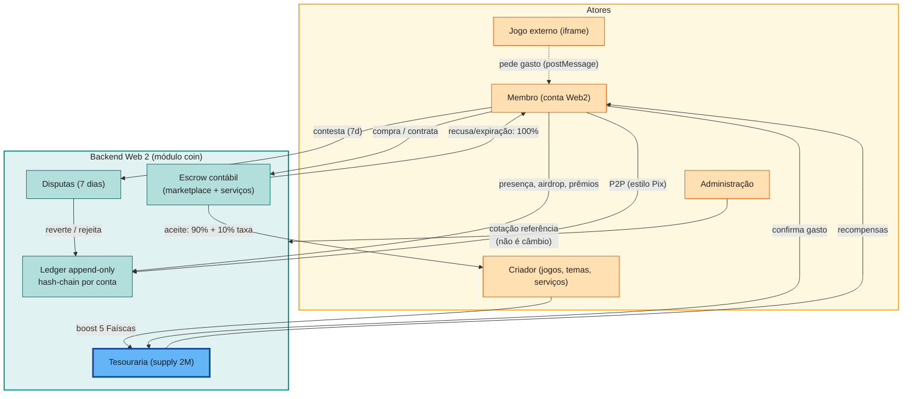

# 08 — Levantamento da Faísca na Web 2

Este documento registra o levantamento do **comportamento real da Faísca na
plataforma Web 2 em produção**, feito a partir do código-fonte público e do
site, como base para calibrar os requisitos do sistema econômico Web 3. Ele
distingue estritamente **o que já existe** (Web 2, evidenciado em código) de
**o que se propõe** (Web 3, decisões desta análise).

## 1. Escopo e fontes

| Fonte | Referência | Evidência |
|---|---|---|
| Site em produção | `enois.ia.br` | Página pública descreve Faísca, carteira com extrato, transferências instantâneas e "resgate em bens". |
| Backend | `github.com/Rede-ENois/enois-backend` | Commit `e84954f5` (main), Spring Boot 4 / Java 25, arquitetura hexagonal, MariaDB. Pacote econômico: `com.socialcoisa.rede.coin`. |
| Frontend | `github.com/Rede-ENois/enois-frontend` | Commit `c7694811` (main), React 19 + TanStack Start. Clientes de API: `lib/api/wallet.ts`, `marketplace.ts`, `services.ts`, `games.ts`, `seals.ts`. |
| Migrações | `src/main/resources/db/migration/` | `V69__coin_ledger.sql`, `V76__coin_rate.sql`, `V78__coin_disputes.sql`, `V79__game_boost.sql`, `V85__game_identity_tokens.sql`, `V143__marketplace_items.sql`, `V152__service_listing_currency.sql`. |

> **Nota de validade:** este levantamento é um *snapshot* do `main` público na
> data da coleta (2026-10-23). O comportamento em produção pode divergir do
> código conforme o deploy evolui; divergências relevantes devem ser revisadas
> antes de fechar parâmetros de migração.

## 2. O modelo contábil da Faísca na Web 2

A Faísca Web 2 **não é um número decorativo**: é um subsistema contábil
completo implementado no módulo `coin` do backend.

### 2.1. Ledger append-only com hash-chain

- `coin_entries` guarda lançamentos imutáveis com `amount`, `kind`, `ref_id`,
  `message` (cifrada em AES-GCM — conteúdo sensível nunca em claro),
  `idempotency_key` **única por conta** e `prev_hash`/`hash` **encadeados por
  conta**.
- `coin_accounts.balance` é um **snapshot** com versionamento otimista; a
  verdade é o ledger, reconstruível por job de reconciliação.
- **Unidade mínima:** mili-faísca (1/1000). `CoinService.FAIS(n)` multiplica
  por 1000 — ex.: o boost de jogo custa `5_000` mf = **5 Faíscas**.
- **Supply fixo:** 2 milhões de Faíscas emitidas no genesis
  (`GENESIS_TREASURY`), **sem emissão posterior**. Todas as "recompensas" são
  débitos da tesouraria — a Web 2 já implementa, em espírito, o orçamento de
  emissão exigido pela análise Web 3.

### 2.2. Tipos de lançamento (`CoinEntry.Kind`)

`AIRDROP`, `GENESIS_TREASURY`, `TRANSFER_IN`, `TRANSFER_OUT`, `REWARD`,
`PURCHASE`, `SALE`, `REFUND`, `REFUND_IN`, `ADJUSTMENT`, `ESCROW_OUT`,
`ESCROW_HOLD`, `ESCROW_RELEASE`, `ESCROW_IN`, `FEE_IN`, `REVERSAL_OUT`,
`REVERSAL_IN`.

### 2.3. Cotação de referência — não é câmbio

- `CoinRate.brlCents`: valor de referência **publicado por administração**,
  com histórico completo (`GET /coin/cotacao`, `POST /coin/cotacao` admin).
  Referência inicial: **1 centavo por Faísca** (R$ 0,01 — a mesma referência
  interna desta análise).
- O próprio código afirma: **"NÃO é câmbio"** — não existe compra de Faísca
  com dinheiro. A venda de Faísca por valor real é mencionada como fase futura
  **condicionada a parecer jurídico**.

## 3. Inventário: todas as formas de transacionar Faísca

| # | Fluxo | Endpoint / código | Regra econômica (parâmetro de referência) | Destino dos fundos |
|---|---|---|---|---|
| 1 | Transferência P2P | `POST /carteira/transferencias` | Estilo Pix por username; idempotente; **contestável por 7 dias** | Destinatário |
| 2 | Contestação de transferência | `/admin/carteira/disputas/{id}/deferir`·`/rejeitar` | Deferir reverte a transferência e pode restringir o suposto fraudador; rejeitar pode restringir o falso reclamante | Reversão administrativa |
| 3 | Airdrop de cadastro | interno (`CoinService`) | +100 Faíscas por usuário novo | Tesouraria → usuário |
| 4 | Presença diária | interno | +5/dia; bônus +25/semana | Tesouraria → usuário |
| 5 | Jogos diários (Palavras, Labirinto, Blocos) | módulo `dailygames` + schedulers | Prêmio por resultado | Tesouraria → usuário |
| 6 | Microprojetos | `MicroProjectService` | +200 ao profissional concluído; **máx. 3×/mês/profissional**; idempotente por projeto; pagamento real **fora** da plataforma | Tesouraria → profissional |
| 7 | Prêmios de evento/comunidade | `POST /carteira/premios` (admin) | Grant administrativo | Tesouraria → usuário |
| 8 | Loja de molduras (avatar) | seção "Loja" em `/carteira` | Compra direta de cosmético nativo | Tesouraria (sink) |
| 9 | Marketplace P2P | `POST /marketplace/{id}/buy`, `/confirm`, `/refund` | Preço mínimo **50** Faíscas; **escrow 7 dias**; confirmar → criador recebe **90%** (taxa 10%); reembolso → **100%**; itens: temas, banners, templates, páginas, posts, blogs, serviços | Comprador → escrow → criador + taxa |
| 10 | Serviços freelance | `/servicos/ofertas/{id}/contratar`, `/pedidos/{id}/escolher`, `/contratos/{id}/entregar`·`/aceitar`·`/reembolso` | Modelo Fiverr (ofertas, máx. 5 abertas) + pedidos com propostas em faixa; **escrow até aceite**; aceite → **90%** vendedor; recusa → **100%** comprador | Comprador → escrow → vendedor + taxa |
| 11 | Freelas (vagas de trabalho) | `FreelanceService` | `paymentMethod: CASH\|FAISCAS`, default **FAISCAS** — sinalização de intenção; liquidação fora da plataforma | Off-platform |
| 12 | Boost de jogo | `POST /games/{id}/boost` | **5 Faíscas** → topo do catálogo por **7 dias**; **1 boost/semana/jogo** (dedup `boost:{game}:{semana}`) | Tesouraria (sink) |
| 13 | Gasto in-game | `POST /games/{id}/despesas` | Jogo pede via `postMessage`; **jogador confirma na plataforma com a própria sessão** — o jogo nunca autentica; idempotente por `game:{id}:{requestId}` | Tesouraria (sink) — **não vai ao criador do jogo hoje** |
| 14 | Preço de jogo | `priceCoins` em `GameDetails` | Campo presente; fluxo de cobrança ainda não ligado | — |
| 15 | Identidade de jogo | `POST /games/{id}/identity`, `POST /games/tokens/validate` | Token opaco 32B guardado só como hash, **15 min, uso único**; `playerRef` = HMAC(usuario,jogo) pseudônimo estável; sessão É Nóis jamais vai ao iframe | — (não move Faísca) |
| 16 | Ajustes administrativos | `ADJUSTMENT`, `REVERSAL_*` | Correção de conta e reversão decidida em disputa | Contas afetadas |
| 17 | Doações (apoio) | página `/apoiar` — Pix real (`PIX_KEY`, QR) | Dinheiro real, **sem contrapartida** em Faísca | Fiat off-chain |
| 18 | Cosméticos comunitários | `CommunityCosmeticsService` | FONT/PALETTE/EFFECT/PROFILE_BORDER/BUNDLE com manifest JSON sanitizado e licença declarada; moderação DRAFT→SUBMITTED→PUBLISHED; vendidos via marketplace | Comprador → criador |

**Não movem Faísca:** selos de post (reações gratuitas), badges de perfil
(atribuídos — candidato natural a coleção de conquistas), projetos
comunitários, reputação.

**Confirmação no site:** *"Faíscas: a moeda circula entre as pessoas, sem
dinheiro real. Carteira com extrato, transferências instantâneas e resgate em
bens"*; três jogos diários com prêmio; loja de molduras; marketplace de temas;
API pública documentada em `/developers` com alias versionado `/api/v1`.

## 4. A economia Web 2 em diagrama

## 5. Mapeamento Web 2 → Web 3

| Padrão Web 2 | Equivalente Web 3 recomendado |
|---|---|
| `idempotency_key` por conta; `ref_id` semântico | Dedup on-chain por `refId`/hash de requisição + nonce de autorização |
| Escrow contábil (`ESCROW_HOLD`) | Contrato **`FaiscaEscrow`** com custódia real — o token sai do saldo do usuário |
| Contestação administrativa em 7 dias | Disputa **arbitral multisig** — somente sobre fluxos mediados (escrow); **transferência ERC-20 livre é irreversível** |
| Supply fixo; recompensas = débito de tesouraria | `Treasury` com **orçamentos nomeados** por programa (airdrop, presença, jogos diários, microprojeto, prêmios), consumo auditável |
| Gasto in-game confirmado pelo titular | Autorização **EIP-712** do titular ou allowance limitado por módulo — jamais débito por iniciativa do servidor do jogo |
| `playerRef` pseudônimo (HMAC user+game) | Identidade derivada de wallet/pseudônimo — **nenhum dado pessoal on-chain** |
| Mensagem cifrada por lançamento | Metadados sensíveis off-chain; on-chain apenas `refId`/hash |
| Cotação de referência (1¢) sem câmbio | Separar **cotação de exibição** (oráculo/parâmetro off-chain) de **preço de mercado** (swap); conversão fiat↔Faísca é fase posterior condicionada a parecer jurídico |
| Doações por Pix | Adapter de doação (`IProductAdapter`/recebimento identificado); hoje sem contrapartida — a gratificação é política de campanha |
| Badges de perfil | Coleção de conquistas em `RF-NFT` (ERC-1155/721, soulbound quando aplicável) |

## 6. Gaps e divergências com a análise atual

1. **Câmbio vs. cotação:** a Web 2 não é câmbio — a cotação é referência
   administrativa. O swap (`RF-SWP`) e a conversão fiat↔Faísca devem ficar
   **condicionados a análise jurídica/regulatória**, não presumidos entregues.
2. **Saque de criador:** existe como *conceito* no código (a cotação
   "financia o saque pelo revenue do marketplace"), mas **não há saque BRL
   implementado** — hoje criadores só acumulam Faísca. É decisão de
   produto + legal.
3. **Escrow duplicado:** marketplace e serviços usam a mesma semântica
   (hold → 90/10 | refund 100%): consolidar em **um** `FaiscaEscrow`.
4. **GameFi real:** na Web 2 os jogos são **externos** (iframe), a plataforma
   não hospeda, e a monetização é gasto de Faísca + boost + identidade
   pseudônima — não NFT. Requisitos de `RF-GAM` devem cobrir esse trilho
   além do de NFTs.
5. **Migração conta→wallet:** saldos Web 2 são por `account_id` de plataforma
   (vinculado à identidade/username); on-chain é por endereço — exige
   snapshot elegível + claim único assinado + política para contas banidas,
   excluídas ou em disputa.
6. **Disputa:** a Web 2 permite reversão administrativa ampla; on-chain,
   delimitar contestação a fluxos mediados — nenhum clawback de transferência
   livre de EOA.
7. **Badges já existem off-chain** — mapear à coleção de conquistas de
   `RF-NFT`.

## 7. Decisões em aberto deste levantamento

Alimentam as decisões da arquitetura (ver §9 de
[04-arquitetura](04-arquitetura.md)):

- **D-11** — mecanismo de disputa arbitral do escrow (multisig próprio ×
  arbitragem delegada × janela + timelock);
- **D-12** — split do gasto em jogo ao criador (tesouraria × split
  configurável por domínio);
- **D-13** — trilho e gating jurídico da conversão fiat↔Faísca e do eventual
  saque de criador em moeda fiduciária.

## Changelog

| Data | Versão | Descrição |
|---|---|---|
| 2026-10-23 | 0.1.0 | Levantamento da Faísca Web 2: modelo contábil (ledger hash-chain, mili-faísca, supply 2M), inventário dos 18 fluxos de transação, mapeamento Web 2 → Web 3 e gaps alimentando RF-ESC e as decisões D-11..D-13. |

