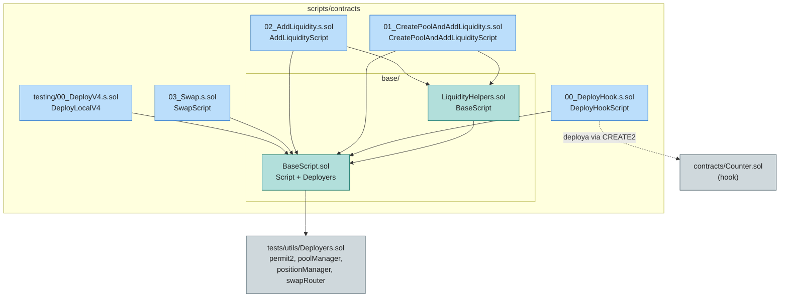

[](../../LICENSE)


[](https://github.com/Rede-ENois/smartcontracts/issues)

# Scripts Forge — Deploy e Interação com Hooks Uniswap v4

Scripts Foundry (`forge script`) para deploy do hook `Counter` e operações de
ciclo de vida de um pool Uniswap v4: criação de pool, provisionamento de
liquidez e swap. Funcionam tanto em Anvil local (`chainid 31337`) quanto em
redes de produção via `--rpc-url`.

## Estrutura



## Arquivos

| Arquivo | Contrato | Função |
|---|---|---|
| `00_DeployHook.s.sol` | `DeployHookScript` | Minera o salt com `HookMiner` e deploya `Counter` (hook) via CREATE2 com os flags `BEFORE_SWAP`, `AFTER_SWAP`, `BEFORE_ADD_LIQUIDITY` e `BEFORE_REMOVE_LIQUIDITY` codificados no endereço. |
| `01_CreatePoolAndAddLiquidity.s.sol` | `CreatePoolAndAddLiquidityScript` | Cria o pool (`fee 3000`, `tickSpacing 60`, `sqrtPriceX96 = 2^96`) e adiciona a posição inicial de liquidez (100e18 de cada token). |
| `02_AddLiquidity.s.sol` | `AddLiquidityScript` | Adiciona liquidez a um pool existente, calculando `tickLower`/`tickUpper` a ±1000 `tickSpacing` do tick atual. |
| `03_Swap.s.sol` | `SwapScript` | Executa `swapExactTokensForTokens` de 1e18 `zeroForOne` via `swapRouter` (sem slippage protection — apenas teste). |
| `testing/00_DeployV4.s.sol` | `DeployLocalV4` | Deploya os artefatos Uniswap v4 (Permit2, PoolManager, PositionManager, SwapRouter) no Anvil local. Restrito a `chainid == 31337`. |
| `base/BaseScript.sol` | `BaseScript` | Configuração compartilhada: herda `Script` + `Deployers`, resolve deployer, ordena `currency0`/`currency1`, rotula endereços (`vm.label`) e implementa `_etch` via `anvil_setCode`. |
| `base/LiquidityHelpers.sol` | `LiquidityHelpers` | Helpers de liquidez: `_mintLiquidityParams` (actions `MINT_POSITION`/`SETTLE_PAIR`/`SWEEP`), `tokenApprovals` (ERC20 + Permit2) e `truncateTickSpacing`. |

## Uso

```bash
# 1) subir o Anvil local
anvil --fork-url <YOUR_RPC_URL>

# 2) (opcional) deployar os artefatos V4 locais
forge script scripts/contracts/testing/00_DeployV4.s.sol \
    --rpc-url http://localhost:8545 \
    --private-key <PRIVATE_KEY> \
    --broadcast

# 3) deployar o hook e operar o pool, na ordem
forge script scripts/contracts/00_DeployHook.s.sol \
    --rpc-url http://localhost:8545 \
    --private-key <PRIVATE_KEY> \
    --broadcast
```

Ordem típica: `00_DeployHook` → `01_CreatePoolAndAddLiquidity` →
`02_AddLiquidity` → `03_Swap`. Em produção, prefira `--account` (keystore do
`cast wallet import`) a `--private-key`.

## Configuração

Os parâmetros operacionais ficam em constantes/seções `--- Configure These ---`
no topo de cada arquivo:

- `BaseScript.sol`: `token0`, `token1` e `hookContract` (endereço do hook
  deployado — deve ser atualizado após o passo `00`).
- `01`/`02`: `lpFee`, `tickSpacing`, `token0Amount`, `token1Amount`.
- `03`: `amountIn`, `zeroForOne` e `deadline` no corpo de `run()`.

## Dependências

- Foundry (`forge`, `anvil`) — ver `foundry.toml` (`solc 0.8.30`, `ffi = true`).
- Remappings em `remappings.txt`: `forge-std`, `@uniswap/v4-core`,
  `@uniswap/v4-periphery`, `hookmate`, `permit2`.
- `scripts/contracts/tests/utils/Deployers.sol` — deploy/resolução dos contratos
  V4 e Permit2 (resolvido via remapping `test/=scripts/contracts/tests/`).
- `contracts/Counter.sol` — hook alvo do deploy.

## Changelog

| Data | Versão | Descrição |
|---|---|---|
| 2026-10-24 | 0.1.0 | Documentação inicial após migração de `script/` para `scripts/contracts/`. |
| 2026-10-24 | 0.2.0 | `test/` migrado para `scripts/contracts/tests/`; `foundry.toml` passa a apontar `test = "scripts/contracts/tests"` e `remappings.txt` ganha `test/=scripts/contracts/tests/`. |


