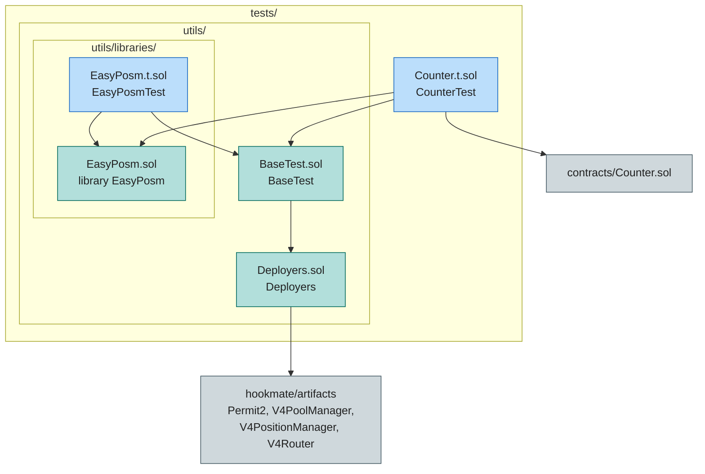

[](../../../LICENSE)


[](https://github.com/Rede-ENois/smartcontracts/issues)

# Testes Forge — Hooks Uniswap v4

Suíte de testes Foundry (`forge test`) do hook [`Counter`](../../../contracts/Counter.sol)
e das bibliotecas utilitárias de posicionamento de liquidez. Esta pasta é o
diretório de testes configurado em `foundry.toml` (`test = "scripts/contracts/tests"`)
e também serve os scripts de deploy em [`scripts/contracts`](../README.md): o
remapping `test/=scripts/contracts/tests/` em `remappings.txt` mantém o import
`test/utils/Deployers.sol` resolvível a partir de qualquer arquivo do projeto.

## Estrutura



## Arquivos

| Arquivo | Contrato/Library | Função |
|---|---|---|
| `Counter.t.sol` | `CounterTest` | Testes do hook `Counter`: verifica que `beforeSwap`/`afterSwap`/`beforeAddLiquidity`/`beforeRemoveLiquidity` incrementam os contadores (`testCounterHooks`, `testLiquidityHooks`). |
| `utils/Deployers.sol` | `Deployers` | Deployer base: resolve Permit2, PoolManager, PositionManager e SwapRouter — em `chainid 31337` deploya instâncias locais via artefatos `hookmate`, nas demais redes usa os endereços canônicos (`AddressConstants`). Também provê deploy de tokens mock e pares de `Currency`. Compartilhado entre testes e scripts. |
| `utils/BaseTest.sol` | `BaseTest` | Setup comum dos testes: `deployArtifactsAndLabel`, `deployCurrencyPair` com `vm.label` e `_etch` via `vm.etch` (diferente de `BaseScript`, que usa `anvil_setCode`). |
| `utils/libraries/EasyPosm.sol` | `EasyPosm` | Library que abstrai o calldata do `PositionManager` (mint, increase, decrease, burn, collect), incluindo variantes para token nativo (ETH). Empacota dados para evitar *stack too deep*. |
| `utils/libraries/EasyPosm.t.sol` | `EasyPosmTest` | Testes da library: mint/increase/decrease/burn de posições, nas variantes ERC20 e ETH nativo. |

## Uso

```bash
# rodar toda a suíte
forge test

# um arquivo/contrato específico
forge test --match-contract CounterTest
forge test --match-path scripts/contracts/tests/Counter.t.sol

# verbosidade (traces, logs)
forge test -vvv

# gas report
forge test --gas-report
```

## Convenções

- Novos testes seguem o layout `arquivo.t.sol` / contrato `*Test`, herdando de
  `BaseTest` para reutilizar o setup de artefatos e moedas mock.
- Utilitários compartilhados ficam em `utils/`; libraries em `utils/libraries/`.
- `forge test` só descobre arquivos sob o diretório configurado em
  `foundry.toml` — mantenha os testes dentro desta pasta.
- Os scripts em `scripts/contracts/base/BaseScript.sol` importam
  `test/utils/Deployers.sol` via remapping: renomear/mover esta pasta exige
  atualizar `test/=` em `remappings.txt` e `test =` em `foundry.toml`.

## Dependências

- Foundry (`forge`) — `foundry.toml` (`solc 0.8.30`, `ffi = true`, `evm_version = cancun`).
- `hookmate` (artefatos e `AddressConstants` das redes suportadas), `permit2`,
  `solmate` (`MockERC20`), `@uniswap/v4-core` e `@uniswap/v4-periphery` — ver
  `remappings.txt`.

## Changelog

| Data | Versão | Descrição |
|---|---|---|
| 2026-10-24 | 0.1.0 | Documentação inicial após migração de `test/` para `scripts/contracts/tests/`. |


