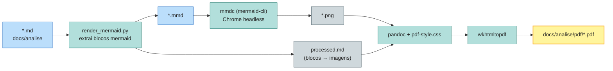

[](../../LICENSE)


[](https://github.com/Rede-ENois/smartcontracts/issues)

# Scripts — Geração de PDF da Documentação

Toolchain que converte os Markdowns de [`docs/analise`](../../docs/analise) em
PDF, renderizando os diagramas Mermaid como imagens.

## Pipeline



## Arquivos

| Arquivo | Função |
|---|---|
| `install-docs-toolchain.sh` | Ativa Node 22 via NVM, instala `@mermaid-js/mermaid-cli` (versão ≥ 7 dias) e verifica pandoc/wkhtmltopdf/Chrome. |
| `md-to-pdf.sh` | Orquestrador: converte um `.md` ou um diretório inteiro em PDFs. |
| `render_mermaid.py` | Extrai blocos ` ```mermaid `, renderiza PNGs via `mmdc` e gera `processed.md` (remove banners/badges remotos). |
| `puppeteer-config.json` | Aponta o Chrome do sistema (`/usr/bin/google-chrome`) com `--no-sandbox`. |
| `pdf-style.css` | Estilo dos PDFs (cabeçalhos, tabelas, código, quebra de página). |

## Uso

```bash
# 1) instalar/verificar o toolchain (uma vez)
./scripts/docs/install-docs-toolchain.sh

# 2) converter todos os docs de análise
./scripts/docs/md-to-pdf.sh docs/analise docs/analise/pdf

# ou um único arquivo
./scripts/docs/md-to-pdf.sh docs/analise/01-visao-geral.md
```

Saída: `docs/analise/pdf/<nome>.pdf` + artefatos intermediários em
`docs/analise/pdf/.build/` (mermaid sources e PNGs — gitignored).

## Variáveis de ambiente

| Variável | Padrão | Efeito |
|---|---|---|
| `MERMAID_SCALE` | `3` | Escala dos PNGs (nitidez). |
| `MIN_AGE_DAYS` | `7` | Idade mínima da versão do mermaid-cli instalada. |
| `NVM_DIR` | `$HOME/.nvm` | Localização do NVM. |

## Dependências

- Node 22 via NVM (regra `smartcontracts-node.md`);
- `@mermaid-js/mermaid-cli` (instalado globalmente pelo script);
- `pandoc`, `wkhtmltopdf`, `python3` (apt);
- `/usr/bin/google-chrome` (render do mermaid — ajuste
  `puppeteer-config.json` se o executável for outro).

## Changelog

| Data | Versão | Descrição |
|---|---|---|
| 2026-10-23 | 0.1.0 | Pipeline inicial md→pdf com mermaid. |
| 2026-10-24 | 0.2.0 | Toolchain movido de `scripts/` para `scripts/docs/`; caminhos de uso atualizados. |


